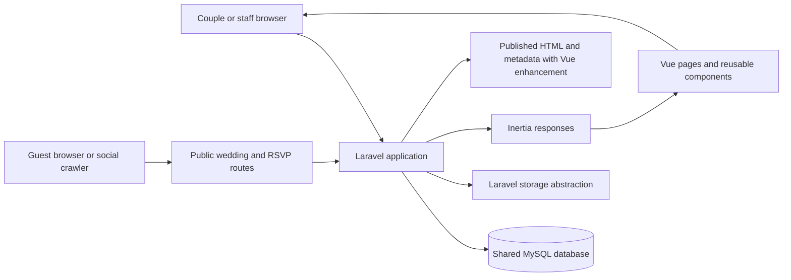

# Wedding RSVP SaaS Architecture

This document combines the implemented foundation, draft CMS, private photo, Milestone 3A publication (previously 2C.2), Milestone 4A guest management, 4B personalized links and 5A responses with explicitly labeled future proposals. The conceptual ERD is not a list of implemented tables. D-010 limits delivery to Modern Classic; template catalogs, registries, and switching remain deferred.

## 1. Executive overview

### Confirmed requirements

- The application uses Laravel 12, Vue 3, TypeScript, Inertia, Tailwind CSS, Vite, and MySQL.
- The product serves multiple couples and weddings through self-service and done-for-you onboarding.
- Couples can eventually manage wedding websites, invitations, guests, RSVPs, and seating. Internal staff need customer and order management.
- Payments start as manually recorded GCash, Maya, or bank transfers. An automated payment gateway is not required at launch.
- Website content stays separate from presentation. Modern Classic is the only current design; Milestone 2B supports two messages and three section visibility controls. Additional editing capabilities and designs require later scope approval.
- The first architecture should be understandable to a small team and avoid unnecessary packages, infrastructure, and service layers.

### Proposed architecture

Use a **shared-database modular monolith**. A customer account is the commercial and access grouping; an account can contain one or more weddings and multiple members. Users join accounts through memberships. Every private wedding record is scoped to its account and wedding, with Laravel policies enforcing access. Internal staff access is explicit, limited to a customer or wedding, and audited.

The CMS stores one mutable JSON draft per wedding and immutable publication snapshots of validated content, wedding facts and media references (section 7). A transaction changes the published pointer. Public Laravel HTML delivers metadata and primary content, enhanced by the existing Vue renderer. No SSR process is required. History/rollback interfaces and production hosting remain deferred.

Keep Laravel's standard app structure while the product is small. Use conventional controllers, Form Requests, policies, models, and focused domain actions where a multi-step operation needs one. Organize Vue pages by user-facing area and reusable website sections by section type. Introduce deeper domain folders only when actual code volume or team ownership justifies them.

### Assumptions

- One customer account is the initial billing and staff-support boundary. A couple shares an account and can invite another member.
- A user may belong to more than one account and access multiple weddings.
- At launch, each wedding has one public slug on the platform's domain. Custom domains are a later option.
- Public wedding content is intentionally public after publication. Guest lists/contacts remain owner-scoped; D-015/D-016 additionally let an active invitation bearer view its own group's current names/responses and submit choices. Contacts and other groups' information stay private.
- Each invited guest responds individually, allowing partial attendance within an invitation group.
- Laravel delivers public sharing metadata and invitation HTML with Vue enhancement and shared Modern Classic styles. A future full Inertia SSR process or hosting infrastructure needs separate justification and approval.

## 2. High-level system diagram



The diagram shows logical responsibilities, not separate services. Laravel remains the application boundary and MySQL remains the initial system of record. Wedding images should use Laravel's storage abstraction so a production object store can be configured later without coupling content records to a storage vendor.

## 3. Recommended project organization

Keep the current starter kit layout as the baseline:

```text
app/
  Http/Controllers/       HTTP entry points grouped by area
  Http/Requests/          Input validation and authorization context
  Models/                 Eloquent records and relationships
  Policies/               Account and wedding access decisions
  Actions/                 Focused multi-step operations, when useful
  Providers/
resources/js/
  pages/                  Inertia pages grouped by account, wedding, admin, and public site
  components/             Existing shared UI components
  components/wedding-site/sections/  Reusable public section renderers
  layouts/                Authenticated, editor, and public layouts as they emerge
  types/                  Shared frontend view-model types
routes/
  web.php                 Route entry point; extract route files by area as they grow
  auth.php
  settings.php
database/
  migrations/
  factories/
  seeders/
```

The current `app/Models/User.php`, `app/Http/Controllers`, `routes/`, and `resources/js/pages/` fit this approach. Do not create empty domain directories or generic repositories now. A controller should translate an HTTP request into a validated operation and response; a policy decides access; a focused action can coordinate a transaction when an operation spans records. Keep ordinary Eloquent queries and model relationships straightforward.

Suggested frontend page areas, when implemented, are `accounts/`, `weddings/`, `editor/`, `admin/`, and `public/`. Keep wedding section renderers presentational: pass them validated data and avoid giving them direct knowledge of database or authorization rules.

## 4. Main domain boundaries

| Area                    | Responsibility                                     | Likely records and behavior                                                                             |
| ----------------------- | -------------------------------------------------- | ------------------------------------------------------------------------------------------------------- |
| Accounts and access     | Customer ownership, collaboration, staff support   | Accounts, account memberships, roles, scoped staff access grants, audit events                          |
| Weddings and websites   | Event identity and website lifecycle               | Wedding, slug, selected template, draft and published revision pointers                                 |
| Templates and content   | Supported appearance and structured content        | Template catalog/version metadata, section schema, revision validation, preview and publication         |
| Invitations and guests  | Who is invited and how to reach their invitation   | Invitation groups, individual guests, invitation delivery state, secret link lifecycle                  |
| RSVPs                   | Each guest's response and attendance details       | Per-guest response, response timestamp, dietary/accessibility notes where approved                      |
| Seating                 | Physical tables and guest placements               | Wedding tables, capacity, one active seat assignment per guest                                          |
| Orders and payments     | Commercial order and manual payment reconciliation | Orders, PHP amounts, manual payment entries, evidence references, verification history                  |
| Internal administration | Support and operational workflows                  | Staff-only pages, scoped access, audit trail; built on account/wedding data rather than a parallel copy |

These are responsibility boundaries, not a requirement for separate Laravel packages or services. Keep the first implementation in normal Laravel conventions; separate code by domain only after repeated complexity makes the boundary useful.

## 5. Preliminary database design

The following is a conceptual starting point, not the deployed schema or a migration specification. Templates, invitation delivery and seating remain future proposals; implemented draft/revision contracts are in section 7, guests in 7A, links in 7B and responses in 7C. The conceptual fields below are not authorization to implement tokens, guest contact fields or redundant guest wedding keys. Use InnoDB foreign keys and transactions for related writes. Prefer MySQL `BIGINT` IDs for internal relations; use random public identifiers or high-entropy tokens at future private public-access boundaries. Tenant ownership may be unambiguously derived through constrained parent relations.


### Ownership, keys, indexes, and constraints

- `accounts` represent a customer relationship; `account_members` is a many-to-many membership table. Add a unique key on `(account_id, user_id)` and index `(user_id, account_id)` for account switching. Keep roles small and explicit, such as `owner`, `editor`, and `viewer`; enforce role capabilities in policies rather than scattered string checks.
- `weddings.account_id` is the tenant ownership anchor. Index `(account_id, id)`. `public_slug` should be normalized and unique for the initial single-domain route. Use a unique constraint and a validation rule to prevent ambiguous public URLs.
- `website_revisions` stores full validated snapshots, not an evolving bag of untyped page-builder data. Enforce unique `(wedding_id, revision_number)` and index `(wedding_id, state, created_at)`. Keep the published pointer on `weddings`; change it transactionally after a revision passes validation. A revision's template version must remain available for rendering or have an explicit compatibility path.
- `templates` should have a unique key on `(key, version)` so releases can coexist while older published revisions still reference their renderer.
- `invitation_groups` currently have a wedding parent, label and optional contact email/phone, indexed by `(wedding_id, id)`. Token hashes, rotation/revocation and delivery lifecycle are future work, not fields in Milestone 4A.
- `guests` currently belong to one invitation group; the wedding is derived through that group rather than duplicated on each guest. Index `(invitation_group_id, id)`; names are not unique. Future individual RSVP responses can refer to this stable guest identity. Any redundant wedding key proposed later must have enforced parent consistency; none is needed for current CRUD.
- `rsvp_responses` should have one response per guest, enforced with a unique `guest_id`; include `wedding_id` if needed for efficient tenant-scoped access and ensure it agrees with the guest's wedding. Use database constraints/composite foreign keys where practical, plus transactional application validation. Invitation status (`sent`, `revoked`, `opened`) is not the same as attendance status (`pending`, `attending`, `declined`).
- `wedding_tables` need positive capacity. `seating_assignments` should enforce one active assignment per guest and should not exceed table capacity. A count-then-insert check can race; perform assignment changes in a transaction that locks the table row, counts current placements, and validates capacity before inserting. Preserve wedding consistency between guest, table, and assignment.
- Store money as integer minor units with explicit `currency` (initially PHP), not floating point. Manual payments should record method, received amount/time, status, private evidence key if provided, verifier, and verification time. Do not store bank credentials, card numbers, or payment passwords. Restrict and audit edits to verified payments.
- Account and wedding foreign keys should be present on all tenant-owned records or be unambiguously reachable through a constrained parent relation. Add indexes beginning with `account_id` or `wedding_id` for tenant list pages and operational queries. Use soft deletion only where retention and restore behavior are defined; do not apply it by default to every entity.

## 6. Multi-tenancy and authorization

### Tenant model

Use one shared MySQL database and shared tables. `Account` owns one or more `Wedding` records. Users join an account through `account_members`; one account can therefore be managed by both partners, and one user can participate in multiple accounts. A done-for-you customer uses the same records and editor after staff has helped set up the site.

Do not use a user ID as the tenant ID, and do not infer authorization from a wedding slug or an ID being difficult to guess. Public IDs and tokens reduce enumeration but do not replace authorization. Do not introduce a tenancy package or database-per-customer model at this stage; neither is needed for the stated product and both would add operational complexity.

### Authorization flow

1. Authenticate the member using the existing Laravel starter-kit authentication.
2. Load the account or wedding through a membership-scoped query, for example through the current user's accounts, rather than loading an arbitrary record and relying on the UI to hide it.
3. Authorize the requested operation with a Laravel policy. Apply the same policy to reads, edits, exports, file access, and background operations.
4. Validate submitted parent IDs against the authorized wedding; never trust a client-supplied `account_id`, `wedding_id`, role, or ownership field.
5. Use transactions for changes that span a wedding and its related records. Include the tenant key in lookups and updates to prevent cross-wedding reassignment.

Serialize first-workspace creation with a lock on the authenticated user's row, and serialize wedding creation with a lock on its account row. Profile deletion must also lock the user and owned accounts, and must be blocked when it would leave an account containing weddings without an owner. Ownership transfer, customer data export, and retention after account closure remain product decisions.

Use account-level roles as a starting point. If product requirements later establish different rights per wedding, add wedding memberships or scoped grants rather than encoding per-wedding exceptions in controllers. Internal staff should authenticate through the same application but have a distinct administrative capability. Grant support access to a specific account or wedding, require a reason and expiry, allow revocation, and log sensitive reads and writes. Avoid silent or permanent impersonation. Do not add staff roles or modify authentication until the product policy is agreed.

## 7. Modern Classic draft CMS and future publication

### Implemented — Milestone 2B

`website_drafts` is the smallest draft-only subset of the proposed revision architecture:

| Column                     | Contract                                                                                                    |
| -------------------------- | ----------------------------------------------------------------------------------------------------------- |
| `id`                       | Internal primary key                                                                                        |
| `wedding_id`               | Unique, non-null foreign key to `weddings`, cascading on wedding deletion                                   |
| `schema_version`           | Server-controlled content schema version, currently `1`                                                     |
| `lock_version`             | Save counter; clients submit their last observed version as `draft_version` (`0` before the first save)     |
| `content`                  | Validated JSON: `introduction_message`, `closing_message`, and `sections: { ceremony, reception, closing }` |
| `created_at`, `updated_at` | Draft creation and last-save timestamps                                                                     |

Both messages are required plain text of at most 500 characters; line breaks are supported, angle brackets/markup rejected, and Vue interpolations escape all rendered values. Section values must be JSON booleans. Unknown root, content, and section keys are rejected. No account IDs, wedding facts, template IDs, publication flags, or ownership values are accepted from the form.

The editor, standalone preview, and save transaction explicitly require stored `schema_version === 1`. Unsupported versions return a controlled HTTP 409 message (plain text for browser/Inertia requests, JSON for JSON clients), never expose the stored content, and never rewrite its version, content, or save counter. Authorization runs first; the write guard runs after acquiring the wedding lock. No schema migration/compatibility framework is introduced.

The unique wedding key gives each wedding an independent mutable draft without creating a template registry or an incomplete revision-history system. Account ownership is reached through `Wedding -> Account`; reads/writes resolve the nested account/wedding route and reuse `WeddingPolicy::update`. Saves lock the wedding row in a transaction (including first save), compare `lock_version`, and return a validation error for stale submissions. No wedding fact is changed by this operation.

`Wedding::presentationData()` supplies the existing six wedding facts to both preview surfaces. The editor receives a separate typed `InvitationCustomization`, edits a local reactive copy, and passes that copy to the existing `ModernClassicInvitation` component. The standalone authenticated preview loads only the saved draft. Without a draft both routes use the original messages and all sections enabled; loading defaults does not create a record. Hidden sections retain their messages and relational venue data. Portal light/dark/system appearance never changes the invitation's Modern Classic colors or typography.

Routes: authenticated `GET /accounts/{account}/weddings/{wedding}/invitation/edit` and `PUT /accounts/{account}/weddings/{wedding}/invitation`; existing `GET .../preview` remains private. Foreign-account owners receive the existing policy's 403; mismatched nested parents receive 404. Milestone 2B added no public wedding route; 2C.2 adds the published-only surface below.

Milestone 2B deliberately used a standalone mutable draft without publication history or template foreign keys. Milestone 2C.2 adds immutable snapshots separately; the draft schema/save counter remain distinct from publication revisions and their state counter.

### Implemented — Milestone 2C.1 private hero photo

An additive migration adds nullable, server-controlled `hero_photo_disk`/`hero_photo_path` columns to `website_drafts`. There is no media table or JSON schema bump: content remains version 1 and unknown stored versions remain blocked. The existing save counter covers messages, visibility, and photo together. Wedding facts remain unchanged.

`wedding_photos` uses Laravel Filesystem with a non-serving private local root. UUID WebP objects live under account/wedding-specific hero prefixes. The authenticated nested `GET .../invitation/hero-photo/{photo}` route authorizes the wedding owner and serves only its current reference with private/no-store and nosniff headers. No paths or public object URLs enter Inertia props; both preview surfaces receive a separate nullable `{url}` photo prop and share ModernClassicInvitation.

Multipart saves JSON-encode the existing content so strict booleans survive transport. Native GD/EXIF normalizes JPEG/PNG/WebP (5 MiB, 12 MP, maximum 6,000px per side) into metadata-free static WebP, at most 1,600px long edge without upscaling. Original bytes are never retained. The runtime needs EXIF, supported GD codecs, adequate upload limits, and at least 256M memory; setup is documented in README.md.

Normalization precedes the wedding lock; durable writes follow the locked schema/counter checks. Reference/content/counter updates share one transaction. After confirmed commit, superseded files are deleted only after a primary-database reference recheck under the wedding lock. Rollback/uncertain-commit cleanup uses that same safeguard. Cleanup failure leaves an orphan for the dry-run-first `wedding-photos:prune --delete` operator command (generated, unreferenced objects older than 24 hours); incompatible-schema weddings are skipped.

Milestone 2C.2 extends draft replacement/pruning checks to retain references in every immutable revision, including history after unpublishing. Production local storage must be persistent/backed up; adopting private S3-compatible storage later requires its adapter/configuration and object migration separately.

### Implemented — Milestone 3A publication (previously 2C.2)

The additive `2026_10_16_075658_create_website_revisions_table` migration creates snapshot rows and adds nullable `weddings.published_revision_id` plus unsigned `publication_version` (default 0). Existing weddings start unpublished. MySQL DDL was reviewed with `--pretend`, applied to development without resets, and checked with Boost. No existing invitation was published automatically.

| Record                                            | Contract                                                                                     |
| ------------------------------------------------- | -------------------------------------------------------------------------------------------- |
| `website_drafts`                                  | Existing mutable version-1 CMS, photo reference and save counter                             |
| `website_revisions.wedding_id`, `revision_number` | Wedding ownership and unique per-wedding sequence                                            |
| `schema_version`, `wedding_facts`, `content`      | Supported version, six wedding facts and validated CMS snapshots                             |
| `hero_photo_disk`, `hero_photo_path`              | Nullable immutable private media reference; indexed together for cleanup checks              |
| `fingerprint`, `published_at`                     | Canonical SHA-256 source fingerprint and publication time                                    |
| `weddings.published_revision_id`                  | Nullable foreign key; publisher/resolver also require the revision to belong to this wedding |
| `weddings.publication_version`                    | Monotonic counter across publish/republish/unpublish, preventing stale and ABA requests      |

`WeddingPublication` locks the same wedding row used by draft saves, reloads the saved draft, checks schema, draft/publication counters and source fingerprint, validates facts/content/media, inserts a revision, and changes pointer/counter in one transaction. Require a saved draft, both names and a date; time/venues are optional. `WebsiteDraft::contentRules()` shares existing strict CMS validation. The fingerprint includes facts, schema, content and photo reference, detecting wedding-detail changes as well as draft edits. Clients never submit snapshot content or pointers. An identical current snapshot with fresh counters is a no-op; stale repeated requests fail validation.

Snapshots reject Eloquent updates/deletions and have no mutation endpoint. Unpublishing clears only the pointer and increments its counter, retaining draft/history/files. The pointer foreign key restricts deleting a referenced revision; a future wedding-deletion workflow must clear that pointer before cascading deletion. Administrators can bypass model guards; there is no general revision editor, history browser or rollback feature.

Public `GET /w/{slug}` resolves only the active, same-wedding, supported revision, never live draft content or live wedding facts. `GET /w/{slug}/photo/{photo}` streams only its matching generated WebP after disk/prefix/identifier checks. Missing, unpublished, unsupported or wrong-wedding pages/media return 404. Draft images still require owner authorization. Replacement/removal/pruning recheck all revision references under the wedding lock, retaining active and historical media. No public disk, symlink or bearer URL is introduced.

A dedicated Blade document/Vite entry delivers escaped invitation HTML and title/description/canonical/Open Graph/Twitter metadata. `ModernClassicInvitation.vue` enhances it. Both share `resources/css/modern-classic.css`, extracted without changing declarations; explicit stylesheet entries also style no-JavaScript output. Tradeoff: the small fallback markup must stay in parity with Vue, covered by browser JavaScript/no-JavaScript checks. No additional SSR server or dependency is needed.

Only public presentation props are embedded, excluding authentication/accounts, numeric IDs, payments, schema/counters, paths and fingerprints. Disabled section venues/closing text are also stripped from public props. Blade/Vue escape text; `Js::encode` safely embeds JSON. Portal overview controls provide explicit confirmation, state/timestamp, republish/unpublish and URL actions. Opt-in overlay styling affects only publication dialogs; existing defaults and invitation design remain intact.

The recommended conservative default is implemented as `noindex, nofollow, noarchive` in HTML/headers, with private/no-store caching for page/photo responses. Confirm indexing preference during owner QA. This is public content: downloaded copies and third-party preview caches cannot be recalled. Localhost is not Internet hosting; live messaging previews require a reachable deployment. Hosting/custom domains remain outside this milestone.

Six opt-in MySQL concurrency cases remain unexecuted: four original draft/photo cases plus two simultaneous publish/republish cases. They require an approved disposable target with all migrations and `INNODB_TRX` inspection privileges. SQLite/duplicate-request tests and MySQL schema checks do not verify MySQL concurrency.

### Future proposals — deferred beyond Milestone 2B

Publication needs separate scoping. Multiple-template infrastructure in the following comparison is deferred until after core functionality and owner-supplied Figma/Canva references (D-010); it is not a prerequisite for the current CMS.

### Patterns considered

| Pattern                                                                       | Benefits                                                                                                                                                                             | Costs and risks                                                                                                                                                              |
| ----------------------------------------------------------------------------- | ------------------------------------------------------------------------------------------------------------------------------------------------------------------------------------ | ---------------------------------------------------------------------------------------------------------------------------------------------------------------------------- |
| Structured section data rendered by a versioned template registry             | Content is independent of design; templates share section components; section types can be validated; ordering and visibility are straightforward; templates can evolve deliberately | Requires a defined schema per section and migration/compatibility rules when schemas change                                                                                  |
| Freeform page builder with arbitrary blocks, layout rules, or embedded markup | Maximum customer flexibility; can model unusual layouts without a new section type                                                                                                   | Harder validation, accessibility, responsive behavior, preview consistency, security, and support; more editor complexity; content becomes coupled to builder implementation |

### Earlier section/registry recommendation — future only

Use the structured, section-based model. A template is a presentation choice and a registry of supported section renderers; content is stored separately as data. A revision contains an ordered list of typed sections, each with a stable section ID, section type, visibility flag, and validated settings. Examples might include `hero`, `story`, `event_details`, `gallery`, `schedule`, and `faq`. Keep the list of supported types in application code and reject unknown types or fields on save. Never render customer-provided HTML or JavaScript as trusted markup.

Each Vue section component receives a typed, already validated view model. A small template-level component maps section types to renderers and supplies theme tokens (colors, fonts, spacing) through CSS variables or a similarly constrained theme object. Template-specific presentation can compose the same section renderers with different wrappers, typography, and layout. Avoid creating a generic drag-and-drop canvas until validated product demand shows section reordering is insufficient.

Store content in JSON for the versioned section snapshots, but keep operational entities such as guests, RSVPs, seating, and orders in relational tables. JSON is appropriate for bounded presentation configuration; it should not replace relational records that require constraints, joins, privacy controls, and reporting.

### Publication lifecycle and deferred enhancements

Milestone 2C.2 implements the mutable-draft/immutable-snapshot lifecycle above. Prior snapshots are retained, but browsing, rollback, expiry/deletion policies and signed draft-preview links remain separately scoped. Draft previews currently require the existing authenticated owner session.

Public HTML/metadata now use Laravel with Vue enhancement. A future full Inertia SSR process needs hosting confirmation and separate approval.

## 7A. Implemented guest management — Milestone 4A (D-014)

`invitation_groups`: bigint ID, required wedding FK, label (255), nullable contact email (254)/phone (50), timestamps; index `(wedding_id, id)`. `guests`: bigint ID, required invitation-group FK, name (255), timestamps; index `(invitation_group_id, id)`. Both parent deletions cascade. These are the only new tables. No delivery/response/status/token/speculative fields or new tenancy package.

Relationships: Wedding has many invitation groups and has many guests through them; InvitationGroup belongs to Wedding and has many Guests; Guest belongs to InvitationGroup. Parent IDs are absent from fillable/validated customer fields. There is no reparent endpoint. Scoped account → wedding → invitationGroup → guest route binding rejects mismatched parents with 404; existing WeddingPolicy owner authorization protects every list/write action (foreign users/viewers receive the established 403).

Group creation inserts at least one named guest in the same transaction. Standard FKs cannot express a required child count: all management writes preserve nonempty groups in application code. Guest add/rename/remove and group update/delete acquire the same parent group lock and reload the record in a transaction; deleting the final member fails, while deleting the group cascades its members. The per-group technical bound is 100 people, with no wedding-wide quota. Unknown fields/nested guest keys are rejected. Names may repeat both within and across groups. No RSVP is inferred.

GET `/accounts/{account}/weddings/{wedding}/guests` lists 25 groups/page in stable descending ID order (new groups appear first), eagerly loads members, and searches group labels/member names using bound literal LIKE patterns. All members of each matching group remain visible. Separate unfiltered wedding group/has-many-through person counts avoid confusing invitation totals with invited seats. Optional contacts remain owner-only. A single responsive Vue page uses modal CRUD and confirmation; no separate create/edit pages are necessary for these short forms.

POST `.../invitation-groups` creates; PATCH/DELETE `.../invitation-groups/{invitationGroup}` changes metadata/deletes; POST `.../invitation-groups/{invitationGroup}/guests` adds; PATCH/DELETE `.../guests/{guest}` renames/removes. All routes are authenticated/verified/scoped web routes with normal CSRF protection. Guest management is independent of CMS and immutable published snapshots; the generic public wedding renderer does not read guest records; personalized guest access is added separately in §§7B–7C.

Milestone 4A initially permitted permanent deletion of pre-delivery/pre-RSVP records. Issued-group retention in §7B and responded-guest retention in §7C now narrow that behavior; future delivery/archive/wedding-deletion flows still need retention decisions. Concurrent MySQL last-person/capacity behavior is designed around locks but not empirically verified; the six existing draft/photo/publication concurrency tests also remain pending. No optimistic guest-edit counter is introduced: simultaneous metadata/name edits are serialized, with the last successful write winning.

## 7B. Personalized invitation links — implemented Milestone 4B (D-015)

Additive migration `2026_10_16_095519_add_invitation_links_to_invitation_groups` adds nullable unique `invitation_token_hash` CHAR(64), nullable `invitation_token` TEXT and unsigned `invitation_link_version` default 0. No new table. Tokens use 32 cryptographically random bytes encoded as 64 hex characters; SHA-256 permits indexed lookup, while Laravel encrypted casting supports explicitly authorized recopying. Both credential attributes are hidden and absent from customer fillable/validated fields. Ordinary list props expose only derived status/version.

State is derived without speculative delivery fields: version 0 is not generated; positive version with hash/ciphertext is active; positive version with cleared credentials is revoked. The monotonic version also records prior issuance. `InvitationLink` transactionally locks/reloads the wedding-scoped group and checks the expected version for every operation. Fresh repeated generate/copy preserves the active credential; stale duplicate requests return 422, never competing links. Revoke is idempotent at its current revoked version, clears credentials and advances once; regenerate replaces credentials/advances. Copying unreadable ciphertext fails safely; ciphertext dirty comparison permits explicit regeneration without decrypting a corrupt original. No expiry or delivery inference.

Owner POST `/accounts/{account}/weddings/{wedding}/invitation-groups/{invitationGroup}/invitation-link/{action}` accepts only `generate`, `copy`, `revoke` or `regenerate`, with a required `link_version`. Existing nested bindings and WeddingPolicy owner checks apply, with normal session/CSRF protection. No-store JSON is deliberately separate from Inertia visits/flash/history. The dialog retrieves a URL only after an explicit action, holds it in memory and clears it on close/navigation. It does not remember the URL in browser storage. Clipboard/browser history remain outside application recall.

`InvitationGroup` rejects hard deletion once version > 0, including after revocation; normal group deletion already locks/reloads that row. Never-issued deletion and pre-RSVP named-member edits remain intact. Model guards do not protect raw SQL or parent FK cascades; no customer wedding-deletion action exists today. Revisit retention/cascades before future deletion/delivery/response workflows. This deliberately narrows the earlier pre-link group-deletion behavior.

GET `/invite/{token}` is a stateless bearer surface: no session/cookie/Inertia middleware or CSRF-cookie emission. Only this read-only route excludes CSRF middleware; portal writes remain protected. Lookup uses the hash, never internal IDs/query selectors. Resolve its actual group's wedding and current supported published revision; return generic 404 for inactive/unknown/malformed/unpublished content. The shared `PublishedWedding` service is also used by `/w/{slug}` and public photo resolution. Wedding facts/content/media come from snapshots only. Current saved group label and member names are rendered escaped in a greeting outside the unchanged Modern Classic renderer. Contact fields, IDs, credentials and private CMS metadata are never supplied to the public view.

Personalized metadata uses generic title/description/photo alt and the already-public wedding canonical/OG URL, never group/member names or bearer URLs. The greeting also works without JavaScript. Responses (including public errors) use private/no-store, no-referrer, noindex/nofollow/noarchive and nosniff; failures never render debug traces. Rate limiting is 60 views/minute per IP with token-free cache keys. Revoking a group link does not unpublish the otherwise public wedding/photo. Links show a newly published revision automatically and show saved label/member changes immediately.

Recoverability is an explicit D-015 tradeoff: protect APP_KEY independently from database/backups, retain required keys through coordinated rotation/re-encryption, or deliberately regenerate links. Database plus encryption-key compromise reveals recoverable links; hash-only lookup alone does not. Losing a key can prevent recopying while existing hash-valid links remain usable until revoked/regenerated. No key is changed automatically.

Application logging uses `RedactInvitationTokens` taps on standard configured channels: redact `/invite/*`, long hex credential-shaped strings, nested context and exception details; represent arbitrary objects by type to avoid accidental serialization. Scoped public exception reporting sanitizes details before passing them to logging, including emergency fallback paths. This intentionally also redacts long diagnostic hashes and drops arbitrary object payload details. It does not rewrite PHP stdout, arbitrary third-party handlers, database query/response capture, APM or upstream access logs. Laravel's standard development router still prints request paths. Before real distribution, require HTTPS and verified exclusion/redaction of these paths and recovery responses in every external logging/monitoring layer. No framework/vendor/server infrastructure was modified. Generic metadata/noindex cannot stop a preview provider given the bearer URL from reading names.

Automated checks use isolated SQLite/storage/sessions; two new opt-in MySQL concurrency cases exercise simultaneous generate/regenerate only when an approved target exists. The original six cases and new two remain unexecuted, as do guest capacity/final-person and delete-versus-issuance race verification against MySQL. No historical link table, sending, analytics, expiry, RSVP or soft-delete/archive system.

## 7C. Per-person RSVP submission — implemented Milestone 5A (D-016)

Additive migration `2026_10_16_104215_create_rsvp_responses_table` adds `invitation_groups.rsvp_version` (unsigned integer, default 0) and `rsvp_responses`: bigint ID, unique required `guest_id` FK with ON DELETE RESTRICT, enum `status` (`attending`, `declined`), required `responded_at` and conventional timestamps. No redundant wedding/group key: ownership derives through the guest's constrained group. Guest has one RsvpResponse; RsvpResponse belongs to Guest. Absence means pending, not declined. The unique key supports lookup and prevents duplicate records; no speculative attendance indexes, history/event tables or CMS changes.

`InvitationRsvp` first locates the group by token hash, then transactionally locks wedding → group → members ordered by ID. It rechecks the exact active hash and supported published revision under those locks. Wedding-first ordering serializes publication/unpublication; group locking serializes lifecycle actions and existing roster writes, which never acquire a wedding lock afterwards. Reads collect a consistent roster/response/version under the same order. No new token credential or guest account is introduced.

The public form gets token-keyed HMAC guest references, names, saved statuses/timestamps and `rsvp_version`; it receives no database guest/group/account IDs, contacts or token. References are resolved only against current members inside the transaction; rotation changes references as well as invalidating the old token. Submitted top-level/nested keys, list shape, quantity (1–100), unique references and statuses are strictly validated. Invalid shape has generic fixed feedback rather than reflecting input keys/values. Invalid/revoked/rotated/unpublished access returns generic 404.

POST `/invite/{token}/rsvp` applies only submitted changes, retaining omitted answers. Actual response changes advance the group version once; identical retries do not change response timestamps or advance it. Old versions with any changed choice fail 422; an identical retry may return the current state safely, while future versions are rejected. Successful owner add/rename/remove and label changes also advance the version, making outstanding changed forms stale. Contacts do not change it. No merge silently overwrites another saved answer. The UI sends only changed nonpending choices and requires explicit reload/review after stale feedback; saved answers cannot be cleared to pending in 5A.

The existing personalized GET remains stateless with no session/CSRF-cookie emission. Saving first requests same-origin GET `/invitation-rsvp/csrf-token`, a normal session-backed, no-store JSON CSRF setup route containing no invitation information. The POST retains normal web-session and CSRF validation; neither setup nor POST uses Inertia or flashes submitted data. The token-free setup URL may enter session previous-URL state; the bearer GET and non-GET submission do not. Same-origin fetch uses credentials and X-CSRF-TOKEN. No CORS relaxation or CSRF exemption is added. Limits after the RF-001 fix: setup 60/minute/IP; submission 20/minute per SHA-256 invitation digest (not raw token), plus a separate 120/minute/IP abuse guard. Distinct prefixes/named buckets prevent setup from consuming submissions and keep restrictive allowances independent between invitations, including shared IPs. Responses preserve Retry-After and include its actual interval in JSON/form feedback. Deployment uses persistent shared cache; browser HTTP regression uses temporary file cache, while PHPUnit forces array cache through both environment/server adapters. No blanket cache flush is required. Known findings and pending acceptance are tracked in [RF-001](risks_and_followups.md#rf-001--premature-rsvp-throttling).

The unchanged Modern Classic renderer remains in its existing mount. A separate Vue RSVP form mounts below it only on personalized pages, with server-rendered saved-state fallback for JavaScript-disabled visitors. Metadata remains generic with no group names, answers or token. All setup/submission/success/error responses retain private/no-store, no-referrer, noindex/nofollow/noarchive and nosniff. Existing application redaction covers submission paths/exceptions; PHP/upstream access logs and request/response capture still require the explicit deployment protections in §7B.

Responded guest removal fails with an understandable model guard and a restrictive database FK; renaming retains stable identity/answers. The portal exposes only a `has_response` removal guard, disables removal and explains retention, without adding attendance summaries. Pending members remain removable subject to nonempty-group rules; issued groups remain undeletable even after revocation. Future wedding deletion, response correction/clearing, archive and retention policy require separate scope; no raw-SQL/cascade bypass is supported by portal actions. The migration is additive on upgrade; rolling it back would delete response data and must not be used against valuable records.

SQLite/HTTP stale and simultaneous-request checks do not prove InnoDB lock behavior. The original six CMS/publication and two link MySQL tests remain pending, with RSVP-versus-RSVP/rotation/revocation/unpublication/member-removal races requiring isolated MySQL verification. No development customer responses are created by tests.

## 8. Application routing

Use named, area-based route groups, keeping the current `routes/web.php`, `routes/auth.php`, and `routes/settings.php` conventions. Split route files only when the files become difficult to navigate.

| Area                    | Initial convention                           | Access                                                                            |
| ----------------------- | -------------------------------------------- | --------------------------------------------------------------------------------- |
| Marketing and demos     | `/`, `/templates/{template}`                 | Public; demos use non-sensitive example data                                      |
| Customer dashboard      | `/dashboard`, `/accounts/{account}/...`      | Authenticated, verified account member                                            |
| Wedding editor          | `/accounts/{account}/weddings/{wedding}/...` | Authenticated member, authorized by policy                                        |
| Public wedding website  | `/w/{slug}`                                  | Active published snapshot only; otherwise 404                                     |
| Personalized invitation | `/invite/{token}`                            | Active bearer token plus published snapshot; scoped RSVP reads/writes under D-016 |
| Internal admin          | `/admin/...`                                 | Authenticated staff capability and audited scoped access                          |

For launch, prefer `/w/{slug}` if marketing routes may need root-level paths; use a dedicated public wedding hostname only if the product/domain plan makes it worthwhile. Reserve the selected path namespace and normalize slugs. A later custom-domain feature can map verified hostnames to a wedding through a domain table and middleware while reusing the same published-site resolver. Never trust arbitrary `Host` values as a tenant selector; validate custom domains and verify ownership before activation.

## 9. Security and privacy considerations

- **Tenant leaks:** Scope all private queries and file access by account/wedding, enforce policy checks at the server, and test users from different accounts against every read and write path.
- **Invitation links:** Generate high-entropy tokens, store lookup hashes plus encrypted authorized recovery under D-015, throttle attempts, support expiry/revocation, and avoid logging raw tokens. Keep guest responses out of public page props.
- **Mass assignment and validation:** Use explicit Form Request rules and allowlists for section types and fields. Never mass-assign tenant ownership, roles, publication state, payment verification, or arbitrary template identifiers from user input.
- **Stored content:** Escape text, validate URL schemes, constrain colors/fonts to supported values, limit image type/size, and avoid rendering arbitrary HTML. Apply CSP and safe image handling when deployment policy is designed.
- **Personal data:** Guest names, contact details, dietary notes, and attendance can be sensitive. Collect only needed fields, restrict exports, protect uploaded evidence, define retention and deletion rules, and avoid leaking data through analytics or logs.
- **Staff support:** Require explicit scoped grants, reason, expiry, revocation, and audit events for access to customer work. Restrict payment verification to authorized staff and record who changed status and when.
- **Concurrency:** Use transactions and row locks for first-workspace creation and owner deletion, as well as publication pointer updates, invitation response writes where duplicate submissions matter, payment verification, and seating capacity enforcement. Add idempotency or optimistic version checks to avoid overwriting concurrent editor changes.
- **Public endpoints:** Rate-limit RSVP lookups and submissions, use CSRF protection for state-changing web requests, validate signed previews, and return no information that allows enumeration of guest records.
- **Backups and operations:** Define backup, restore, retention, and incident procedures before production data is collected. Keep secrets in environment configuration, never in the repository or content JSON.

## 10. Tradeoffs and alternatives

- **Shared database vs. database per customer:** Shared tables with explicit tenant keys are simpler to operate and suit the initial scale. Database-per-customer offers stronger physical separation but complicates migrations, backups, reporting, and support; reconsider only for contractual isolation or scale requirements.
- **Account ownership vs. direct wedding ownership by a user:** An account adds one membership boundary but supports partners, staff-assisted work, and multiple weddings without transferring ownership. Direct user ownership is simpler for a single-person product but becomes awkward when collaboration arrives.
- **Section CMS vs. freeform builder:** Structured sections constrain customization but make templates safer, faster, testable, and easier to support. Start structured and add section types based on demand.
- **JSON content vs. fully relational sections:** JSON snapshots make atomic publication and version rollback practical. Relational content offers stronger per-field querying but creates many tables and migration work for a shape that is primarily presentation. Keep guests, RSVPs, seating, and commerce relational.
- **SSR vs. client-only public pages:** Client-only pages are simpler to deploy but social crawlers may miss metadata/content and first render depends on JavaScript. SSR improves crawlability and initial HTML, with the cost of confirming Node runtime support. Public pages should not be considered ready until the deployment choice is known.
- **Modular monolith vs. microservices:** A single Laravel application keeps transactions, authorization, and deployment straightforward for a small team. There is no current scale or organizational need for separate services.
- **Manual payments vs. gateway:** Manual recording matches the initial consultation-led sales process. It needs reliable verification and audit history but avoids gateway integration and automated billing work until the business needs them.

## 11. Development and testing strategy

### Suggested implementation milestones

1. **Account and wedding foundation:** Define account ownership, membership invitation/acceptance, wedding creation, roles, policies, and tenant-scoped query conventions. Add cross-account authorization tests before exposing customer records.
2. **Modern Classic CMS:** Milestone 2B implements the bounded draft editor and shared private preview above; owner review remains required. Additional CMS controls are not implicitly included.
3. **Publication:** Scope published snapshots and public rendering/hosting first, then implement publication and server-readable metadata. History/rollback require separate approval; do not add template catalogs or switching.
4. **Invitation and RSVP workflow:** Add groups, guests, hashed tokens, invitation state, and per-guest responses after their rules are approved. Test partial household attendance, token expiry/revocation, throttling, duplicate submissions, privacy, and concurrent updates.
5. **Seating, orders, and staff tools:** Add table capacity and assignments with transactional checks, manual order/payment records with audit trails, then scoped internal administration. Keep each area behind policies and domain-focused tests.

### Essential tests

- A member can only list, view, edit, publish, export, and access files for accounts and weddings they are authorized to access.
- A member from another account cannot access a wedding even with a valid numeric ID or slug. Include direct route, nested relation, and file URL cases.
- Owners can invite and remove account members according to policy; role changes cannot be made by unauthorized editors.
- Published pages return only published content; draft previews require the right access and cannot be retrieved after expiry/revocation.
- Content validation rejects unknown sections, unsupported keys, unsafe URLs, and invalid theme values; each supported section schema has representative valid/invalid cases.
- RSVP token lookup does not reveal whether arbitrary guests exist; valid links are throttled and revocable; household guests can respond independently; repeated or concurrent submissions follow a defined update policy.
- Seating assignment enforces one seat per guest, same-wedding ownership, positive capacity, and no over-capacity result when concurrent changes occur.
- Payment verification is restricted, transaction amounts/currency are preserved exactly, and history records verifier and time.
- Vue component tests should focus on reusable section rendering, editor field behavior, and accessible interaction states. Use component tests only where conditional UI behavior warrants them; keep domain rules in Laravel tests.

### CI

Start with the repository's existing Laravel and frontend tools. CI should install locked Composer/npm dependencies, run PHP formatting checks, Laravel tests against an isolated test database, TypeScript checks, ESLint without auto-fix, and a production Vite build. Use a dedicated CI MySQL service or an isolated SQLite test database; never point tests at development or production data. Add dependency auditing on a regular schedule. Do not add browser automation, a new test framework, or extra infrastructure until an important user journey needs it.

## 12. Potential overengineering to avoid

- Do not split the app into microservices or add a tenancy package before a concrete isolation requirement appears.
- Do not implement a generic page builder, arbitrary HTML blocks, or user-authored JavaScript when structured sections meet the stated need.
- Do not create generic repositories, event buses, plugin systems, or empty domain modules for CRUD that Eloquent and policies can handle.
- Do not build subscription billing, payment gateway integration, custom domains, or full impersonation workflows before product decisions and demand justify them.
- Do not persist analytics or denormalized attendance totals before measuring a query problem; derive dashboard counts from indexed RSVP records first.

## 13. Product questions to resolve before the related milestones

1. Can one customer account own multiple weddings, or should the first plan enforce one active wedding per account? This proposal permits multiple.
2. Which account roles and actions are needed at launch, and can an invited partner change billing or only wedding content?
3. What support access may staff use, who approves it, and which views or changes must be logged?
4. Which guest fields are required? Can couples collect dietary/accessibility notes, and who can see them?
5. Are plus-ones named guests, anonymous seats, or disallowed? The proposed per-guest RSVP model assumes every attendee is represented as a guest record.
6. Can an RSVP be edited after submission, until what deadline, and what happens when the invitation token is reused?
7. Which RSVP summaries may be visible to guests, if any? The default assumption is that individual responses and guest lists are private to wedding members.
8. What happens to guest and payment data after a wedding, cancellation, or account closure? Define retention and export/deletion policy before production collection.
9. What order statuses, deposits, refunds, and evidence are required for manual payment operations? Initial payments are recorded and verified manually; accounting policy is not specified.
10. Which domain and hosting provider will serve public sites, and can the selected host run Inertia SSR? This determines the public rendering implementation and later custom-domain path.
11. Deferred until after core functionality: what should a future design do with content it does not support? Revisit only with owner-supplied design references; preserve reusable content without implementing switching now.

## Recommended first milestone

Start with **account and wedding ownership plus authorization**, before building the CMS or guest workflows. It establishes the tenant boundary that all later records will depend on. The milestone is complete when an owner can create an account and wedding, invite a second member, use explicit policies for each operation, and pass automated tests proving that another account's member cannot read or mutate those records. Keep registration behavior changes and billing decisions out of this milestone until their product rules are approved.
