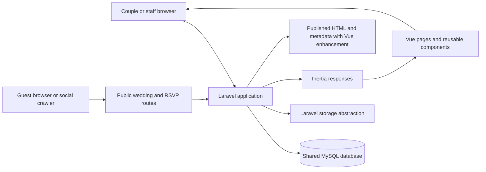

DEL-09a final owner feedback (2026-10-25): strip rendering passes a presentation-only natural/fill photo copy to `EditorialPhoto` for equal cover-filled frames, retaining published focal position and authorized URL. It does not mutate CMS/snapshot data or actual website photo framing. Hero stays programmatically focusable without a section-sized outline; interactive keyboard focus remains visible. [Focused verification](tasks/premium_delight_experience.md#final-owner-feedback--hero-outline-and-strip-framing-2026-10-25).

DEL-09a / D-058 (2026-10-25): add `photobooth` v1 to the existing enabled-intro registry/typed union; no new persisted keys/tables. Only Enchanted's guarded publisher accepts this style, with fixed ivory/editorial/three-frame presets; other reserved intros remain rejected. `EnchantedWebsite` projects optional `opening` display props from the immutable experience and a stable public wedding slug. The existing visible-photo projection supplies a bounded deduplicated strip, rendered by `EditorialPhoto`; no draft/library/history/Album resolver. `EnchantedLoading` coordinates one persistent content/bird subtree with a scoped opening overlay; configured opening entries bypass unbounded font/photo gating while non-opted sites retain their existing readiness behavior. The opening never owns RSVP state. Session memory stores only a public-slug key and `opened`; hashes/storage denial/bootstrap failure bypass safely. [Full lifecycle, compatibility and evidence](tasks/premium_delight_experience.md#del-09a--enchanted-editorial-photobooth-opening).

CMS-INTEGRATION / D-057 (2026-10-25): authenticated Invitation, overview and private-preview dispatch share `CmsEditorPreview::shouldOpen`. Under the existing local/testing gate, a saved Enchanted v2 draft or an unconfigured wedding (no draft, active pointer or revision history) selects the existing complete CMS. No draft is created on reads; first explicit Save uses existing v2 validation/version/locking and pins content IDs. Saved v1 and historical revisions retain legacy behavior. Overview exposes saved preview only after a saved version exists. Registration/workspace/wedding creation, media ownership, publication snapshots, public/personal projection and production hard denial are unchanged. [Workflow/evidence](tasks/cms_customer_workflow_integration.md).

DEL-02d refinement (2026-10-21): no CMS schema/persistence changes. Existing Story milestones project to optional resolved EditorialStorySection.milestones (ID/title/description/date-or-year/photo); narrative is no longer a flattened duplicate. The same owner-authorized media resolver/byte endpoint supplies every photo; existing main Story fallback remains. Timeline heading is template-owned. Compact editor expansion/validation state is local only. Desktop uses a viewport-sized split with navigation outside a single left field scroller and a separate iframe; mobile uses natural flow. [Exact evidence/remaining integration](tasks/cms_v2_premium_wedding_website_plan.md#21-del-02d--editorial-story-timeline-and-compact-editor).

DEL-02c refinement (2026-10-21): isolated editor only. hero/details/story are independent nullable media references in the **nonpersistent preview envelope**; Details no longer inherits hero and its optional HTTP key preserves older open-tab requests. Story may render a photograph without narrative; Closing has its own typed presentation section/anchor independent of RSVP. Full-source validation remains strict; contextual UI does not weaken it. Capability projection/preservation remains code-owned without a normal editor simulation control. No persisted document/version, schema, public renderer or RSVP authorization changes. Durable shared photo-slot persistence is a DEL-03 proposal, not an implemented CMS field. [Verification](tasks/cms_v2_premium_wedding_website_plan.md#20-del-02c--isolated-editor-owner-qa-fixes).

Current status (2026-10-21, D-035): DEL-02b adds an isolated guided editor and authenticated media HTTP adapters over verified DEL-01/02a. Normal runtime defaults off; production always denies preview routes, and missing schema fails closed. No CMS-v2 draft saving or publishing. Modern Classic/personal RSVP remain accepted; development database/migrations unchanged. Historical 23 InnoDB passes and separate CMS constraint/media races remain distinct. D-034 auto-slide stays future work; 5D before pilot, Seating postponed/S01–S06 unapproved.

# Wedding RSVP SaaS Architecture

**DEL-05b / D-056, 2026-10-25:** the existing personal RSVP POST uses the same wedding-first transaction and returns the unchanged authorized `rsvp` state plus ephemeral `{receipt: {changed: boolean}}` after successful completion. Internal state-only `submit()` callers are preserved. GET/reload/public HTML/snapshots gain no receipt; no new storage, endpoint, permissions or CMS schema. The Enchanted-only confirmation slot classifies current saved authorized rows, never client optimistic choices; no-op/failed/uncertain/reloaded state cannot celebrate. Runtime state guards reject malformed acknowledgements. Modern Classic retains its plain form presentation. [Exact contract and verification](tasks/premium_delight_experience.md#del-05--romantic-guest-experience-closeout).

**DEL-05a / D-055, 2026-10-25:** DEL-07b is owner-accepted. Existing `EditorialStoryTimeline` progressively enhances the same ordered semantic HTML with one IntersectionObserver and finite native opacity/transform animations. Text/date/photo/node parts reveal independently, with row-level rearming to avoid edge jitter; the landing SVGs and bird coordinator are unchanged. Visible default HTML and finite non-forwards fill preserve readable no-JS/failure/reduced-motion fallback; cleanup cancels enhancement on removal/reorder/unmount. No CMS document, immutable snapshot, backend permission or media contract changes. [Exact Story behavior/evidence](tasks/premium_delight_experience.md#del-05a--interactive-our-story-progressive-reveals); DEL-05a visual acceptance remains pending.

**2026-10-25 / D-051:** the product direction is a premium wedding website service with secure personal RSVP, plus a separately entitled paid **Our Wedding Memories** add-on. Advanced drag-and-drop Seating is indefinitely deferred outside MVP priorities pending real customer demand. Existing conceptual models/history below are preserved, not implementation commitments. 5D/internal operations/release/pilot safeguards remain independent.

[ALB-00 source assessment and proposed contracts](tasks/alb00_wedding_photo_album_plan.md) recommend reusing tenancy, policies, private media registry/processing and wedding-first locking. Album collection/moderation/reveal must stay outside immutable invitation CMS revisions. Explicit media-purpose isolation is required before guest uploads, since today's CMS library lists all wedding assets; album originals/renditions, entitlement/grants and release storage remain **proposed, not approved or implemented schema**. D-052 approves ALB-D01's staged-update behavior, not its schema. The existing invitation's 5 MiB/processed-WebP limits and publication/RSVP authority stay unchanged. Review remaining ALB-D02–07 as applicable before ALB-01; no parallel media/publishing infrastructure is approved.

This document records implemented milestones and explicitly labeled future proposals. Section 7I supersedes inactive/default-legacy phase descriptions. Milestones 1–5C/portal refinements are accepted. D-024 supersedes the earlier blanket post-M9 CMS/template deferral for prioritized planning; it does not approve v2 schema/design/implementation or final revised MVP scope. D-051 indefinitely defers advanced drag-and-drop Seating outside MVP priorities; S01–S06 remain preserved, unapproved proposals. The conceptual ERD is not a list of implemented tables.

## 1. Executive overview

### Confirmed requirements

**ALB-00 follow-up, 2026-10-25:** D-052 approves explicit initial Reveal and **Update revealed album**: new approved photos and presentation edits stay private until the couple publishes an update; removal/rejection of released content denies delivery immediately. The album data/storage model remains proposed and independent of immutable invitation revisions.

**Preferred deployment candidate — evaluation only (D-053):** Hostinger VPS (KVM 2 candidate) runs the existing Laravel + Vue/Inertia monolith, MySQL and Laravel workers; one branded domain serves wedding-scoped routes. Cloudflare CDN is proposed for explicitly safe public static assets, and R2 for private album object storage. This is neither an approved/verified production configuration nor a new frontend/API architecture: no standalone Vue SPA, separate hosting API or Vercel/Netlify frontend deployment for MVP.

Keep personalized RSVP/token routes, authenticated/CMS/private-preview pages, Inertia responses and all private album media out of shared CDN/reverse-proxy caches; preserve origin private/no-store and current published-media revocation behavior. A public build-asset allow-list must not cache protected images by extension or override private headers. Proposed R2 buckets stay nonpublic with application-authorized delivery; no public bucket URL or media migration is approved. [Full candidate/cache isolation and future validation](tasks/alb00_wedding_photo_album_plan.md#deployment-candidate--evaluation-only) covers effective edge rules, tenant/session isolation, revoke/hide/remove, runtime/worker capacity, upload/gallery performance, costs, backups/restore and rollout/rollback. These checks remain unexecuted; production and all existing release/DEL-07b gates are unchanged.

- The application uses Laravel 12, Vue 3, TypeScript, Inertia, Tailwind CSS, Vite, and MySQL.
- The product serves multiple couples and weddings through self-service and done-for-you onboarding.
- Couples customize premium wedding websites and use secure personal RSVP; guest management supports that experience. Our Wedding Memories is a separately paid add-on (D-051). Internal staff need scoped assisted setup and manual commercial administration. Advanced drag-and-drop Seating is outside MVP priorities and indefinitely deferred; historical proposals remain below.
- Payments start as manually recorded GCash, Maya, or bank transfers. An automated payment gateway is not required at launch.
- Website content stays separate from presentation. Modern Classic is the only current design; Milestone 2B supports two messages and three section visibility controls. Additional editing capabilities and designs require later scope approval.
- The first architecture should be understandable to a small team and avoid unnecessary packages, infrastructure, and service layers.

### Proposed architecture

Use a **shared-database modular monolith**. A customer account is the commercial and access grouping; an account can contain one or more weddings and multiple members. Users join accounts through memberships. Every private wedding record is scoped to its account and wedding, with Laravel policies enforcing access. Internal staff access is explicit, limited to a customer or wedding, and audited.

The CMS stores one mutable JSON draft per wedding and immutable publication snapshots of validated content, wedding facts and media references (section 7). A transaction changes the published pointer. Public Laravel HTML delivers metadata and primary content, enhanced by the existing Vue renderer. No SSR process is required. History/rollback interfaces and production hosting remain deferred.

Keep Laravel's standard app structure while the product is small. Use conventional controllers, Form Requests, policies, models, and focused domain actions where a multi-step operation needs one. Organize Vue pages by user-facing area and reusable website sections by section type. Introduce deeper domain folders only when actual code volume or team ownership justifies them.

### Assumptions

- One customer account is the initial billing and staff-support boundary. A couple shares an account and can invite another member.
- A user may belong to more than one account and access multiple weddings.
- At launch, each wedding has one public slug on the platform's domain. Custom domains are a later option.
- Public wedding content is intentionally public after publication. Guest lists/contacts remain owner-scoped; D-015/D-016 additionally let an active invitation bearer view its own group's current names/responses and submit choices. Contacts and other groups' information stay private.
- Each invited guest responds individually, allowing partial attendance within an invitation group.
- Laravel delivers public sharing metadata and invitation HTML with Vue enhancement and shared Modern Classic styles. A future full Inertia SSR process or hosting infrastructure needs separate justification and approval.

## 2. High-level system diagram



The diagram shows logical responsibilities, not separate services. Laravel remains the application boundary and MySQL remains the initial system of record. Wedding images should use Laravel's storage abstraction so a production object store can be configured later without coupling content records to a storage vendor.

## 3. Recommended project organization

Keep the current starter kit layout as the baseline:

```text
app/
  Http/Controllers/       HTTP entry points grouped by area
  Http/Requests/          Input validation and authorization context
  Models/                 Eloquent records and relationships
  Policies/               Account and wedding access decisions
  Actions/                 Focused multi-step operations, when useful
  Providers/
resources/js/
  pages/                  Inertia pages grouped by account, wedding, admin, and public site
  components/             Existing shared UI components
  components/wedding-site/sections/  Reusable public section renderers
  layouts/                Authenticated, editor, and public layouts as they emerge
  types/                  Shared frontend view-model types
routes/
  web.php                 Route entry point; extract route files by area as they grow
  auth.php
  settings.php
database/
  migrations/
  factories/
  seeders/
```

The current `app/Models/User.php`, `app/Http/Controllers`, `routes/`, and `resources/js/pages/` fit this approach. Do not create empty domain directories or generic repositories now. A controller should translate an HTTP request into a validated operation and response; a policy decides access; a focused action can coordinate a transaction when an operation spans records. Keep ordinary Eloquent queries and model relationships straightforward.

Suggested frontend page areas, when implemented, are `accounts/`, `weddings/`, `editor/`, `admin/`, and `public/`. Keep wedding section renderers presentational: pass them validated data and avoid giving them direct knowledge of database or authorization rules.

## 4. Main domain boundaries

| Area                    | Responsibility                                     | Likely records and behavior                                                                             |
| ----------------------- | -------------------------------------------------- | ------------------------------------------------------------------------------------------------------- |
| Accounts and access     | Customer ownership, collaboration, staff support   | Accounts, account memberships, roles, scoped staff access grants, audit events                          |
| Weddings and websites   | Event identity and website lifecycle               | Wedding, slug, selected template, draft and published revision pointers                                 |
| Templates and content   | Supported appearance and structured content        | Template catalog/version metadata, section schema, revision validation, preview and publication         |
| Invitations and guests  | Who is invited and how to reach their invitation   | Invitation groups, individual guests, invitation delivery state, secret link lifecycle                  |
| RSVPs                   | Each guest's response and attendance details       | Per-guest response, response timestamp, dietary/accessibility notes where approved                      |
| Seating                 | Physical tables and guest placements               | Wedding tables, capacity, one active seat assignment per guest                                          |
| Orders and payments     | Commercial order and manual payment reconciliation | Orders, PHP amounts, manual payment entries, evidence references, verification history                  |
| Internal administration | Support and operational workflows                  | Staff-only pages, scoped access, audit trail; built on account/wedding data rather than a parallel copy |

These are responsibility boundaries, not a requirement for separate Laravel packages or services. Keep the first implementation in normal Laravel conventions; separate code by domain only after repeated complexity makes the boundary useful.

## 5. Preliminary database design

The following is a conceptual starting point, not the deployed schema or a migration specification. Templates, invitation delivery and seating remain future proposals; implemented draft/revision contracts are in section 7, guests in 7A, links in 7B and responses in 7C. The conceptual fields below are not authorization to implement tokens, guest contact fields or redundant guest wedding keys. Use InnoDB foreign keys and transactions for related writes. Prefer MySQL `BIGINT` IDs for internal relations; use random public identifiers or high-entropy tokens at future private public-access boundaries. Tenant ownership may be unambiguously derived through constrained parent relations.


### Ownership, keys, indexes, and constraints

- `accounts` represent a customer relationship; `account_members` is a many-to-many membership table. Add a unique key on `(account_id, user_id)` and index `(user_id, account_id)` for account switching. Keep roles small and explicit, such as `owner`, `editor`, and `viewer`; enforce role capabilities in policies rather than scattered string checks.
- `weddings.account_id` is the tenant ownership anchor. Index `(account_id, id)`. `public_slug` should be normalized and unique for the initial single-domain route. Use a unique constraint and a validation rule to prevent ambiguous public URLs.
- `website_revisions` stores full validated snapshots, not an evolving bag of untyped page-builder data. Enforce unique `(wedding_id, revision_number)` and index `(wedding_id, state, created_at)`. Keep the published pointer on `weddings`; change it transactionally after a revision passes validation. A revision's template version must remain available for rendering or have an explicit compatibility path.
- `templates` should have a unique key on `(key, version)` so releases can coexist while older published revisions still reference their renderer.
- `invitation_groups` currently have a wedding parent, label and optional contact email/phone, indexed by `(wedding_id, id)`. Token hashes, rotation/revocation and delivery lifecycle are future work, not fields in Milestone 4A.
- `guests` currently belong to one invitation group; the wedding is derived through that group rather than duplicated on each guest. Index `(invitation_group_id, id)`; names are not unique. Future individual RSVP responses can refer to this stable guest identity. Any redundant wedding key proposed later must have enforced parent consistency; none is needed for current CRUD.
- `rsvp_responses` should have one response per guest, enforced with a unique `guest_id`; include `wedding_id` if needed for efficient tenant-scoped access and ensure it agrees with the guest's wedding. Use database constraints/composite foreign keys where practical, plus transactional application validation. Invitation status (`sent`, `revoked`, `opened`) is not the same as attendance status (`pending`, `attending`, `declined`).
- `wedding_tables` need positive capacity. `seating_assignments` should enforce one active assignment per guest and should not exceed table capacity. A count-then-insert check can race; perform assignment changes in a transaction that locks the table row, counts current placements, and validates capacity before inserting. Preserve wedding consistency between guest, table, and assignment.
- Store money as integer minor units with explicit `currency` (initially PHP), not floating point. Manual payments should record method, received amount/time, status, private evidence key if provided, verifier, and verification time. Do not store bank credentials, card numbers, or payment passwords. Restrict and audit edits to verified payments.
- Account and wedding foreign keys should be present on all tenant-owned records or be unambiguously reachable through a constrained parent relation. Add indexes beginning with `account_id` or `wedding_id` for tenant list pages and operational queries. Use soft deletion only where retention and restore behavior are defined; do not apply it by default to every entity.

## 6. Multi-tenancy and authorization

### Tenant model

Use one shared MySQL database and shared tables. `Account` owns one or more `Wedding` records. Users join an account through `account_members`; one account can therefore be managed by both partners, and one user can participate in multiple accounts. A done-for-you customer uses the same records and editor after staff has helped set up the site.

Do not use a user ID as the tenant ID, and do not infer authorization from a wedding slug or an ID being difficult to guess. Public IDs and tokens reduce enumeration but do not replace authorization. Do not introduce a tenancy package or database-per-customer model at this stage; neither is needed for the stated product and both would add operational complexity.

### Authorization flow

1. Authenticate the member using the existing Laravel starter-kit authentication.
2. Load the account or wedding through a membership-scoped query, for example through the current user's accounts, rather than loading an arbitrary record and relying on the UI to hide it.
3. Authorize the requested operation with a Laravel policy. Apply the same policy to reads, edits, exports, file access, and background operations.
4. Validate submitted parent IDs against the authorized wedding; never trust a client-supplied `account_id`, `wedding_id`, role, or ownership field.
5. Use transactions for changes that span a wedding and its related records. Include the tenant key in lookups and updates to prevent cross-wedding reassignment.

Serialize first-workspace creation with a lock on the authenticated user's row, and serialize wedding creation with a lock on its account row. Profile deletion must also lock the user and owned accounts, and must be blocked when it would leave an account containing weddings without an owner. Ownership transfer, customer data export, and retention after account closure remain product decisions.

Use account-level roles as a starting point. If product requirements later establish different rights per wedding, add wedding memberships or scoped grants rather than encoding per-wedding exceptions in controllers. Internal staff should authenticate through the same application but have a distinct administrative capability. Grant support access to a specific account or wedding, require a reason and expiry, allow revocation, and log sensitive reads and writes. Avoid silent or permanent impersonation. Do not add staff roles or modify authentication until the product policy is agreed.

## 7. Modern Classic draft CMS and future publication

### Implemented — Milestone 2B

`website_drafts` is the smallest draft-only subset of the proposed revision architecture:

| Column                     | Contract                                                                                                    |
| -------------------------- | ----------------------------------------------------------------------------------------------------------- |
| `id`                       | Internal primary key                                                                                        |
| `wedding_id`               | Unique, non-null foreign key to `weddings`, cascading on wedding deletion                                   |
| `schema_version`           | Server-controlled content schema version, currently `1`                                                     |
| `lock_version`             | Save counter; clients submit their last observed version as `draft_version` (`0` before the first save)     |
| `content`                  | Validated JSON: `introduction_message`, `closing_message`, and `sections: { ceremony, reception, closing }` |
| `created_at`, `updated_at` | Draft creation and last-save timestamps                                                                     |

Both messages are required plain text of at most 500 characters; line breaks are supported, angle brackets/markup rejected, and Vue interpolations escape all rendered values. Section values must be JSON booleans. Unknown root, content, and section keys are rejected. No account IDs, wedding facts, template IDs, publication flags, or ownership values are accepted from the form.

The editor, standalone preview, and save transaction explicitly require stored `schema_version === 1`. Unsupported versions return a controlled HTTP 409 message (plain text for browser/Inertia requests, JSON for JSON clients), never expose the stored content, and never rewrite its version, content, or save counter. Authorization runs first; the write guard runs after acquiring the wedding lock. No schema migration/compatibility framework is introduced.

The unique wedding key gives each wedding an independent mutable draft without creating a template registry or an incomplete revision-history system. Account ownership is reached through `Wedding -> Account`; reads/writes resolve the nested account/wedding route and reuse `WeddingPolicy::update`. Saves lock the wedding row in a transaction (including first save), compare `lock_version`, and return a validation error for stale submissions. No wedding fact is changed by this operation.

`Wedding::presentationData()` supplies the existing six wedding facts to both preview surfaces. The editor receives a separate typed `InvitationCustomization`, edits a local reactive copy, and passes that copy to the existing `ModernClassicInvitation` component. The standalone authenticated preview loads only the saved draft. Without a draft both routes use the original messages and all sections enabled; loading defaults does not create a record. Hidden sections retain their messages and relational venue data. Portal light/dark/system appearance never changes the invitation's Modern Classic colors or typography.

Routes: authenticated `GET /accounts/{account}/weddings/{wedding}/invitation/edit` and `PUT /accounts/{account}/weddings/{wedding}/invitation`; existing `GET .../preview` remains private. Foreign-account owners receive the existing policy's 403; mismatched nested parents receive 404. Milestone 2B added no public wedding route; 2C.2 adds the published-only surface below.

Milestone 2B deliberately used a standalone mutable draft without publication history or template foreign keys. Milestone 2C.2 adds immutable snapshots separately; the draft schema/save counter remain distinct from publication revisions and their state counter.

### Implemented — Milestone 2C.1 private hero photo

An additive migration adds nullable, server-controlled `hero_photo_disk`/`hero_photo_path` columns to `website_drafts`. There is no media table or JSON schema bump: content remains version 1 and unknown stored versions remain blocked. The existing save counter covers messages, visibility, and photo together. Wedding facts remain unchanged.

`wedding_photos` uses Laravel Filesystem with a non-serving private local root. UUID WebP objects live under account/wedding-specific hero prefixes. The authenticated nested `GET .../invitation/hero-photo/{photo}` route authorizes the wedding owner and serves only its current reference with private/no-store and nosniff headers. No paths or public object URLs enter Inertia props; both preview surfaces receive a separate nullable `{url}` photo prop and share ModernClassicInvitation.

Multipart saves JSON-encode the existing content so strict booleans survive transport. Native GD/EXIF normalizes JPEG/PNG/WebP (5 MiB, 12 MP, maximum 6,000px per side) into metadata-free static WebP, at most 1,600px long edge without upscaling. Original bytes are never retained. The runtime needs EXIF, supported GD codecs, adequate upload limits, and at least 256M memory; setup is documented in README.md.

Normalization precedes the wedding lock; durable writes follow the locked schema/counter checks. Reference/content/counter updates share one transaction. After confirmed commit, superseded files are deleted only after a primary-database reference recheck under the wedding lock. Rollback/uncertain-commit cleanup uses that same safeguard. Cleanup failure leaves an orphan for the dry-run-first `wedding-photos:prune --delete` operator command (generated, unreferenced objects older than 24 hours); incompatible-schema weddings are skipped.

Milestone 2C.2 extends draft replacement/pruning checks to retain references in every immutable revision, including history after unpublishing. Production local storage must be persistent/backed up; adopting private S3-compatible storage later requires its adapter/configuration and object migration separately.

### Implemented — Milestone 3A publication (previously 2C.2)

The additive `2026_10_16_075658_create_website_revisions_table` migration creates snapshot rows and adds nullable `weddings.published_revision_id` plus unsigned `publication_version` (default 0). Existing weddings start unpublished. MySQL DDL was reviewed with `--pretend`, applied to development without resets, and checked with Boost. No existing invitation was published automatically.

| Record                                            | Contract                                                                                     |
| ------------------------------------------------- | -------------------------------------------------------------------------------------------- |
| `website_drafts`                                  | Existing mutable version-1 CMS, photo reference and save counter                             |
| `website_revisions.wedding_id`, `revision_number` | Wedding ownership and unique per-wedding sequence                                            |
| `schema_version`, `wedding_facts`, `content`      | Supported version, six wedding facts and validated CMS snapshots                             |
| `hero_photo_disk`, `hero_photo_path`              | Nullable immutable private media reference; indexed together for cleanup checks              |
| `fingerprint`, `published_at`                     | Canonical SHA-256 source fingerprint and publication time                                    |
| `weddings.published_revision_id`                  | Nullable foreign key; publisher/resolver also require the revision to belong to this wedding |
| `weddings.publication_version`                    | Monotonic counter across publish/republish/unpublish, preventing stale and ABA requests      |

`WeddingPublication` locks the same wedding row used by draft saves, reloads the saved draft, checks schema, draft/publication counters and source fingerprint, validates facts/content/media, inserts a revision, and changes pointer/counter in one transaction. Require a saved draft, both names and a date; time/venues are optional. `WebsiteDraft::contentRules()` shares existing strict CMS validation. The fingerprint includes facts, schema, content and photo reference, detecting wedding-detail changes as well as draft edits. Clients never submit snapshot content or pointers. An identical current snapshot with fresh counters is a no-op; stale repeated requests fail validation.

Snapshots reject Eloquent updates/deletions and have no mutation endpoint. Unpublishing clears only the pointer and increments its counter, retaining draft/history/files. The pointer foreign key restricts deleting a referenced revision; a future wedding-deletion workflow must clear that pointer before cascading deletion. Administrators can bypass model guards; there is no general revision editor, history browser or rollback feature.

Public `GET /w/{slug}` resolves only the active, same-wedding, supported revision, never live draft content or live wedding facts. `GET /w/{slug}/photo/{photo}` streams only its matching generated WebP after disk/prefix/identifier checks. Missing, unpublished, unsupported or wrong-wedding pages/media return 404. Draft images still require owner authorization. Replacement/removal/pruning recheck all revision references under the wedding lock, retaining active and historical media. No public disk, symlink or bearer URL is introduced.

A dedicated Blade document/Vite entry delivers escaped invitation HTML and title/description/canonical/Open Graph/Twitter metadata. `ModernClassicInvitation.vue` enhances it. Both share `resources/css/modern-classic.css`, extracted without changing declarations; explicit stylesheet entries also style no-JavaScript output. Tradeoff: the small fallback markup must stay in parity with Vue, covered by browser JavaScript/no-JavaScript checks. No additional SSR server or dependency is needed.

Only public presentation props are embedded, excluding authentication/accounts, numeric IDs, payments, schema/counters, paths and fingerprints. Disabled section venues/closing text are also stripped from public props. Blade/Vue escape text; `Js::encode` safely embeds JSON. Portal overview controls provide explicit confirmation, state/timestamp, republish/unpublish and URL actions. Opt-in overlay styling affects only publication dialogs; existing defaults and invitation design remain intact.

The recommended conservative default is implemented as `noindex, nofollow, noarchive` in HTML/headers, with private/no-store caching for page/photo responses. Confirm indexing preference during owner QA. This is public content: downloaded copies and third-party preview caches cannot be recalled. Localhost is not Internet hosting; live messaging previews require a reachable deployment. Hosting/custom domains remain outside this milestone.

Six opt-in MySQL concurrency cases remain unexecuted: four original draft/photo cases plus two simultaneous publish/republish cases. They require an approved disposable target with all migrations and `INNODB_TRX` inspection privileges. SQLite/duplicate-request tests and MySQL schema checks do not verify MySQL concurrency.

### Implemented — CMS-A.1 internal contracts (D-026)

Historical A.1 subset at delivery; DEL-01 below extends this internal shape without activating customer paths.

`WebsiteDesignRegistry` resolves immutable `WebsiteTemplateManifest` and `IntroductionStyleManifest` values by explicit key/version/schema. Modern Classic v1 names the existing Vue component and `public.wedding` fallback; reserved floral-trial v1 supports schema 2 and four section types. Five reserved intro manifests have shared-setting keys and distinct allowlisted variant options. Compatibility follows supported schema versions, independently of website identity. Only Modern Classic appears in `availableTemplates()`; `availableIntroductions()` is empty. `reserved:` renderer/fallback identities have no component/view implementation.

`CmsV2Contract` validates a bounded internal document; `CmsV2Document::fromArray()` validates before constructing its readonly value. `toArray()` preserves private disabled content, while `publicContent()` removes disabled sections and excludes document metadata. Theme/intro values are reserved curated identifiers, not licensed font/artwork installations. PHP owns runtime safety, limits and schema compatibility; `resources/js/types/cms-v2.ts` supplies matching discriminated TypeScript shapes. Shared JSON fixtures exercise both PHP and the installed TypeScript compiler, including expected structural failures. This is an internal content projection, not an HTTP/publication/authorization grant.

No existing controller/model/service/provider/route, Vue/Blade renderer or database contract was changed. V2 input still fails the existing v1 save boundary; unsupported stored drafts are blocked in private preview/publication, and v2 snapshots fail closed on public/personal surfaces. Existing schema/version locks, snapshot fingerprints, media/privacy and personal authority remain intact. There is no runtime v2 dispatcher or customer selector until a complete separately approved path exists. See [exact A.1 subset, checks and A.2 dependencies](tasks/cms_v2_premium_wedding_website_plan.md#12-implemented-cms-a1--internal-contract-foundation); no ERD/table additions belong in this batch.

### Implemented — DEL-01 / CMS-A.3a reusable internal content (D-032)

`CmsV2Contract` validates seven singleton section types independently of selected-template section capabilities. Limits are centralized there: 128 KiB/12-level JSON budget; 12 story milestones, four 1,000-character narrative paragraphs, 140-character headings/titles, 600-character descriptions/captions; **10 gallery items (D-038, superseding the former 24)**; 16 entourage role groups, 64 people per group/250 total, 160-character names. Disabled/unsupported content still receives full validation. UUIDs are lowercase and unique within their lists; entourage person IDs are unique across role groups. Gallery asset references must be distinct within that gallery, including hidden entries; deliberate reuse across Story/Gallery/other photo slots remains allowed. Duplicate names remain allowed. Saved list order is authoritative, with no second order field.

| Kind        | Validated data                                                                                                                                                                                                                                                                                                                                                                                                   |
| ----------- | ---------------------------------------------------------------------------------------------------------------------------------------------------------------------------------------------------------------------------------------------------------------------------------------------------------------------------------------------------------------------------------------------------------------- |
| `story`     | Required `heading` and `paragraphs` list; optional `milestones`. Each milestone has stable `id`, strict `enabled`, `title`, optional description, nullable/optional `when` and `photo`. `when` is `{precision:year,value:integer 1–9999}` or `{precision:date,value:YYYY-MM-DD}` with a real calendar date; no fabricated day/timezone for year-only input. Narrative and milestones belong to one story source. |
| `gallery`   | Required heading and ordered `items`: stable id, strict enabled, image reference and optional caption.                                                                                                                                                                                                                                                                                                           |
| `entourage` | Required heading and ordered custom role `groups`: stable id, strict enabled, title and one or more named people with stable IDs. No fixed Philippine role enumeration or private guest/response relationship.                                                                                                                                                                                                   |

Image references contain only `asset_id` UUID, plain `alt`, curated `focal` (`center/top/bottom/left/right`) and `crop` (`natural/portrait/landscape/square`). No URL, path, disk, contacts, guest IDs or arbitrary coordinates. **This batch validates structure only**; future DEL-02 must resolve wedding ownership/processed immutable bytes and visible-publication delivery before rendering. Current visual-trial `EditorialPhoto` URLs/focal treatments remain separate display inputs; they are not persisted documents.

Experience is now `{enabled:false}` with no style/version/settings, or `{enabled:true,intro_style,intro_version,intro_settings}` with existing strict variant validation. Disabled is not a sixth intro and selects no renderer. All five styles remain unavailable. Read-only aggregate inspection before editing found only schema-v1 drafts/revisions locally; no durable v2 documents required migration, and no data was converted.

`CmsV2Document::toArray()` retains the complete source. `withTemplate()` validates a new known schema-compatible selection without mutating content, IDs or ordering. `publicContent()` delegates to `CmsV2Contract::project()`: revalidate first, include only supported/enabled sections and enabled milestones/gallery items/role groups, then reindex visible lists. Switching Enchanted → Floral → Enchanted restores its original projection; unknown versions/settings fail instead of dropping data. Never persist a display projection or treat a media reference as delivery authority. Both current v2 manifests share the existing curated theme options; future incompatible theme presets need an explicit contract decision rather than silent resetting.

Enchanted is registered with reserved renderer/fallback identities and `available:false`. Live v1 save/preview/publish/public/personal boundaries remain unchanged; no Vue/Blade/HTTP integration, tables, uploads, music or motion were introduced. See [DEL-01 implementation and exact verification](tasks/cms_v2_premium_wedding_website_plan.md#17-del-01--cms-a3a--reusable-content-foundation).

### Implemented — CMS-A.2 persistence/image foundation (D-027)

Existing drafts/revisions gain required template_key VARCHAR(64) default modern-classic and unsigned-small template_version default 1. Schema/content/counters/facts/hero references and historical snapshots keep their semantics; intro_style/version/settings stay within validated content.experience JSON. No timezone column. Database defaults, not new model attribute defaults, preserve the still-unmigrated development application.

New wedding_media_assets has a UUID PK, indexed restrictive wedding FK, image-only kind, required private disk/path/MIME/byte-size/dimensions and timestamps, with unique disk/path. website_revision_media has restrictive revision/asset FKs, composite PK and reverse-asset index. No FK alone establishes same-wedding ownership. Typed Wedding/Revision/Asset relations and a guarded custom pivot support the internal creation boundary. Existing hero columns/storage and publication code are unchanged.

CreateWebsiteRevision validates a prepared unsaved snapshot and server-derived distinct owned image IDs, takes Wedding then ordered asset locks, and creates snapshot/references atomically. It does not authorize customer requests, change the publication pointer, or enable v2. Model guards block asset mutation/pinned deletion and ordinary reference updates/detach/post-hoc attach; restrictive FKs backstop existence/retention/uniqueness, not raw-SQL immutability or tenant equality. Future publisher integration must add authenticated completeness/fingerprint checks and derive media references from validated content.

WeddingImageAssetStorage defines guarded image/WebP metadata, 5 MiB/1,600px normalized bounds and exact UUID/wedding paths on a separate private non-serving wedding_media disk. Metadata validation is not byte verification; there are no upload/processing/delivery/pruning endpoints/jobs. Hidden disk/path/wedding/pivot values do not enter normal asset serialization. Published visibility must later be checked against the current visible snapshot, not all pinned historical media. See [Section 13](tasks/cms_v2_premium_wedding_website_plan.md#13-implemented-cms-a2--minimal-persistence-and-image-foundation) for exact DDL, tests, rollout limitations and Windows ACL caveat.

### Implemented — DEL-02a internal processed-image boundary (D-033)

`WeddingImageProcessor` extracts the existing GD/EXIF normalization shared by the unchanged hero upload interface and the new internal `UploadWeddingImage` action. Actual bytes, detected MIME and decoded dimensions are checked before storage: JPEG/PNG/WebP, 5 MiB upload, 6,000px maximum side, 12 million pixels. The new action also requires an agreeing allowed filename extension; client MIME and filenames never determine storage metadata/paths. JPEG and bounded PNG/WebP EXIF orientation are corrected; decoding onto a fresh canvas and WebP quality 82 encoding discard metadata. No upscaling; maximum output edge 1,600px and 5 MiB. Runtime remains GD/EXIF with supported codecs and at least 256 MiB memory. No new dependency.

`UploadWeddingImage::upload(owner, wedding, file)` reloads persisted wedding ownership and uses WeddingPolicy before processing, then reauthorizes under the wedding row lock. It must own its outer transaction: no ambient transaction and no automatic transaction retry around filesystem writes. Insert an immutable A.2 asset row to reserve the server UUID/unique private path before writing, refuse any existing file, write private bytes and verify recorded size/MIME/dimensions/decodability before commit. Return only `{id,kind,mime_type,byte_size,width,height}`. No draft, publication or canonical wedding fact changes.

Filesystem writes and SQL commits are not atomic together. On failure, roll back and reacquire the wedding lock on the primary connection before compensating only this operation's failed file. Any committed asset row retains its bytes, including uncertain/lost commit acknowledgments; an unknown database outcome defers cleanup. Existing UUID/path collisions are never overwritten or deleted. A process crash or cleanup failure can leave a private unregistered orphan; [RF-030](risks_and_followups.md#rf-030--image-upload-filesystemdatabase-recovery) and QA-RACE-09–11 track recovery/races before activation. No physical deletion API or generic cleanup job is added; retained revision references remain restrictive.

`WeddingImageResolver` reloads the wedding and authorizes its owner on every internal resolution/preview. It resolves only that wedding's UUIDs and returns reference presets plus safe metadata, or bounded verified bytes for an owner preview. `validateDocument()` checks every Story milestone/Gallery reference in the **complete validated source**, including hidden/unsupported entries; deduplicate IDs and batch-query ownership, then verify stored bytes. A reference or hidden revision binding never grants public access. Future draft/publish writers must revalidate inside their wedding-first transaction; this read-only check is not a race-proof assignment operation. `CmsV2Contract::imageReference()` exposes existing reference validation without changing the JSON/TS contract.

`WeddingImageAssetStorage::validate()` remains metadata-only for existing model/snapshot creation. The new `readVerified()` explicitly verifies private bytes; it does not authorize a caller. `CreateWebsiteRevision` is not silently converted into a complete publisher. DEL-03 must derive/pin references from validated content and verify owned bytes/current-visible delivery under the correct locks. No HTTP route is added here. Future owner adapters require scoped authorization, private/no-store/nosniff responses, protected upload POSTs and appropriate limits; future public delivery requires current visible publication checks. Windows fake-filesystem POSIX visibility is not evidence of production ACLs.

No schema, model, disk configuration or customer workflow changes; no development migrations applied. CMS-v2 remains unavailable. D-034's future gallery auto-slide option/default is recorded only; its presentation setting and accessible playback controls await separate integration.

### Implemented — DEL-02b isolated guided editor/private media HTTP (D-035)

`config/cms_editor.php` defaults `preview_enabled` to false and accepts only an explicit boolean true from `CMS_EDITOR_PREVIEW_ENABLED`. `EnforceCmsEditorPreview` plus centralized private error handling gate every `/accounts/{account}/weddings/{wedding}/cms-preview` surface. Require local/testing environment, A.2 media/draft metadata schema and, since DEL-03a, canonical timezone; production/invalid/disabled configuration returns private 404, missing schema private 503. This does not apply migrations or enable a public CMS renderer. Existing portal navigation has no new customer entry point.

| Method/path beneath the scoped preview prefix | Behavior                                                                                                                                |
| --------------------------------------------- | --------------------------------------------------------------------------------------------------------------------------------------- |
| GET `/`                                       | Inertia editor, canonical facts, saved complete source or first-save starter, PHP limits/capabilities and relative endpoint paths       |
| GET `/draft`                                  | Owner-only complete saved source/version plus resolved private referenced images; starter/version zero before first save                |
| PUT `/draft`                                  | Strict `{document,draft_version}`; owner transaction, full-source/media validation and optimistic counter; no publication               |
| GET `/saved-preview`                          | Owner-only rendering of last durable draft; 404 before first save; no editor-only placeholders                                          |
| GET `/images?page=N`                          | Owner's safe metadata/private preview URLs only; 12 assets per page                                                                     |
| POST `/images`                                | Strict multipart `image` payload; existing `UploadWeddingImage`; 201 only after verified commit                                         |
| GET `/images/{asset}`                         | Existing owner resolver; verified WebP bytes, generic unavailable response for foreign/missing/corrupt assets                           |
| POST `/validate`                              | Strict `{document,slots}`; PHP contract plus full-source/slot ownership verification; returns source/projection without database writes |

Scoped binding and WeddingPolicy are server-enforced; UUIDs confer no authority. All responses/errors are private/no-store, nosniff, no-referrer and noindex with same-origin resource policy; safe exception reporting omits source paths. Upload throttles are 15/user/minute plus 60/IP, separate from 240/user read and 180/user validation buckets. Normal web CSRF remains; client uses the current XSRF cookie, with initial owner token fallback. Only these preview paths skip Laravel's trimming/empty-string-to-null conversion so strict JSON string/null distinctions survive HTTP. Other application normalization remains unchanged.

Shared Vue section controls edit a cloned typed document, with stable IDs, PHP-supplied limits/capabilities, repeatable content, ordering, visibility and bounded photo presets. Local state survives section navigation and failed requests; no localStorage/remembered history draft or publication claim. Since DEL-03a, only explicit Save persists to the single draft. Debounced validation remains read-only and aborts/ignores stale requests; immediate presentation is separate from server-confirmed upload/save success. Media picker supports real progress, paginated existing photographs, retry, and explicit selection. Removing an image reference never deletes its bytes. An interrupted/closed upload can have committed: reopen the library before retrying.

`CmsPreviewFrame` mounts the existing Enchanted renderer and both template stylesheets into a same-origin iframe, reacts to typed presentation changes and reveals the edited section without moving focus. It isolates viewport/CSS from the portal. Shared fields are template-independent; only the presentation adapter maps into Enchanted. The existing photo component gains optional curated crop/focal projection with observer cleanup; trial inputs without those properties retain their framing. No template redesign or public renderer dispatch changes.

DEL-03a/D-040 supersedes the original local-only slot boundary: optional shared `content.photo_slots` contains required hero/details/story keys when present, each null or the existing bounded image reference. Older v2 documents without slots retain exact source semantics. Full source is saved, including hidden/unsupported content; projection only controls display. Slots and milestone/gallery references are owned-byte validated together, regardless of visibility. RSVP stays informational; no private invitee data/authority enters CMS.

### DEL-03b.1 presentation readiness and editor publish adapter (D-044)

CmsPublishAction posts the existing saved draft/publication versions and fingerprint to the existing publication route. The controller returns owner-only JSON summary for JSON requests; HTML/Inertia keeps the overview redirect. Editor/save responses include that same summary. No publication/revision/pivot/locking changes or new persistence fields. Dirty/pending/mismatched saved state disables the action; explicit confirmation and stale/uncertain recovery preserve edits.

EnchantedLoading is a display-only boundary reused by live iframe, saved preview and public Vue. It awaits supplied data, fonts and initial visible/eager image settlement/decode plus layout, then reveals content and transfers the reusable original FRONT/LEFT/RIGHT bird to section:invitation. Transient DOM geometry and ResizeObserver reanchor only the first destination; no stored coordinates, scroll listener or animation engine. Reduced motion is static. Client-only masking preserves readable Vue SSR/no-JS; published Blade has a small module-bootstrap mask with script-error fallback. Null photo slots render no placeholder; assigned failed images keep graceful fallback. [Exact code and tests](tasks/del03a_draft_persistence_contract.md#10-del-03b1--focused-preview-publishing-and-loader-polish).

### DEL-07a layered hummingbird and contained motion prototype (D-048)

DEL-07a/D-048 extends the existing display-only EnchantedHummingbird and loader rather than adding a CMS motion system. One trusted original layered SVG contains matching front/profile path coordinates; the component interpolates transient heading values for LEFT/FRONT_LEFT/FRONT/FRONT_RIGHT/RIGHT with per-instance gradient IDs. CSS featherbeat is mounted once and remains independent of heading/body/travel. Heading RAF work is bounded to a turn, while document/intersection visibility and reduced motion suspend the channels; observers/listeners/frames are released on unmount. The existing loader waits for supplied content/fonts/images and moves to the current Hero blossom. Normal motion aligns the bill from a safe side; reduced motion is a static decorative fallback. The five-way travel demonstration lives only in the isolated frontend fixture and is not part of the production bundle, CMS source or publication snapshot. No scroll listener, persistent coordinate, new relational field or animation library is added. [Prototype and approval gate](tasks/premium_delight_experience.md#del-07a--layered-svg-hummingbird-and-contained-motion-prototype).

### DEL-07b guided hummingbird flight integration (D-049)

D-050 owner-feedback refinement (2026-10-24) preserves the same component, SVG and waypoint IDs. Existing flower SVG circles now expose `data-nectar-center` in Vue and escaped Blade. `EnchantedLoading` measures this actual circle, applies the authored profile tip offsets (±93, −52 in the centred 200×180 viewBox rendered at 76px), and chooses a stable resting side from available flower/viewport space rather than the next segment tangent. The sole Hero flower moves to the composition's upper-right edge; a transient DOM-derived translate lifts it into short initial viewports. This display adjustment is never persisted. Route geometry is cached in document coordinates until resize/marker/layout mutations; scroll frames subtract scroll offset and update only the transform target. A 38%-height reading line and short endpoint dwell bands allow real section/milestone/closing flower contact; the last destination is reachable at maximum scroll. Smootherstep travel grows to 1.18× desktop / 1.10× mobile and returns to exact 1.0×/zero bank at rest. The loader's absolute→fixed handoff preserves the current rendered position and existing bird/wing nodes. Reduced-motion, readiness and cleanup contracts remain intact. [Verification and visual gate](tasks/premium_delight_experience.md#del-07b-owner-feedback-refinement--nectar-contact-hero-and-travel-zoom).

After the loader's Hero handoff, the same bird becomes a single fixed, pointer-transparent decoration. `EnchantedLoading` refreshes `discoverWeddingWaypoints(root)` after readiness and on frame-coalesced scroll, resize and relevant DOM mutations. It caches only transient viewport geometry for the current render; hidden/inert/removed markers are excluded by the shared helper, and no coordinates enter CMS JSON, revisions or database state. Scroll position selects the ordered section/milestone segment; a bounded quadratic path with eased progress, safe viewport clamps, subtle scale and heading updates moves the bird between destinations. The accepted SVG's independent wing/body/tail channels continue through travel and resting; target endpoints use a side offset so the beak faces the marker flower, and reduced motion disables route updates and keeps the static Hero presentation. Visibility/intersection suspension remains owned by `EnchantedHummingbird`; all coordinator RAFs, observers and listeners are cancelled on unmount. No second bird, motion library, schema, CMS/publishing/RSVP change or full scroll-follow engine outside this bounded coordinator is introduced. [Implementation and evidence](tasks/premium_delight_experience.md#del-07b--guided-hummingbird-flight-integration).

### DEL-04.1 optional Enchanted Countdown (D-046)

CMS-v2 adds `countdown` to the validated Enchanted section union and allows eight sections so the starter can place it between event details and story. Its strict data shape is only `{heading, subtitle}`; date, time and IANA timezone are never stored as duplicate CMS values. New unsaved starter documents enable it. Existing draft/snapshot arrays and visibility are not transformed; hiding retains authored text. Other templates reject Countdown unless their manifest explicitly supports it. No schema-version bump, table, migration, or new persistence path.

The private editor preview uses the current Wedding facts; public and authorized personal Enchanted renderers use the active immutable revision’s facts. Vue resolves one target instant in the supplied IANA zone, updates D/H/M/S, stops at arrival, and falls back to an explanatory message when date/time/zone is missing or invalid. Escaped Blade exposes the static date/time fallback without fabricated timer values when JavaScript is unavailable. The section keeps the stable `section:countdown` waypoint, uses existing Enchanted styles, and adds no bird flight behavior or RSVP semantics. The editor’s “Back to wedding” link is navigation only; Save and publish actions retain their saved-version/fingerprint/confirmation guards. [Exact implementation and evidence](tasks/del03a_draft_persistence_contract.md#del-041--wedding-countdown-and-editor-navigation-polish).

### DEL-04.2 optional Enchanted Guest Guide (D-047)

CMS-v2 adds one optional `guest_guide` section and raises the bounded section count to nine. Its exact nested content is three independently enabled blocks: Attire (`dress_code`, short description, up to five UUID/labeled six-digit hex swatches), Gifts (heading/message/optional credential-free HTTPS URL), and FAQs (up to seven UUID/question/answer pairs). PHP is authoritative; TypeScript types and editor preflight validation mirror the content bounds and safe-link constraints. A fresh starter enables the FAQ block with three neutral editable questions and leaves Attire/Gifts hidden. Older documents and published revision source are never transformed; an older draft can add the section only through an explicit owner action.

The section follows Entourage and precedes RSVP in the starter, has one navigation entry and the stable `section:guest-guide` waypoint. Source retains hidden preferences; the validated public projection excludes hidden blocks, and hides the entire section/waypoint if no block is visible. Vue and escaped Blade render the same plain-text content, native accessible FAQ disclosures, labeled swatches and optional registry link. RSVP guidance never duplicates RSVP storage: personal pages link to their existing authorized RSVP anchor; generic pages provide neutral instructions and do not receive guest state or bearer URLs. The shared locked immutable publisher, CMS-v2 schema version, Modern Classic renderer and existing RSVP/5D paths remain unchanged. [Exact implementation, verification and owner preview](tasks/del03a_draft_persistence_contract.md#del-042--guest-guide).

### DEL-03b controlled immutable Enchanted publication (D-043)

The existing WeddingPublication/CreateWebsiteRevision transaction, website_revisions, revision-media pivots and Wedding publication pointer/counter are reused. EnchantedWebsite only validates/adapts exact CMS-v2 Enchanted v1 source and canonical facts/display values. Wedding-first locking precedes saved draft/media locks; owner, expected draft/publication versions and all retained media ownership/verified bytes are rechecked. V2 fingerprints canonicalize associative keys while preserving every list order, and include template/version plus immutable facts. V1 fingerprints are unchanged. Existing facts JSON adds timezone and wedding_instant_utc; missing time means null instant, ambiguous/nonexistent DST times reject. No new table/migration.

Complete hidden source and media bindings remain retained. Public presentation projects only visible values; GET /w/{slug}/media/{asset} separately requires current revision, visible reference, matching wedding ownership and retained binding. A shared wedding lock covers authorization and byte materialization against concurrent unpublish/republish. No-store/private/noindex and same-origin media headers remain. The public Vue entry reuses the approved composition; escaped Blade provides readable no-JS narrative/milestones/photos with Fit/Fill/crop/focus parity. Draft/facts edits never alter live content until explicit republish; failed transactions roll back the pointer/revision/bindings together. No restoration/history UI or cleaner.

Owner overview reuses PublicationPanel confirmations/status and links the editor/saved preview. Only persisted drafts publish. Both CMS_EDITOR_PREVIEW_ENABLED and CMS_V2_PUBLISHING_ENABLED must be true in local/testing; production and global registry availability remain denied. Until DEL-04, active personal credentials block Enchanted publishing, published Enchanted blocks non-revoke credential issuance/recovery/rotation, and personal v2 read/write dispatch fails closed. Generic public HTML/JSON/media contain no guest state. Modern Classic dispatch/fallback and RSVP services remain supported. [Exact contract, environment and verification](tasks/del03a_draft_persistence_contract.md#9-del-03b--immutable-publishing-and-public-wedding-website).

### DEL-03a durable drafts and saved private preview

DEL-03a.2/D-042 adds only presentation behavior: one linked warning summary, notice backgrounds, friendly empty galleries, an enhanced mobile disclosure menu (desktop/no-JS navigation preserved) and a 420 ms opacity dissolve of one inert decorative outgoing photograph. Reduced motion removes the dissolve. Starter gallery items remain empty; the existing wedding-scoped media relation and saved selections are retained without data cleanup. Static markers add `data-landing-id` identities (`section:<anchor>` / `milestone:<existing UUID>`); `discoverWeddingWaypoints(root)` returns fresh document-ordered rendered elements without coordinates, observers or animation state. [DEL-07 contract and FRONT/LEFT/RIGHT states](tasks/premium_delight_experience.md#del-03a2-waypoint-and-orientation-foundation-d-042-2026-10-22). No CMS JSON/database/public-media/RSVP contract changes.

DEL-03a.1/D-041 extends the same validated source with optional `CmsImageReference.frame` (`fit|fill`) and optional gallery `data.slideshow` (`autoplay: boolean`, `interval_seconds: 5|8|12`). No schema/table/version bump or automatic old-source conversion. Absent frame retains previous rendering; newly selected references default Fill, with explicit Fit using `contain` and Fill `cover`, existing focal points and bounded crop presets. Natural crop with an explicit frame uses the template frame; old absent-frame ratio behavior is retained. Bytes/processing/storage are unchanged. Missing slideshow settings resolve to autoplay on/5 seconds only when two or more visible items exist, without writing defaults into older documents. Saved disabled/hidden preferences are never overridden. PHP rejects invalid types, unknown options and unsupported intervals before save/projection.

`EditorialGallery` retains manual keyboard/touch/arrows, adds visible pause/play, suppresses live announcements during automatic advancement and pauses on manual interaction/focus, offscreen or hidden document, and reduced motion. Timer/visibility/media-query/intersection resources clean up on unmount. This is not the future shared motion system. Static original SVG flowers/plane/rings carry no authority, state or CMS-specific storage; `data-landing-section` references existing visible HTML section IDs for future DEL-07 review only. No flight or hovering is simulated.

The owner editor maps authoritative backend error keys to friendly copy, a linked accessible summary and invalid-field descriptions. New validation results may open invalid collections; ordinary tab navigation does not reopen completed collections using stale errors. Explicit error links still open/focus their target. Semantic monochrome feedback distinguishes saved/dirty/conflict/information without changing transaction behavior. Enchanted local fonts are preloaded, display headings use weight 600 and the private iframe waits for its declared fonts before mounting (fallback on font failure); body weights/design geometry remain unchanged. Production font payload/slow-device acceptance is still a QA gate.

`CmsDraft` reuses the unique `website_drafts.wedding_id`, template metadata and existing `lock_version`. Owner authorization is rechecked inside **Wedding → draft → referenced assets ordered by UUID** locks, with bounded transaction retries. Expected version zero is first issuance of a draft; saves advance the counter once, including repeated explicit saves with the new expected version. Stale/counter-bound requests fail safely with 422. Existing schema-v1 or changed template key/version returns 409 with source unchanged; there is no implicit conversion, parallel draft or silent content discard. Complete-source ownership and byte checks precede commit. Read resolves every referenced private asset independently of library pagination. Missing/corrupt bytes fail closed without erasing the draft. GET/PUT adapters inherit owner scoping, CSRF, private/no-store/no-referrer/noindex/nosniff responses and explicit read/save throttles (save 30/user/minute).

`weddings.timezone` is a canonical `VARCHAR(64) NOT NULL DEFAULT 'Asia/Manila'`, validated as a supported IANA name in the wedding-details workflow. That update now locks the wedding and reauthorizes. The migration is additive and only exercised against disposable SQLite here. On unmigrated ordinary development pages the optional field is omitted; no model default writes an absent column. The guarded premium editor instead requires the column and fails 503 if unavailable/invalid. Private preview consumes fresh facts and that timezone, never a duplicated editable CMS date. Existing v1 snapshot/fingerprint data is unchanged; DEL-03b must explicitly snapshot timezone and resolve UTC instant/DST semantics.

The editor compares full current source with the last confirmed request snapshot. Explicit Save clones source; later edits stay dirty even when an earlier save succeeds. No auto-save, force overwrite or browser-persisted CMS draft. Failed/stale/uncertain saves retain edits; reload requires explicit confirmation. Saved private preview reads committed source, not local state, and does not write revisions or publication pointers. All premium routes remain behind the default-off local/testing boundary; no production/public CMS-v2 activation. [Exact implementation/verification and pending owner gate](tasks/del03a_draft_persistence_contract.md#6-del-03a-implementation-and-verification-closeout-2026-10-22). Publication, current-visible media delivery, escaped public fallback, personal renderer integration and new InnoDB schedules remain DEL-03b/QA gates.

`tests/Frontend/cms-editor-preview.mjs` verifies actual SQLite configuration against a newly created temporary root before migrations/seeding; the test router rechecks database/storage isolation. It supplies synthetic credentials and a unique session cookie, bypasses the normal Vite hot file only inside this harness, and serves loopback. No normal `.env`, development database, public family-photo copy or real credential is used. Use a private browser window; this is not deployment infrastructure. Crash/cleanup/MySQL races remain QA-RACE-09–11 and RF-030; customer activation must not bypass them. See CMS plan Section 19 for observed checks and remaining gates.

### Implemented — DEL-02e isolated visibility and gallery selection (D-038)

The content adapter already projects enabled, supported empty sections. The Enchanted renderer's subsequent content-presence filter caused their disappearance. `CmsPreviewFrame` now explicitly passes a code-owned `editorPreview` prop; this retains enabled headings/anchors, with concise Gallery/Entourage empty guidance. Story supports heading/narrative without an image or milestone. Normal renderers retain omission rules and receive no placeholders; no CMS data can activate editor guidance. Hidden sections remain excluded by projection. The unconditional Story ampersand is removed; couple-name ampersands remain.

`PhotoChoice` optionally describes a bounded multi-selection and excluded gallery assets. The picker stages selections across library pages, uploads multiple files sequentially through the unchanged single-image endpoint, reports per-file progress/failures and permits retrying failures without reuploading successes. An explicit confirmation consumes the callback once. The gallery rechecks current capacity and reference uniqueness when appending or replacing; PHP rejects duplicates/over-limit documents before projection, including hidden content. TypeScript's shared ceiling and server-supplied limits are 10. No byte-level deduplication or transactional batch upload is claimed; uploads remain independent private assets, not draft saves. Canceled/lost responses still require library inspection (RF-030). Split-pane scrolling and local-only state are unchanged.

### Implemented — CMS-B.1a isolated visual composition (D-028)

`InvitationOpening` owns only opening/replay/focus/motion state and composes an independent `BotanicalBloomIntro` with `FloralTrialInvitation`/`FloralEventCard` through slots. `FloralTrialPresentation` combines existing CMS-v2 typed content with canonical wedding facts, resolved hero URL/alt and display-only event labels; it grants no save/publication/RSVP authority and is not a new persisted schema. Synthetic data belongs to `tests/Frontend/fixtures`, outside component source. Template CSS/fonts use floral-prefixed selectors/families; Modern Classic is unchanged.

The loopback-only fixture host is outside Laravel routes and production Vite inputs; it uses no database or real personal links. Website/intro manifests remain reserved/unavailable. No-JS support here is semantic synthetic HTML, not a completed CMS-v2 server-rendered publication fallback. Future B.1b must implement authorized editor/preview/publishing and visible media resolution/fallback parity, reusing personal RSVP rather than adding public registration. See [trial evidence](tasks/figma_first_trial_design_spec.md#8-cms-b1a-implemented-visual-trial).

### Implemented — CMS-B.2a isolated Enchanted Editorial composition (D-029)

`EnchantedEditorialPresentation` is a display-only contract combining canonical `WeddingPresentation` facts, existing `CmsEventEntry` address/directions/HTTPS map inputs and resolved photo metadata. It is **not** a persisted CMS-v2 document: no PHP/TypeScript registry availability, validator, template-switching or publication dispatch changes. The existing v2 `floral-trial` union is unchanged. A future approved adapter must resolve only owned visible media; display URLs never grant ownership or access.

`EnchantedEditorialInvitation`, `EnchantedWeddingDetails`, `EditorialPhoto` and original `EnchantedBotanical` compose the header, hero and first details section. Prefixed CSS/font families isolate the design. Four bounded focal presets and fixed responsive crop slots support ordinary portrait/landscape photos; text wraps without truncating wedding facts. Dates format calendar dates in UTC to avoid browser-zone drift; ceremony time uses canonical wedding time, explicitly Philippine time; reception says celebration to follow rather than inventing another persisted time.

The separate loopback Vite fixture host allowlists four supplied private photo files; storage is excluded from generic Vite filesystem serving. Headers are private/no-store, no-referrer, noindex and nosniff; unknown/private-file probes are denied. Test-only `renderToString` provides semantic, styled synthetic HTML without JavaScript, then Vue hydrates it. This is in-process fixture rendering, **not** new Laravel/public SSR infrastructure or a production fallback. No Laravel route/database/credential/customer mutation or production entrypoint imports this trial. Private browser evidence and family photos stay ignored in storage. Customer v2 rendering/publishing and media delivery remain unfinished.

### Implemented — CMS-B.2b complete isolated Enchanted composition (D-030)

The approved visual direction now composes optional ordered display-only sections after the existing hero. `EditorialStory`, `WeddingCountdown`, `EditorialGallery`, `EditorialEntourage` and `EditorialRsvpClosing` consume proposed typed inputs; stable IDs/enabled flags drive order/omission and navigation. No active CMS document union, PHP registry/validator, Wedding model or database change. Story/gallery/entourage fields are **not yet persistable**. Missing narrative/empty collections omit sections; image failures use the existing fallback. Entourage is independent public presentation copy, never derived from Guests/RSVP records.

Countdown consumes canonical wedding date/time plus a required named zone; only the synthetic fixture defaults to Asia/Manila. The pure resolver uses `Intl.DateTimeFormat.formatToParts` and strict calendar/zone round trips; ambiguous/nonexistent DST times have no fabricated target. Browser display uses current time on each tick, stops at the event/unmount and provides a static dated no-JS fallback. There is no editable duplicate date in section content, deadline or response authorization. Before integration, approve relational timezone/snapshot resolution and PHP validation; no timezone persistence is introduced here.

Gallery uses six real supplied files, manual wraparound buttons, local keyboard controls, dot selection and touch swipes; no autoplay/dependency. Bounded contain framing retains complete portrait/landscape photos. Without JS, all figures remain available in a native horizontal scroll strip with captions. The local allowlist expands to exactly 11 original files (four prior, story, six gallery); generic storage access stays denied. Ephemeral test ports are explicitly selected because Vite treats zero as its default port; listen failures close their fixture server. The owner preview stays loopback 5196.

RSVP is clearly informational in this fixture, with a slot for a future server-authorized PersonalRsvpForm adapter. Generic published pages must remain informational; only a valid personal credential may supply holder/dependent controls. The trial supplies no credentials, guest roster, response states or write transport. Proposed CMS contracts/media/reference validation, renderer/fallback parity and immutable snapshot publication remain separately gated before activation. See [CMS task Section 16](tasks/cms_v2_premium_wedding_website_plan.md#16-cms-b2b--complete-enchanted-visual-website).

### Future proposals — deferred beyond Milestone 2B

The following alternatives retain historical design rationale. Publication and the narrow A.1 internal contracts are implemented above. D-024 prioritizes the separately reviewed [CMS v2/premium plan](tasks/cms_v2_premium_wedding_website_plan.md), superseding D-010's timing restriction; D-026/D-027 authorize only the implemented A.1/A.2 subsets above. Remaining template/media-delivery/customer contracts require approval before implementation; do not present future timezone/AV/gallery or other proposed tables as implemented.

### Patterns considered

Planning addendum D-025: [CMS v2 Section 5](tasks/cms_v2_premium_wedding_website_plan.md) proposes independently versioned intro styles/settings in draft/published content, a shared opening host with five distinct renderers and revised CMS-0/A/B.1–B.5 batches. [The first official Figma trial extraction](tasks/figma_first_trial_design_spec.md) records actual source measurements/screenshots and pending deviations. These are proposals awaiting final architecture/reference approval; no implemented schema, ERD or renderer contract changes here.

| Pattern                                                                       | Benefits                                                                                                                                                                             | Costs and risks                                                                                                                                                              |
| ----------------------------------------------------------------------------- | ------------------------------------------------------------------------------------------------------------------------------------------------------------------------------------ | ---------------------------------------------------------------------------------------------------------------------------------------------------------------------------- |
| Structured section data rendered by a versioned template registry             | Content is independent of design; templates share section components; section types can be validated; ordering and visibility are straightforward; templates can evolve deliberately | Requires a defined schema per section and migration/compatibility rules when schemas change                                                                                  |
| Freeform page builder with arbitrary blocks, layout rules, or embedded markup | Maximum customer flexibility; can model unusual layouts without a new section type                                                                                                   | Harder validation, accessibility, responsive behavior, preview consistency, security, and support; more editor complexity; content becomes coupled to builder implementation |

### Earlier section/registry recommendation — future only

Use the structured, section-based model. A template is a presentation choice and a registry of supported section renderers; content is stored separately as data. A revision contains an ordered list of typed sections, each with a stable section ID, section type, visibility flag, and validated settings. Examples might include `hero`, `story`, `event_details`, `gallery`, `schedule`, and `faq`. Keep the list of supported types in application code and reject unknown types or fields on save. Never render customer-provided HTML or JavaScript as trusted markup.

Each Vue section component receives a typed, already validated view model. A small template-level component maps section types to renderers and supplies theme tokens (colors, fonts, spacing) through CSS variables or a similarly constrained theme object. Template-specific presentation can compose the same section renderers with different wrappers, typography, and layout. Avoid creating a generic drag-and-drop canvas until validated product demand shows section reordering is insufficient.

Store content in JSON for the versioned section snapshots, but keep operational entities such as guests, RSVPs, seating, and orders in relational tables. JSON is appropriate for bounded presentation configuration; it should not replace relational records that require constraints, joins, privacy controls, and reporting.

### Publication lifecycle and deferred enhancements

Milestone 2C.2 implements the mutable-draft/immutable-snapshot lifecycle above. Prior snapshots are retained, but browsing, rollback, expiry/deletion policies and signed draft-preview links remain separately scoped. Draft previews currently require the existing authenticated owner session.

Public HTML/metadata now use Laravel with Vue enhancement. A future full Inertia SSR process needs hosting confirmation and separate approval.

## 7A. Implemented guest management — Milestone 4A (D-014)

`invitation_groups`: bigint ID, required wedding FK, label (255), nullable contact email (254)/phone (50), timestamps; index `(wedding_id, id)`. `guests`: bigint ID, required invitation-group FK, name (255), timestamps; index `(invitation_group_id, id)`. Both parent deletions cascade. These are the only new tables. No delivery/response/status/token/speculative fields or new tenancy package.

Relationships: Wedding has many invitation groups and has many guests through them; InvitationGroup belongs to Wedding and has many Guests; Guest belongs to InvitationGroup. Parent IDs are absent from fillable/validated customer fields. There is no reparent endpoint. Scoped account → wedding → invitationGroup → guest route binding rejects mismatched parents with 404; existing WeddingPolicy owner authorization protects every list/write action (foreign users/viewers receive the established 403).

Group creation inserts at least one named guest in the same transaction. Standard FKs cannot express a required child count: all management writes preserve nonempty groups in application code. Guest/group mutations now acquire Wedding before the same parent group lock and reload the record in a transaction; deleting the final member fails, while deleting the group cascades its members. The per-group technical bound is 100 people, with no wedding-wide quota. Unknown fields/nested guest keys are rejected. Names may repeat both within and across groups. No RSVP is inferred.

GET `/accounts/{account}/weddings/{wedding}/guests` lists 25 groups/page in stable descending ID order (new groups appear first), eagerly loads members, and searches group labels/member names using bound literal LIKE patterns. All members of each matching group remain visible. Separate unfiltered wedding group/has-many-through person counts avoid confusing invitation totals with invited seats. Optional contacts remain owner-only. A single responsive Vue page uses modal CRUD and confirmation; no separate create/edit pages are necessary for these short forms.

POST `.../invitation-groups` creates; PATCH/DELETE `.../invitation-groups/{invitationGroup}` changes metadata/deletes; POST `.../invitation-groups/{invitationGroup}/guests` adds; PATCH/DELETE `.../guests/{guest}` renames/removes. All routes are authenticated/verified/scoped web routes with normal CSRF protection. Guest management is independent of CMS and immutable published snapshots; the generic public wedding renderer does not read guest records; personalized guest access is added separately in §§7B–7C.

Milestone 4A initially permitted permanent deletion of pre-delivery/pre-RSVP records. Issued-group retention in §7B and responded-guest retention in §7C now narrow that behavior; future delivery/archive/wedding-deletion flows still need retention decisions. Concurrent MySQL last-person/capacity behavior is designed around locks but not empirically verified; the six existing draft/photo/publication concurrency tests also remain pending. No optimistic guest-edit counter is introduced: simultaneous metadata/name edits are serialized, with the last successful write winning.

## 7B. Personalized invitation links — implemented Milestone 4B (D-015)

Additive migration `2026_10_16_095519_add_invitation_links_to_invitation_groups` adds nullable unique `invitation_token_hash` CHAR(64), nullable `invitation_token` TEXT and unsigned `invitation_link_version` default 0. No new table. Tokens use 32 cryptographically random bytes encoded as 64 hex characters; SHA-256 permits indexed lookup, while Laravel encrypted casting supports explicitly authorized recopying. Both credential attributes are hidden and absent from customer fillable/validated fields. Ordinary list props expose only derived status/version.

State is derived without speculative delivery fields: version 0 is not generated; positive version with hash/ciphertext is active; positive version with cleared credentials is revoked. The monotonic version also records prior issuance. `InvitationLink` now locks Wedding then reloads the scoped group transactionally and checks the expected version for every operation. Fresh repeated generate/copy preserves the active credential; stale duplicate requests return 422, never competing links. Revoke is idempotent at its current revoked version, clears credentials and advances once; regenerate replaces credentials/advances. Copying unreadable ciphertext fails safely; ciphertext dirty comparison permits explicit regeneration without decrypting a corrupt original. No expiry or delivery inference.

Owner POST `/accounts/{account}/weddings/{wedding}/invitation-groups/{invitationGroup}/invitation-link/{action}` accepts only `generate`, `copy`, `revoke` or `regenerate`, with a required `link_version`. Existing nested bindings and WeddingPolicy owner checks apply, with normal session/CSRF protection. No-store JSON is deliberately separate from Inertia visits/flash/history. The dialog retrieves a URL only after an explicit action, holds it in memory and clears it on close/navigation. It does not remember the URL in browser storage. Clipboard/browser history remain outside application recall.

`InvitationGroup` rejects hard deletion once version > 0, including after revocation; normal group deletion already locks/reloads that row. Never-issued deletion and pre-RSVP named-member edits remain intact. Model guards do not protect raw SQL or parent FK cascades; no customer wedding-deletion action exists today. Revisit retention/cascades before future deletion/delivery/response workflows. This deliberately narrows the earlier pre-link group-deletion behavior.

GET `/invite/{token}` is a stateless bearer surface: no session/cookie/Inertia middleware or CSRF-cookie emission. Only this read-only route excludes CSRF middleware; portal writes remain protected. Lookup uses the hash, never internal IDs/query selectors. Resolve its actual group's wedding and current supported published revision; return generic 404 for inactive/unknown/malformed/unpublished content. The shared `PublishedWedding` service is also used by `/w/{slug}` and public photo resolution. Wedding facts/content/media come from snapshots only. Current saved group label and member names are rendered escaped in a greeting outside the unchanged Modern Classic renderer. Contact fields, IDs, credentials and private CMS metadata are never supplied to the public view.

Personalized metadata uses generic title/description/photo alt and the already-public wedding canonical/OG URL, never group/member names or bearer URLs. The greeting also works without JavaScript. Responses (including public errors) use private/no-store, no-referrer, noindex/nofollow/noarchive and nosniff; failures never render debug traces. Rate limiting is 60 views/minute per IP with token-free cache keys. Revoking a group link does not unpublish the otherwise public wedding/photo. Links show a newly published revision automatically and show saved label/member changes immediately.

Recoverability is an explicit D-015 tradeoff: protect APP_KEY independently from database/backups, retain required keys through coordinated rotation/re-encryption, or deliberately regenerate links. Database plus encryption-key compromise reveals recoverable links; hash-only lookup alone does not. Losing a key can prevent recopying while existing hash-valid links remain usable until revoked/regenerated. No key is changed automatically.

Application logging uses `RedactInvitationTokens` taps on standard configured channels: redact `/invite/*`, long hex credential-shaped strings, nested context and exception details; represent arbitrary objects by type to avoid accidental serialization. Scoped public exception reporting sanitizes details before passing them to logging, including emergency fallback paths. This intentionally also redacts long diagnostic hashes and drops arbitrary object payload details. It does not rewrite PHP stdout, arbitrary third-party handlers, database query/response capture, APM or upstream access logs. Laravel's standard development router still prints request paths. Before real distribution, require HTTPS and verified exclusion/redaction of these paths and recovery responses in every external logging/monitoring layer. No framework/vendor/server infrastructure was modified. Generic metadata/noindex cannot stop a preview provider given the bearer URL from reading names.

Automated checks use isolated SQLite/storage/sessions; two new opt-in MySQL concurrency cases exercise simultaneous generate/regenerate only when an approved target exists. The original six cases and new two remain unexecuted, as do guest capacity/final-person and delete-versus-issuance race verification against MySQL. No historical link table, sending, analytics, expiry, RSVP or soft-delete/archive system.

## 7C. Per-person RSVP submission — implemented Milestone 5A (D-016)

Additive migration `2026_10_16_104215_create_rsvp_responses_table` adds `invitation_groups.rsvp_version` (unsigned integer, default 0) and `rsvp_responses`: bigint ID, unique required `guest_id` FK with ON DELETE RESTRICT, enum `status` (`attending`, `declined`), required `responded_at` and conventional timestamps. No redundant wedding/group key: ownership derives through the guest's constrained group. Guest has one RsvpResponse; RsvpResponse belongs to Guest. Absence means pending, not declined. The unique key supports lookup and prevents duplicate records; no speculative attendance indexes, history/event tables or CMS changes.

`InvitationRsvp` first locates the group by token hash, then transactionally locks wedding → group → members ordered by ID. It rechecks the exact active hash and supported published revision under those locks. Wedding-first ordering serializes publication/unpublication; group locking serializes lifecycle actions and existing roster writes, which never acquire a wedding lock afterwards. Reads collect a consistent roster/response/version under the same order. No new token credential or guest account is introduced.

The public form gets token-keyed HMAC guest references, names, saved statuses/timestamps and `rsvp_version`; it receives no database guest/group/account IDs, contacts or token. References are resolved only against current members inside the transaction; rotation changes references as well as invalidating the old token. Submitted top-level/nested keys, list shape, quantity (1–100), unique references and statuses are strictly validated. Invalid shape has generic fixed feedback rather than reflecting input keys/values. Invalid/revoked/rotated/unpublished access returns generic 404.

POST `/invite/{token}/rsvp` applies only submitted changes, retaining omitted answers. Actual response changes advance the group version once; identical retries do not change response timestamps or advance it. Old versions with any changed choice fail 422; an identical retry may return the current state safely, while future versions are rejected. Successful owner add/rename/remove and label changes also advance the version, making outstanding changed forms stale. Contacts do not change it. No merge silently overwrites another saved answer. The UI sends only changed nonpending choices and requires explicit reload/review after stale feedback; saved answers cannot be cleared to pending in 5A.

The existing personalized GET remains stateless with no session/CSRF-cookie emission. Saving first requests same-origin GET `/invitation-rsvp/csrf-token`, a normal session-backed, no-store JSON CSRF setup route containing no invitation information. The POST retains normal web-session and CSRF validation; neither setup nor POST uses Inertia or flashes submitted data. The token-free setup URL may enter session previous-URL state; the bearer GET and non-GET submission do not. Same-origin fetch uses credentials and X-CSRF-TOKEN. No CORS relaxation or CSRF exemption is added. Limits after the RF-001 fix: setup 60/minute/IP; submission 20/minute per SHA-256 invitation digest (not raw token), plus a separate 120/minute/IP abuse guard. Distinct prefixes/named buckets prevent setup from consuming submissions and keep restrictive allowances independent between invitations, including shared IPs. Responses preserve Retry-After and include its actual interval in JSON/form feedback. Deployment uses persistent shared cache; browser HTTP regression uses temporary file cache, while PHPUnit forces array cache through both environment/server adapters. No blanket cache flush is required. The confirmed fix and completed owner acceptance are tracked in [RF-001](risks_and_followups.md#rf-001--premature-rsvp-throttling).

The unchanged Modern Classic renderer remains in its existing mount. A separate Vue RSVP form mounts below it only on personalized pages, with server-rendered saved-state fallback for JavaScript-disabled visitors. Metadata remains generic with no group names, answers or token. All setup/submission/success/error responses retain private/no-store, no-referrer, noindex/nofollow/noarchive and nosniff. Existing application redaction covers submission paths/exceptions; PHP/upstream access logs and request/response capture still require the explicit deployment protections in §7B.

Responded guest removal fails with an understandable model guard and a restrictive database FK; renaming retains stable identity/answers. The portal exposes only a `has_response` removal guard, disables removal and explains retention, without adding attendance summaries. Pending members remain removable subject to nonempty-group rules; issued groups remain undeletable even after revocation. Future wedding deletion, response correction/clearing, archive and retention policy require separate scope; no raw-SQL/cascade bypass is supported by portal actions. The migration is additive on upgrade; rolling it back would delete response data and must not be used against valuable records.

SQLite/HTTP stale and simultaneous-request checks do not prove InnoDB lock behavior. The original six CMS/publication and two link MySQL tests remain pending, with RSVP-versus-RSVP/rotation/revocation/unpublication/member-removal races requiring isolated MySQL verification. No development customer responses are created by tests.

## 7D. Wedding attendance monitoring — implemented Milestone 5B (D-017)

No schema or index changes. `WeddingAttendance` derives counts from existing guests → invitation_groups → weddings and the unique guest-linked response. One wedding-scoped aggregate query left joins responses, so each current named guest counts exactly once; pending is a missing response row. Link state is deliberately excluded. Invited = attending + declined + pending, including zero-guest weddings. No derived counters are persisted.

Authenticated scoped GET `/accounts/{account}/weddings/{wedding}/attendance` uses `ViewAttendanceRequest` and the existing owner-only Wedding policy. The controller reads summary/list data in a transaction and emits explicit private/no-store Inertia props. Summary totals are independent of search/status/page. Search matches literal substrings of guest name or group label (LIKE wildcard characters escaped); status and name must match the same guest. Query parameters are `search` (max 255), `status` (all/attending/declined/pending), `view` (guests/groups), and bounded positive `page`.

Guests paginate at 25 with bounded eager loading of group labels and response status/timestamp. Groups paginate at 10 with SQL subquery counts for full invited/attending/declined/pending totals and separate matching-person counts. Main group props contain no member collection. Expanding a group loads GET `/accounts/{account}/weddings/{wedding}/attendance/invitation-groups/{invitationGroup}`, with the same policy, nested binding, search/status filters and 25-member pagination. No unbounded member load or per-row query is introduced; existing FK/unique indexes support these relationships.

The Attendance page reuses the portal layout and native tables/disclosures. Refresh explicitly obtains new responses; group details reload after main-page refresh/filter changes. Timestamps are ISO 8601 from the server, displayed with the existing `en-PH` browser-device-time-zone convention and labeled accordingly. Expanded details are independent reads and may reflect a later response than their summary until Refresh. No realtime synchronization or simultaneous InnoDB behavior is claimed. No contacts, bearer credentials, draft/published CMS content or foreign wedding records are added to attendance payloads. Owner controls are read-only; public rendering and RSVP writes remain unchanged.

### Authenticated portal UX refinement (after 5B)

`WeddingNavigation` reuses existing named routes across the overview, invitation editor, private saved preview, details editor, guests and attendance. Private preview adds authorized account/wedding IDs only for its toolbar; its prior overviewUrl contract and presentation data remain compatible. Public wedding/personalized rendering receives no new navigation or data. Publication UI delegates to the existing versioned endpoints; matching-draft Republish is hidden and Unpublish remains confirmed through a contextual menu.

`usePortalFilters` drives the two current authenticated search surfaces. Search waits 350 ms after the latest input; status changes and Clear apply immediately. Filter changes request page 1; pagination keeps current criteria. Each completed filter/page change uses Inertia history, while same-URL Refresh retains normal Inertia replacement behavior. Server props synchronize fields on Back/Forward/refresh without firing watchers into a request loop. Input changes, history navigation and unmount cancel queued timers and prior visits; request sequence checks protect completion state. Guest/link dialogs pause filter visits and resume unapplied criteria after closing, keeping automatic GETs from interrupting saves. Existing SQL search semantics, totals and page sizes are unchanged.

Guest Management still receives the existing bounded group/member payload. Collapsing to five names is presentation only; searching shows all saved members to preserve visibility under server-side collation. New-group tags serialize to the unchanged `guests: [{ name }]` array and existing Form Request validation. Enter/button add, removing unsaved tags, and committing the final typed name do not create records before Create group. No schema, ownership, deletion, RSVP, publishing or Modern Classic renderer changes.

## 7E. Individual RSVP foundation — 5C.1a only (D-020)

Implemented in source and verified against isolated SQLite; **not applied to development MySQL**. Three additive migrations: `2026_10_19_073458_create_guest_invitation_links_table`, `2026_10_19_073459_create_rsvp_delegations_table`, `2026_10_19_073459_add_rsvp_versions_to_guests_table`. No customer backfill, credential generation/revocation, delegation assignment, response rewrite or public cutover.

Equivalent consolidated MySQL DDL using the project-default utf8mb4/utf8mb4_unicode_ci connection settings follows for owner review (Laravel emits indexes/FKs as subsequent ALTER statements). Charset/collation come from the configured connection; engine inherits the server default. Read-only diagnostics confirmed InnoDB and STRICT_TRANS_TABLES; no DDL was executed on that connection.

```sql
CREATE TABLE guest_invitation_links (
    id BIGINT UNSIGNED NOT NULL AUTO_INCREMENT PRIMARY KEY,
    guest_id BIGINT UNSIGNED NOT NULL,
    token_hash CHAR(64) NULL,
    token TEXT NULL,
    version INT UNSIGNED NOT NULL DEFAULT 1,
    created_at TIMESTAMP NULL,
    updated_at TIMESTAMP NULL,
    UNIQUE KEY guest_invitation_links_guest_id_unique (guest_id),
    UNIQUE KEY guest_invitation_links_token_hash_unique (token_hash),
    CONSTRAINT guest_invitation_links_guest_id_foreign
        FOREIGN KEY (guest_id) REFERENCES guests (id) ON DELETE RESTRICT
) DEFAULT CHARACTER SET utf8mb4 COLLATE utf8mb4_unicode_ci;

CREATE TABLE rsvp_delegations (
    id BIGINT UNSIGNED NOT NULL AUTO_INCREMENT PRIMARY KEY,
    dependent_guest_id BIGINT UNSIGNED NOT NULL,
    representative_guest_id BIGINT UNSIGNED NULL,
    created_at TIMESTAMP NULL,
    updated_at TIMESTAMP NULL,
    UNIQUE KEY rsvp_delegations_dependent_guest_id_unique (dependent_guest_id),
    KEY rsvp_delegations_representative_guest_id_index (representative_guest_id),
    CONSTRAINT rsvp_delegations_dependent_guest_id_foreign
        FOREIGN KEY (dependent_guest_id) REFERENCES guests (id) ON DELETE RESTRICT,
    CONSTRAINT rsvp_delegations_representative_guest_id_foreign
        FOREIGN KEY (representative_guest_id) REFERENCES guests (id) ON DELETE RESTRICT
) DEFAULT CHARACTER SET utf8mb4 COLLATE utf8mb4_unicode_ci;

ALTER TABLE guests ADD rsvp_version INT UNSIGNED NOT NULL DEFAULT 0;
ALTER TABLE guests ADD rsvp_access_version INT UNSIGNED NOT NULL DEFAULT 0;
```

Unique guest/dependent indexes also cover those FK lookups; the representative index is explicit. Multiple NULL token hashes are permitted. There is one credential row per guest, not a history table; no row means never issued. Future first issuance creates version 1 (database default); the unsigned column can represent 0 but it does not mean a never-issued row. Retain cleared credential/delegation slots after revocation. A null representative means no current designation. Token/hash matching and independent eligibility remain future service rules, not DB-enforced credential state.

`GuestInvitationLink` has encrypted token/integer version casts, hidden token/hash and fully guarded mass assignment, and belongs to Guest. `RsvpDelegation` is fully guarded and belongs to dependent/representative Guests. Guest adds `invitationLink()` (has-one), `rsvpDelegation()` (incoming has-one), `representedDelegations()` (outgoing has-many) and integer casts for the two counters. No automatic eager loading, serialized credential exposure or new model deletion/version hooks. Guest has **no new model attribute defaults**: existing inserts remain compatible with an unmigrated development database. Database defaults apply once migrated; no current workflow increments the counters yet.

These FKs preserve existing referenced guests and prevent parent-group cascades from erasing new references, even revoked slots. They do not enforce same group/wedding, no self/cycles/chains, active independent representative access or credential/delegation exclusivity. Those are enforced by the unrouted owner-scoped, wedding-first 5C.1b services in §7F, not by FKs or active legacy routes. Keep existing response RESTRICT FK and legacy issuance marker. UI-friendly retention explanations and lifecycle enforcement are not activated by these persistence models.

Factories require scoped parent guests/groups, like existing guest factories. Defaults create retained cleared credential/delegation fixtures; `withSyntheticToken()` uses an explicitly synthetic non-bearer string, `revoked()` clears fields, and `representedBy()` builds a same-group dependent. Factories are test fixtures, not an issuance/delegation API; no seeder or customer credential is created.

SQLite tests exercise schema, defaults, unique/NULL/FK restrictions, nested encryption/serialization, upgrade compatibility and unchanged legacy RSVP. A separate offline MySQL grammar test verifies unsigned/index/RESTRICT DDL without connecting. SQLite does not enforce MySQL UNSIGNED ranges/CHAR lengths or InnoDB locking. `IndividualRsvpMySqlConstraintTest` is opt-in (`mysql-schema`) against the same validated disposable CMS_MYSQL_TEST_DATABASE naming convention as existing concurrency tests; it checks strict unsigned ranges, NULL uniqueness and RESTRICT behavior, rolls back only its own fixture transaction and never provisions/migrates/resets schema. It is **skipped/unverified**, additional to the existing eight concurrency skips.

Inspect/approve the target before any later live migration; MySQL DDL is not transactionally rolled back like SQLite. New tables start empty and existing rows gain only default-zero columns. The supplied `down()` methods drop these foundation tables/counters: appropriate for disposable tests, **destructive once populated**, not an authorized live rollback. Prefer forward fixes after issuance.

D-021 requires separately designed **5D invitation withdrawal/active eligibility** after accepted 5C and before Seating. It will preserve historical guests/answers while denying withdrawn-person authority and excluding them from active counts. No withdrawal column/table/filter/UI or automatic seating cleanup is added here. Current Attendance still counts all current named guests, and current group links remain the active authority until controlled 5C.3 cutover.

## 7F. Personal RSVP services — historical 5C.1b foundation

At 5C.1b delivery, the verified backend had no personal route/UI. **5C.3a now connects it only behind the server mode boundary in §7H.** Development still lacks the 5C.1a tables/counters. Do not invoke these paths against development/customer records or activate them before the separately authorized migration/integration/cutover. No new schema in 5C.1b; the legacy group authority remains active.

### Internal contracts and authorization

- `PersonalRsvpTransaction::run()` owns the shared transaction: Wedding → scoped InvitationGroup → all group Guests ordered by ID → personal credentials ordered by guest ID → related delegation slots ordered by dependent ID → responses ordered by guest ID. Parent locks serialize absent-row insertion; unique keys remain the backstop. It retries complete deadlocked transactions at most three times. No seating locks/counters yet. Related foreign delegation edges are detected/rejected rather than allowing out-of-group targets.
- `PersonalInvitationLink::execute(owner, wedding, group, guest, action, expectedLinkVersion, expectedAccessVersion)` requires the existing owner policy **inside** the transaction against the fresh wedding; resolves the guest through the locked group. Authenticated owner must come from the future request context, never a submitted owner ID. Generate creates one version-1 credential using 32 random bytes/64 lowercase hex, SHA-256 lookup and encrypted recovery. Current-version generate/copy are no-ops; revoked rows require explicit regenerate. Stale lifecycle/access versions fail without changes. Generate/copy/regenerate reject represented dependents. Copy/recovery is explicit, authorized, and does not imply delivery.
- Revoke clears secrets, retains issuance evidence and advances the credential once if material changes. It atomically clears outgoing designations, preserves their slots, clears any inconsistent dependent credential material to avoid resurrecting old access, and increments affected access versions once. Active rotation advances the holder's credential/access versions but retains designations. Repeated current-state revoke is a no-op. Generic recovery errors cover corrupt ciphertext/hash; the model compares ciphertext directly so explicit rotation/revocation can replace unreadable data. No raw credentials are saved as plaintext, logged or added to ordinary model/portal serialization.
- The explicit lifecycle result is `{status, version, access_version, token}`. **Only the authorized generate/copy/regenerate result contains the recoverable token**; this is an internal return value, not an HTTP response or ordinary page prop. Future owner adapter must create the approved URL and return it through private/no-store explicit action only; never bulk serialize or log the result. No personal URL/route is currently issued to customers.
- `RsvpDelegationManager::inspect()` returns owner-only names/IDs, link states/versions and current designation/dependents, without credential material or contacts. `assign()` handles first designation/reassignment; `revoke()` clears a designation. Commands require an exact access-version map for dependent, previous representative and new representative (deduplicated), plus the dependent's expected credential version. No arbitrary ownership IDs or mass-assigned secrets. All affected people must be within the same locked group/wedding. Representative must have independent active personal access. Self/chains/cycles are rejected; a person with outgoing dependents cannot become a dependent. Designation clears an existing dependent personal key in the same transaction. Removing designation never restores an old key. Current assignments/absent revocation are no-ops; revoking a nonexistent designation must not revoke an independent person's key. Response rows/timestamps never change through these commands.
- `PersonalRsvp::read(token)` returns only `{greeting: {name}, access_version, guests: [{reference, name, version, represented, status, respondedAt}]}` for holder and authorized dependents. No group label/other independent names, database IDs, contacts, live Wedding model, private CMS or raw token. It is an RSVP/greeting projection, not a new wedding renderer. The later invitation adapter must reuse `PublishedWedding` and Modern Classic's published snapshot/media; never fall back to draft facts.

### Personal reads/writes and versions

Candidate lookup grants no authority. Exact active token hash, independent holder, current membership/delegations and supported publication pointer are revalidated under the common locks. A represented person cannot use a remaining personal hash; malformed foreign/self/chained/dual-access designations fail closed. Invalid/revoked/rotated credentials and unpublished/unsupported weddings are unavailable (404 contract); private numeric guest IDs are never credentials.

`submit(token, input)` strictly allowlists `access_version` and nonempty `responses` (maximum existing 100-person group limit), each `{guest, version, status}`. Reference is HMAC-SHA256 of the domain-separated guest identity using the credential; computing a valid reference for another person still grants no authority. Reject duplicate/unknown references, numeric IDs, extra keys, unsupported statuses and future versions with fixed, non-reflecting validation errors. Only attending/declined are writes; Pending remains no response.

Require the current holder access version, then compare **each submitted guest's** `rsvp_version`. A stale changed target rejects the entire batch (422/reload), while identical currently authorized older-version retries are safe no-ops. Omitted people are never overwritten or used as a shared conflict gate. Validate all entries before writing; apply actual changes in guest-ID order, advance each changed guest once and update only its response timestamp. All targets commit/rollback together. Neither the group RSVP counter nor a future seating counter gates personal saves. Access versions advance on issuance/rotation/revocation and actual designation changes for affected holder/representatives/dependent; ABA revoke/regrant therefore invalidates old authority. Counter exhaustion fails/rolls back instead of wrapping.

A revoke/rotate/reassignment/unpublication that commits before a waiting submission is rechecked and denies old authority. A previously committed valid answer is retained after later revocation. SQLite sequential/intercepted-race tests verify these branches, not InnoDB waiting behavior. Eight opt-in independent-worker cases additionally exercise first issuance, independent/same-person writes, competing designation, revoke/rotate/reassignment-before-waiter and representative batches. They verify both workers enter real INNODB_TRX lock waits, use a dedicated validated disposable target, keep bearer input in process stdin (not command arguments/output/logs), and clean only their synthetic fixtures. They **remain skipped/unverified** without that target. Total pending engine cases: previous nine (eight legacy concurrency + one foundation constraint) plus eight new = 17.

### Legacy integration and mandatory activation gates

GuestController add/rename/delete, InvitationGroupController create/update/delete, and legacy InvitationLink lifecycle now lock the existing Wedding row before their existing group operations. These active paths still reference **only existing schema**, retain group RSVP versions and do not read/increment new guest columns or touch personal tables. The old InvitationRsvp already uses wedding-first locks. Regression coverage explicitly removes all 5C.1a additions in an isolated SQLite fixture, then exercises legacy create/edit/remove, links, RSVP and Attendance successfully. No migration/backfill/cutover against development.

Before personal activation, 5C.3 must finish migration-dependent guest rename/identity version increments, relevant membership/access hooks and friendly issued/delegated deletion guards. Current legacy rename/roster/group-RSVP writes intentionally do not maintain personal guest counters; these services must **not** coexist as an active public model with writable legacy group links. No automatic schema probes, feature-triggered migrations or conditional per-request DDL are introduced. Preserve 5D as the separately designed withdrawal/active-count gate before Seating.

Required future HTTP contract (not implemented here): authenticated/scoped owner actions plus normal CSRF; stateless personalized GET; session/CSRF-protected POST with token-free CSRF setup; strict Form Requests and service revalidation; generic 404/debug suppression and fixed 422/stale errors; separate digest-only per-person and broad-IP limiter buckets, independent setup bucket and Retry-After feedback. Apply private/no-store, no-referrer, noindex/nofollow/noarchive, nosniff and generic metadata with public wedding canonical URL on success/errors. Extend application exception/redaction coverage to the new namespace and verify external access/APM/body logging controls separately. `SensitiveParameter` protects service token/submission trace arguments but cannot redact web-server request paths or external capture. No tokens in session/history/bulk props/analytics. No middleware redaction claim for PHP/proxy logs.

5C.2 now provides the disconnected component contracts below; 5C.3 remains pending migration approval, complete hooks, HTTP integration, cutover/recovery rehearsal, real engine checks and owner acceptance. No public access activation or legacy retirement has occurred.

## 7G. Individual RSVP UI foundation — historical 5C.2 delivery

At 5C.2 delivery, `resources/js/types/personal-rsvp.ts` defined disconnected contracts with no HTTP implementation/application import. **5C.3a connects these components through the gated adapters in §7H; default legacy presentation stays unchanged.** Existing `Guests.vue`, `InvitationLinkDialog`, public bootstrap, legacy RSVP form and Modern Classic source/styles are unchanged in this batch. Development MySQL remains unmigrated. Both customer and guest functionality stay legacy-only.

- `RsvpAccessDialog` is a reusable group dialog, exercised by a synthetic contextual RSVP Access menu item. It lists independent/represented people, readable credential states and named dependents, with one Manage access action per person. Details consolidate credential actions; revoke/rotate and representation changes require review/confirmation. Revocation explains outgoing designation loss; rotation preserves designation; assignment explains dependent-key invalidation; removal explicitly does not restore an old key or erase responses. Eligibility filtering is usability only, never authorization.
- `OwnerRsvpMember` mirrors `RsvpDelegationManager::inspect` plus owner-only scoped `groupId`. A future authenticated adapter must provide a consistent, allowlisted `OwnerRsvpGroup` aggregate with no contacts/secrets. Credential commands carry guest ID and expected credential/access versions. Delegation commands carry the dependent, selected representative/null, dependent link version and exact deduplicated access versions for dependent/previous/new representatives. The server must derive/recheck account and wedding scope; numeric owner-management IDs do not grant authority.
- `OwnerRsvpTransport` has explicit credential, delegation and refresh callbacks. Credential results contain an authoritative refreshed group plus an optional **same-origin recovered URL**, never a raw service token. The URL exists only in the open component following the explicit operation; it is cleared on close, member change, refresh/error, backgrounding/pagehide and unmount. No storage, Inertia history, background recovery, emitted URL or bulk exposure. Clipboard failure provides a selectable read-only field; copy never implies delivery. Requests are abortable, busy controls prevent duplicates, and obsolete replies cannot repopulate a closed dialog. Stale/uncertain owner actions block further writes until explicit refresh.
- `PersonalInvitation` composes the **unchanged** Modern Classic renderer using a published-only presentation object, individual greeting and `PersonalRsvpForm`. The latter receives exactly the `PersonalRsvp` projection: greeting, actor access version and authorized `{reference,name,version,represented,status,respondedAt}` targets. No household roster, IDs, contacts, tokens or visible versions. Partial requests contain only changed attending/declined targets, each with its own saved version; omitted/pending targets are not writes. Saved Pending cannot be reselected after an answer. Reload uses an explicit transport callback and updates names/permissions/versions. An unavailable result removes personal names, controls and the stale published presentation from the component.
- `PersonalRsvpTransport` supplies submit/reload callbacks, not invented URLs. `PersonalResult` is a **proposed adapter result**, not an existing HTTP response: fixed typed failure kinds distinguish stale response/access, unavailable, session, validation, rate limiting and network uncertainty. Components do not echo arbitrary exception messages. 5C.3 must define reliable machine-readable HTTP error mapping, CSRF setup/submission, separate limiters/Retry-After, private headers, redaction and generic metadata. Current services use validation exceptions; fixture failure kinds do not prove a real response adapter exists.

`tests/Frontend/fixtures/PersonalRsvpFixture.vue` and its entry/tsconfig are synthetic test assets only. The Node browser test starts a loopback Vite host with **no Laravel plugin/PHP/database/HTTP action handlers**; callbacks mutate synthetic memory and return synthetic noncredential URLs. It closes its host/browser, writes screenshots/cache only to a unique temporary directory and does not touch `public/hot`. This is real-browser component/visual testing, **not personal RSVP end-to-end integration or server authorization/concurrency evidence**. Live-page regressions use a separate disposable SQLite server and existing legacy routes. 5C.3 owns all production wiring and the no-mixed-authority cutover.

## 7H. Historical 5C.3a integration boundary (superseded by Section 7I)

**Current boundary:** 5C.1a/5C.1b/5C.2 are complete foundations; 5C.3a connects them under one server-controlled mode. Sections 7F–7G retain historical foundation-delivery boundaries; this section supersedes their statements that no HTTP adapter/import exists. Development MySQL remains unmigrated and the running application remains **legacy**. 5C.3b rehearsal and 5C.3c controlled activation/owner acceptance are pending; no cutover command or data revocation was implemented/executed.

### Server configuration and fail-closed behavior

- `config/rsvp.php` reads `RSVP_MODE`, default `legacy`. Only exact `legacy` and `personal` values are valid; invalid/null configured values disable RSVP/guest-management surfaces with 503. A missing environment setting or old cached configuration without this key stays legacy. Request flags, query strings and Inertia props cannot choose the server mode.
- `EnforceRsvpMode` runs at the beginning of web middleware, ahead of cookies/session/authentication/CSRF/throttling/bindings. In legacy mode personal endpoints are 404 without reading the new schema. In personal mode legacy personalized GET/RSVP POST **and every owner group-link lifecycle action** are 404. Both groups of routes remain registered for pre-cutover compatibility, but only the selected authority can execute. The UI's server-derived `personalRsvp` prop chooses presentation only.
- Personal mode explicitly asserts required guest counters and credential/delegation table columns; missing schema is 503 with no legacy fallback. This metadata check neither applies migrations nor proves MySQL constraints/engine behavior. Guest/group CRUD in personal mode also requires readiness. Legacy CRUD never reads the new counters/tables; a regression removes them before exercising default-mode operations.
- This is **not a deployment/cutover protocol**. Old binaries, in-flight requests, restoring old database/configuration, or reverting to valid legacy configuration can restore broader authority. C01's permanent retirement, drained maintenance, all-instance/worker coordination and safe rollback must be established in 5C.3b/3c. Never enable these two modes against the same customer data through different instances.

### Routes and adapters

| Surface             | HTTP contract                                                                                | Enforcement/result                                                                                                                                                                                               |
| ------------------- | -------------------------------------------------------------------------------------------- | ---------------------------------------------------------------------------------------------------------------------------------------------------------------------------------------------------------------- |
| Personal invitation | `GET /rsvp/{token}`                                                                          | Stateless, no auth/session/CSRF cookie on open. Published snapshot HTML or allowlisted `{rsvp}` JSON according to Accept. Invalid/revoked/rotated/unpublished/unsupported credentials yield generic private 404. |
| Personal response   | `POST /rsvp/{token}/responses`                                                               | Normal web session/CSRF; strict `SubmitPersonalRsvpRequest`, then existing transactional `PersonalRsvp::submit`. No exemption or numeric guest credential.                                                       |
| CSRF setup          | Existing `GET /invitation-rsvp/csrf-token`                                                   | Token-free session bootstrap, independent limiter, reused in either valid mode.                                                                                                                                  |
| Owner group access  | `GET /accounts/{account}/weddings/{wedding}/invitation-groups/{invitationGroup}/rsvp-access` | Authenticated/scoped owner only; consistent `{group}` snapshot, no contacts/hash/ciphertext/URL.                                                                                                                 |
| Owner credential    | `POST .../rsvp-access/guests/{guest}/credential/{action}`                                    | generate/copy/revoke/regenerate only, strict expected credential/access versions, existing policy/services. Only an explicit successful action returns optional recovered `url`.                                 |
| Owner designation   | `POST .../rsvp-access/guests/{guest}/delegation`                                             | Nullable representative, exact affected access-version map and dependent credential version; same-group services revalidate assignment/reassignment/removal.                                                     |

`PersonalRsvpAccessController` and `PersonalInvitationController` remain thin. `PersonalRsvpAccess` aggregates allowlisted status and wraps service calls plus refreshed projection in the existing wedding-first transaction. Nested calls reacquire already-owned parent/row locks; no conflicting external lock order is introduced. Credential/delegation business rules remain in the existing services. All new owner mutations use Form Requests; unknown fields/actions fail without writes. Scope comes from nested route binding and fresh WeddingPolicy checks inside the transaction, not payload ownership IDs.

Recovered URLs and personal canonical/photo URLs use validated trusted `APP_URL`, not the submitted Host. Its scheme/host/port must match the served origin for UI recovery. Raw service tokens do not enter ordinary props or status snapshots. `PersonalRsvpValidationException` carries typed `stale_response`/`stale_access`/validation feedback; `PersonalRsvpHttp` returns fixed errors and Retry-After without reflecting exception text, inputs, SQL or credential values.

### Connected presentation and HTTP privacy

Guest Management conditionally opens `RsvpAccessDialog` through an explicit status request and `ownerRsvpTransport`; automatic filters, tags, member expansion, pagination and history remain intact. Route navigation aborts pending status requests, unmounts/closes the dialog and clears recovered URL memory. No useRemember/localStorage/global store or background credential recovery. Default legacy mode retains the existing Invitation link workflow; personal controls are not shown.

`PersonalRsvp::page` resolves credential, authority, publication and presentation together under the wedding lock. It calls the existing PublishedWedding renderer with only holder/dependent greeting/state. The existing Blade wedding body/Modern Classic component/styles are reused, with an optional personal wrapper/bootstrap. Both escaped fallback HTML and embedded JSON exclude other independent members, contacts, IDs and raw tokens. Vue mounts `PersonalInvitation` for personal data and the unchanged legacy components otherwise. Private response timestamps use the existing Attendance `en-PH` browser-local convention. JSON reload/submit use current actor access and per-target response versions; only changed nonpending targets are sent. No owner overrides/reset-to-Pending.

Private/no-store, no-referrer, noindex/nofollow/noarchive and nosniff headers cover new success/errors; personalized social metadata stays generic with canonical/OG URLs pointing to `/w/{slug}`. Reads use separate 240/IP and 60/digest-per-minute buckets; writes 120/IP and 20/digest. CSRF setup retains its separate 60/IP bucket; owner access uses 120/owner+IP. Keys never contain raw credentials. These defaults still require real proxy/shared-network deployment verification (RF-014).

Application redaction now covers `/rsvp/*` as well as `/invite/*`, including malformed path segments, nested contexts and exceptions. Personal request error reports log exception type only. Existing standard logger taps remain in place. This does **not** redact PHP/server/proxy/APM/access/analytics or body-capture streams (RF-008), and does not close key-custody or credential-example findings.

### Identity, membership and retention

In personal mode Guest name updates advance only that guest's RSVP version, once for a real change; partial models lacking an original version fail instead of resetting it. Active rename/delete controllers use the shared Wedding → Group → ordered Guests → Credentials → Delegations → Responses transaction and fresh owner policy. Actual response writes keep their existing per-target version/timestamp logic; no-op retries change neither. Additions start pending/version zero and do not invalidate unrelated actors. Guest group reassignment and group wedding reassignment are rejected; no move feature is introduced. All future identity writers must use the same locks; a model event alone is not a concurrency protocol.

Personal-mode deletion guards retain responded/ever-personally-issued/delegated guests, including cleared credentials/null representative slots. Representatives retain credential issuance evidence. Group guards prevent cascades through any such member; Wedding's model deletion guard protects retained invitation/response data at the next parent. No wedding/account deletion endpoint was added. Restrictive FKs remain the backstop, including raw database cascades; broader account/customer lifecycle policy remains RF-011. Never-issued/never-delegated/unanswered people/groups retain authorized deletion subject to the nonempty-group rule. Friendly messages explain that revoking access leaves invited counts unchanged. No withdrawal, archive or seating schema/behavior is added; 5D is still required.

### Verification boundary

Observed evidence is in checklist/handoff: isolated Laravel HTTP, real SQLite PHP/browser owner/guest integration and existing legacy regressions. The prior 17 MySQL cases plus new rename-versus-response and first-issuance-versus-deletion worker scenarios remain unverified: **19 skips**, not InnoDB passes. No development MySQL migration, customer-data change, real link issue/revocation or legacy cutover occurred. Schema upgrade/retirement/backup rollback rehearsal is 5C.3b; approved activation and owner acceptance are 5C.3c.

## 7I. Individual RSVP development activation - D-022, 2026-10-20

This section supersedes the default-legacy and future migration gates in Sections 7E-7H. The owner confirmed all development data disposable. After checking runtime environment/local host/connected database, migrate:fresh --database=mysql --no-interaction recreated only local wedding_rsvp and applied the 13 existing migrations. No new DDL, backfill, token conversion, historical preservation, maintenance simulation or rollback command was needed. The database was left empty for owner registration; no synthetic invitation credentials were distributed.

RSVP_MODE defaults to personal; personal is the only enabled value. Missing configuration uses that default; null/invalid/legacy explicitly configured values disable the relevant personal/guest-management/setup operations. Missing personal schema returns 503. Old group GET/RSVP POST and owner link lifecycle routes are unconditional 404 sinks, blocked before session/auth/CSRF/bindings and disconnected from legacy controllers. No configuration can re-enable group authority in current code. Historical classes/columns remain unused by the active HTTP workflow; do not expose them again. An old application binary remains a different deployment risk, tracked for M8.

Guest Management always opens the connected RsvpAccessDialog; the old dialog, conditional presentation flag and group RSVP JavaScript bootstrap were removed from the running UI. Existing domain services, scoped requests/owner policies, trusted APP_URL recovery, credential-scoped guest references, per-target versions, shared wedding-first transactions, CSRF bootstrap, independent digest/IP rate limits, private headers and redaction remain as Section 7H. No frontend state grants authority. Generic public /w rendering, Modern Classic and Attendance counting are unchanged.

Renames advance only their guest's response version. New people start pending; no-op retries do not alter timestamps. Personal issuance/delegation/response retention remains active, including revoked slots. Revocation is not invitation withdrawal and does not remove people from invited totals. 5D must separately define withdrawal before Seating. No additional retention/withdrawal schema or behavior is introduced here.

Current verification and owner acceptance are in handoff/checklist and D-023. All 5C manual acceptance tests, including RSVP Access clipboard/multi-member state retests, passed. The original 19 engine cases plus four added races passed on isolated InnoDB (23 passes / 483 assertions); exact scope and remaining unverified races are in the issue register. The original two group-link worker scenarios now exercise personal issuance/rotation with wedding locks and credential-free output. Release deployment, backup/key custody, access-log protections and old-binary restore policy remain M8 work. W01–W06 were subsequently approved by D-036; [5D withdrawal](tasks/milestone5d_invitation_withdrawal.md) has only the schema/model foundation in Section 7J, without an active lifecycle. S01–S06 remain unapproved.

## 7J. Invitation withdrawal persistence foundation — 5D.1a / D-036

W01–W06 are owner-approved; **only the schema/model foundation is implemented**. Additive migration `2026_10_21_142258_add_withdrawn_at_to_guests_table.php` adds nullable `guests.withdrawn_at`, default null. Existing rows remain active; no backfill/reset, new table, index, FK or counter. `Guest` casts it as `immutable_datetime` and exposes explicit `activeInvitation()` / `withdrawnInvitation()` scopes with qualified columns. No global scope or fillable withdrawal field; default factory insertion does not mention the new column, while explicit synthetic `active()`/`withdrawn()` states do.

MySQL grammar emits ``alter table `guests` add `withdrawn_at` timestamp null`` (nullable TIMESTAMP has a NULL default); this DDL was compiled without a MySQL connection, not executed on InnoDB or development. Rollback drops only this column and would discard withdrawal state; it is not an invitation-reinstatement mechanism. Existing FK/unique/index behavior remains unchanged.

**5D.1b unloaded-state contract:** a null _loaded_ value means active; an absent attribute is unknown. Future domain eligibility must verify `array_key_exists('withdrawn_at', $guest->getAttributes())` or obtain a full locked row before deciding. Never use `?? null`, optional casting or a mirrored model default to turn a reduced selection into active authority. Add the column to relevant reduced selects and integrated schema-readiness checks, including Attendance, only in the later coordinated batch. Missing schema must fail closed then; do not activate those checks against the currently unmigrated development schema.

No withdrawal command, credential/delegation change, version increment, deletion-rule extension, Attendance filter or public authorization change is implemented here. Existing RSVP/Guest Management behavior remains current; the timestamp alone is not an activated invitation lifecycle. [Approved lifecycle/version/API/retention design and next batches](tasks/milestone5d_implementation_readiness.md). Full 5D acceptance and engine race verification remain pending; 23 historical InnoDB passes are separate evidence.

## 7K. Internal invitation withdrawal lifecycle — 5D.1b / D-037

`GuestInvitationLifecycle::inspect/withdraw/reinstate` provides owner-only, token-free internal operations over `PersonalRsvpTransaction`. No HTTP adapter exists. The transaction still locks Wedding → Group → ordered retained Guests → Credentials → Delegations → Responses, checks the owner policy, and retries deadlocks without external side effects. The service recomputes the affected graph and checks expected state plus the exact affected set and each access/response/link version; invalid input and stale confirmations use existing validation/stale_access exceptions and safe 422 rendering.

Withdrawal sets the timestamp, clears existing credential material without decrypting it, retains rows/slots and disconnects incoming/outgoing designations. The target, former representative and released dependents each get one access increment; credential version changes only when material is cleared. Reinstatement clears the timestamp and increments target access without reviving links/designations. No RSVP status/version/timestamp is touched. Current-version same-state calls are no-ops; old confirmations, ABA, overflow and invalid authority fail safely. Inconsistent state is not repaired silently by a read.

**Inactive integration boundary:** `InvitationEligibility` has immutable `enabled=false` by default. Only the isolated tests bind an enabled instance; there is no provider/configuration/environment/public switch installed. The lifecycle refuses the default context. Existing credential/delegation/RSVP/transaction/model paths explicitly consult this dependency: when enabled they require personal mode, the new schema and loaded withdrawal state; when disabled the accepted pre-withdrawal flow remains unchanged and never queries the new column. This is an explicit unfinished-feature boundary, not a runtime schema fallback. Do not bind enabled in normal application traffic before active read/HTTP/UI integration and affected security/data-integrity gates are complete.

Enabled checks reject withdrawn credential issuance/recovery/rotation and representative grants, and reject holder/target reads/writes before identical-retry acceptance. Restrict-only revoke/removal remains allowed. Guest guards reject unloaded state and re-read stored eligibility to defeat stale model instances; parent guards query withdrawn descendants. Existing C04 and FK protections still apply after reinstatement; the approved unissued/undelegated/unanswered exception remains. Ordinary guest/group writers already lock Wedding first. Model guards do not make raw SQL, uncoordinated parent writers or all engine races safe; no new parent deletion endpoint was added.

Enabled `RsvpMode::assertSchema` requires withdrawn_at; `PersonalRsvpTransaction` and personal credential discovery assert readiness before their work. The normal unmigrated application keeps its existing readiness contract because no enabled dependency is registered. Attendance read filtering/readiness and safe owner DTO capabilities remain **5D.2a**; no counts or owner UI change in this batch. [Exact 48-case / 230-regression evidence, commands and pending engine schedules](tasks/milestone5d_implementation_readiness.md#14-5d1b-internal-lifecycle-closeout). SQLite success does not verify MySQL locking.

## 8. Application routing

Use named, area-based route groups, keeping the current `routes/web.php`, `routes/auth.php`, and `routes/settings.php` conventions. Split route files only when the files become difficult to navigate.

| Area                   | Initial convention                           | Access                                                   |
| ---------------------- | -------------------------------------------- | -------------------------------------------------------- |
| Marketing and demos    | `/`, `/templates/{template}`                 | Public; demos use non-sensitive example data             |
| Customer dashboard     | `/dashboard`, `/accounts/{account}/...`      | Authenticated, verified account member                   |
| Wedding editor         | `/accounts/{account}/weddings/{wedding}/...` | Authenticated member, authorized by policy               |
| Public wedding website | `/w/{slug}`                                  | Active published snapshot only; otherwise 404            |
| Legacy invitation      | `/invite/{token}`                            | Always 404; no group-wide read/write authority           |
| Personal invitation    | `/rsvp/{token}`, `/rsvp/{token}/responses`   | Active individual authority under Section 7I             |
| Internal admin         | `/admin/...`                                 | Authenticated staff capability and audited scoped access |

For launch, prefer `/w/{slug}` if marketing routes may need root-level paths; use a dedicated public wedding hostname only if the product/domain plan makes it worthwhile. Reserve the selected path namespace and normalize slugs. A later custom-domain feature can map verified hostnames to a wedding through a domain table and middleware while reusing the same published-site resolver. Never trust arbitrary `Host` values as a tenant selector; validate custom domains and verify ownership before activation.

## 9. Security and privacy considerations

- **Tenant leaks:** Scope all private queries and file access by account/wedding, enforce policy checks at the server, and test users from different accounts against every read and write path.
- **Invitation links:** Generate high-entropy tokens, store lookup hashes plus encrypted authorized recovery under D-015, throttle attempts, support expiry/revocation, and avoid logging raw tokens. Keep guest responses out of public page props.
- **Mass assignment and validation:** Use explicit Form Request rules and allowlists for section types and fields. Never mass-assign tenant ownership, roles, publication state, payment verification, or arbitrary template identifiers from user input.
- **Stored content:** Escape text, validate URL schemes, constrain colors/fonts to supported values, limit image type/size, and avoid rendering arbitrary HTML. Apply CSP and safe image handling when deployment policy is designed.
- **Personal data:** Guest names, contact details, dietary notes, and attendance can be sensitive. Collect only needed fields, restrict exports, protect uploaded evidence, define retention and deletion rules, and avoid leaking data through analytics or logs.
- **Staff support:** Require explicit scoped grants, reason, expiry, revocation, and audit events for access to customer work. Restrict payment verification to authorized staff and record who changed status and when.
- **Concurrency:** Use transactions and row locks for first-workspace creation and owner deletion, as well as publication pointer updates, invitation response writes where duplicate submissions matter, payment verification, and seating capacity enforcement. Add idempotency or optimistic version checks to avoid overwriting concurrent editor changes.
- **Public endpoints:** Rate-limit RSVP lookups and submissions, use CSRF protection for state-changing web requests, validate signed previews, and return no information that allows enumeration of guest records.
- **Backups and operations:** Define backup, restore, retention, and incident procedures before production data is collected. Keep secrets in environment configuration, never in the repository or content JSON.

## 10. Tradeoffs and alternatives

- **Shared database vs. database per customer:** Shared tables with explicit tenant keys are simpler to operate and suit the initial scale. Database-per-customer offers stronger physical separation but complicates migrations, backups, reporting, and support; reconsider only for contractual isolation or scale requirements.
- **Account ownership vs. direct wedding ownership by a user:** An account adds one membership boundary but supports partners, staff-assisted work, and multiple weddings without transferring ownership. Direct user ownership is simpler for a single-person product but becomes awkward when collaboration arrives.
- **Section CMS vs. freeform builder:** Structured sections constrain customization but make templates safer, faster, testable, and easier to support. Start structured and add section types based on demand.
- **JSON content vs. fully relational sections:** JSON snapshots make atomic publication and version rollback practical. Relational content offers stronger per-field querying but creates many tables and migration work for a shape that is primarily presentation. Keep guests, RSVPs, seating, and commerce relational.
- **SSR vs. client-only public pages:** Client-only pages are simpler to deploy but social crawlers may miss metadata/content and first render depends on JavaScript. SSR improves crawlability and initial HTML, with the cost of confirming Node runtime support. Public pages should not be considered ready until the deployment choice is known.
- **Modular monolith vs. microservices:** A single Laravel application keeps transactions, authorization, and deployment straightforward for a small team. There is no current scale or organizational need for separate services.
- **Manual payments vs. gateway:** Manual recording matches the initial consultation-led sales process. It needs reliable verification and audit history but avoids gateway integration and automated billing work until the business needs them.

## 11. Development and testing strategy

### Suggested implementation milestones

1. **Account and wedding foundation:** Define account ownership, membership invitation/acceptance, wedding creation, roles, policies, and tenant-scoped query conventions. Add cross-account authorization tests before exposing customer records.
2. **Modern Classic CMS:** Milestone 2B implements the bounded draft editor and shared private preview above; owner review remains required. Additional CMS controls are not implicitly included.
3. **Publication:** Scope published snapshots and public rendering/hosting first, then implement publication and server-readable metadata. History/rollback require separate approval; do not add template catalogs or switching.
4. **Invitation and RSVP workflow:** Add groups, guests, hashed tokens, invitation state, and per-guest responses after their rules are approved. Test partial household attendance, token expiry/revocation, throttling, duplicate submissions, privacy, and concurrent updates.
5. **Seating, orders, and staff tools:** Add table capacity and assignments with transactional checks, manual order/payment records with audit trails, then scoped internal administration. Keep each area behind policies and domain-focused tests.

### Essential tests

- A member can only list, view, edit, publish, export, and access files for accounts and weddings they are authorized to access.
- A member from another account cannot access a wedding even with a valid numeric ID or slug. Include direct route, nested relation, and file URL cases.
- Owners can invite and remove account members according to policy; role changes cannot be made by unauthorized editors.
- Published pages return only published content; draft previews require the right access and cannot be retrieved after expiry/revocation.
- Content validation rejects unknown sections, unsupported keys, unsafe URLs, and invalid theme values; each supported section schema has representative valid/invalid cases.
- RSVP token lookup does not reveal whether arbitrary guests exist; valid links are throttled and revocable; household guests can respond independently; repeated or concurrent submissions follow a defined update policy.
- Seating assignment enforces one seat per guest, same-wedding ownership, positive capacity, and no over-capacity result when concurrent changes occur.
- Payment verification is restricted, transaction amounts/currency are preserved exactly, and history records verifier and time.
- Vue component tests should focus on reusable section rendering, editor field behavior, and accessible interaction states. Use component tests only where conditional UI behavior warrants them; keep domain rules in Laravel tests.

### CI

Start with the repository's existing Laravel and frontend tools. CI should install locked Composer/npm dependencies, run PHP formatting checks, Laravel tests against an isolated test database, TypeScript checks, ESLint without auto-fix, and a production Vite build. Use a dedicated CI MySQL service or an isolated SQLite test database; never point tests at development or production data. Add dependency auditing on a regular schedule. Do not add browser automation, a new test framework, or extra infrastructure until an important user journey needs it.

## 12. Potential overengineering to avoid

- Do not split the app into microservices or add a tenancy package before a concrete isolation requirement appears.
- Do not implement a generic page builder, arbitrary HTML blocks, or user-authored JavaScript when structured sections meet the stated need.
- Do not create generic repositories, event buses, plugin systems, or empty domain modules for CRUD that Eloquent and policies can handle.
- Do not build subscription billing, payment gateway integration, custom domains, or full impersonation workflows before product decisions and demand justify them.
- Do not persist analytics or denormalized attendance totals before measuring a query problem; derive dashboard counts from indexed RSVP records first.

## 13. Product questions to resolve before the related milestones

1. Can one customer account own multiple weddings, or should the first plan enforce one active wedding per account? This proposal permits multiple.
2. Which account roles and actions are needed at launch, and can an invited partner change billing or only wedding content?
3. What support access may staff use, who approves it, and which views or changes must be logged?
4. Which guest fields are required? Can couples collect dietary/accessibility notes, and who can see them?
5. Are plus-ones named guests, anonymous seats, or disallowed? The proposed per-guest RSVP model assumes every attendee is represented as a guest record.
6. Can an RSVP be edited after submission, until what deadline, and what happens when the invitation token is reused?
7. Which RSVP summaries may be visible to guests, if any? The default assumption is that individual responses and guest lists are private to wedding members.
8. What happens to guest and payment data after a wedding, cancellation, or account closure? Define retention and export/deletion policy before production collection.
9. What order statuses, deposits, refunds, and evidence are required for manual payment operations? Initial payments are recorded and verified manually; accounting policy is not specified.
10. Which domain and hosting provider will serve public sites, and can the selected host run Inertia SSR? This determines the public rendering implementation and later custom-domain path.
11. Deferred until after core functionality: what should a future design do with content it does not support? Revisit only with owner-supplied design references; preserve reusable content without implementing switching now.

## Recommended first milestone

Start with **account and wedding ownership plus authorization**, before building the CMS or guest workflows. It establishes the tenant boundary that all later records will depend on. The milestone is complete when an owner can create an account and wedding, invite a second member, use explicit policies for each operation, and pass automated tests proving that another account's member cannot read or mutate those records. Keep registration behavior changes and billing decisions out of this milestone until their product rules are approved.

### DEL-04 controlled personalized Enchanted adapter (D-045)

The existing personal controller/credential resolver and wedding-first response/permission transactions remain the authority. PublishedWedding validates the exact gated CMS-v2 revision before personal dispatch. Immutable presentation remains guest-free; a separate allowlisted operational payload provides current authorized names/responses/access versions. EnchantedPersonalInvitation composes the accepted renderer with the existing PersonalRsvpForm/transport. Public pages never receive this payload. Personal metadata is neutral with a trusted generic canonical URL and existing private/no-store protections. Blade fallback shows escaped saved states with JavaScript-required saving guidance.

The authored RSVP section contains information, not access permission. Hiding it does not revoke5C authority; authorized visitors receive a separate private form/section with a stable marker. Current-visible media authorization, immutable revisions, saved-only publishing and lock order are unchanged. Publishing neither rotates nor revokes existing credentials; credential issuance validates the supported published version inside its existing transaction. Unsupported versions/either disabled gate/production fail closed. No new RSVP service/storage/schema or5D activation. [Contract and observed verification](tasks/del03a_draft_persistence_contract.md#11-del-04--personalized-enchanted-rsvp-integration).
