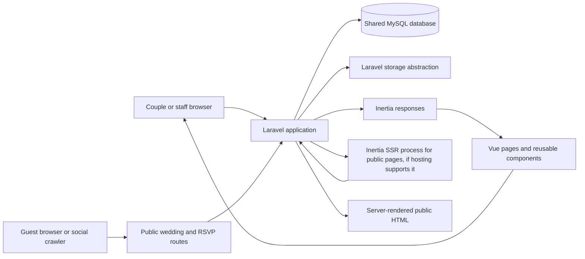
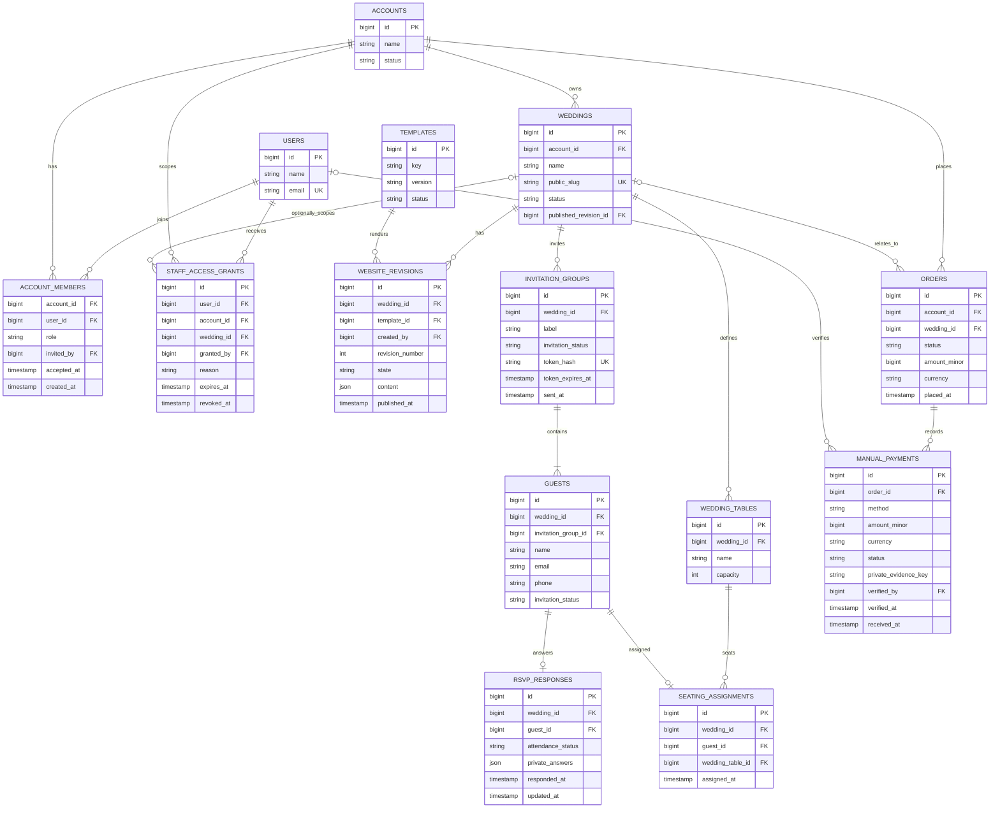

# Wedding RSVP SaaS Architecture

This document describes a proposed architecture for the Wedding RSVP SaaS. It is a planning guide, not a description of features already present in the application. No product features, migrations, or authentication changes have been implemented as part of this document.

## 1. Executive overview

### Confirmed requirements

- The application uses Laravel 12, Vue 3, TypeScript, Inertia, Tailwind CSS, Vite, and MySQL.
- The product serves multiple couples and weddings through self-service and done-for-you onboarding.
- Couples can eventually manage wedding websites, invitations, guests, RSVPs, and seating. Internal staff need customer and order management.
- Payments start as manually recorded GCash, Maya, or bank transfers. An automated payment gateway is not required at launch.
- Website content should use reusable templates and editable, reorderable sections. Draft edits must be previewable before publication.
- The first architecture should be understandable to a small team and avoid unnecessary packages, infrastructure, and service layers.

### Proposed architecture

Use a **shared-database modular monolith**. A customer account is the commercial and access grouping; an account can contain one or more weddings and multiple members. Users join accounts through memberships. Every private wedding record is scoped to its account and wedding, with Laravel policies enforcing access. Internal staff access is explicit, limited to a customer or wedding, and audited.

Represent a website as validated, structured content bound to a versioned template. Store each saved draft or published state as a revision. The public site reads only the wedding's current published revision; an authorized preview reads a draft revision. Public wedding pages should render metadata and page content on the server so social platforms can read link previews and mobile clients receive useful HTML quickly.

Keep Laravel's standard app structure while the product is small. Use conventional controllers, Form Requests, policies, models, and focused domain actions where a multi-step operation needs one. Organize Vue pages by user-facing area and reusable website sections by section type. Introduce deeper domain folders only when actual code volume or team ownership justifies them.

### Assumptions

- One customer account is the initial billing and staff-support boundary. A couple shares an account and can invite another member.
- A user may belong to more than one account and access multiple weddings.
- At launch, each wedding has one public slug on the platform's domain. Custom domains are a later option.
- Public wedding content is intentionally public after publication. Guest lists, contact details, and individual RSVP answers remain private to authorized wedding members.
- Each invited guest responds individually, allowing partial attendance within an invitation group.
- The public page needs social preview metadata. Server-side rendering (SSR) is recommended for the public site; hosting must be checked for support before that milestone. Do not add SSR infrastructure before confirming the deployment target.

## 2. High-level system diagram



The diagram shows logical responsibilities, not separate services. Laravel remains the application boundary and MySQL remains the initial system of record. Wedding images should use Laravel's storage abstraction so a production object store can be configured later without coupling content records to a storage vendor.

## 3. Recommended project organization

Keep the current starter kit layout as the baseline:

```text
app/
  Http/Controllers/       HTTP entry points grouped by area
  Http/Requests/          Input validation and authorization context
  Models/                 Eloquent records and relationships
  Policies/               Account and wedding access decisions
  Actions/                 Focused multi-step operations, when useful
  Providers/
resources/js/
  pages/                  Inertia pages grouped by account, wedding, admin, and public site
  components/             Existing shared UI components
  components/wedding-site/sections/  Reusable public section renderers
  layouts/                Authenticated, editor, and public layouts as they emerge
  types/                  Shared frontend view-model types
routes/
  web.php                 Route entry point; extract route files by area as they grow
  auth.php
  settings.php
database/
  migrations/
  factories/
  seeders/
```

The current `app/Models/User.php`, `app/Http/Controllers`, `routes/`, and `resources/js/pages/` fit this approach. Do not create empty domain directories or generic repositories now. A controller should translate an HTTP request into a validated operation and response; a policy decides access; a focused action can coordinate a transaction when an operation spans records. Keep ordinary Eloquent queries and model relationships straightforward.

Suggested frontend page areas, when implemented, are `accounts/`, `weddings/`, `editor/`, `admin/`, and `public/`. Keep wedding section renderers presentational: pass them validated data and avoid giving them direct knowledge of database or authorization rules.

## 4. Main domain boundaries

| Area | Responsibility | Likely records and behavior |
| --- | --- | --- |
| Accounts and access | Customer ownership, collaboration, staff support | Accounts, account memberships, roles, scoped staff access grants, audit events |
| Weddings and websites | Event identity and website lifecycle | Wedding, slug, selected template, draft and published revision pointers |
| Templates and content | Supported appearance and structured content | Template catalog/version metadata, section schema, revision validation, preview and publication |
| Invitations and guests | Who is invited and how to reach their invitation | Invitation groups, individual guests, invitation delivery state, secret link lifecycle |
| RSVPs | Each guest's response and attendance details | Per-guest response, response timestamp, dietary/accessibility notes where approved |
| Seating | Physical tables and guest placements | Wedding tables, capacity, one active seat assignment per guest |
| Orders and payments | Commercial order and manual payment reconciliation | Orders, PHP amounts, manual payment entries, evidence references, verification history |
| Internal administration | Support and operational workflows | Staff-only pages, scoped access, audit trail; built on account/wedding data rather than a parallel copy |

These are responsibility boundaries, not a requirement for separate Laravel packages or services. Keep the first implementation in normal Laravel conventions; separate code by domain only after repeated complexity makes the boundary useful.

## 5. Preliminary database design

The following is a conceptual starting point. It is not a migration specification. Use InnoDB foreign keys and transactions for related writes. Prefer MySQL `BIGINT` IDs for internal relations; use random public identifiers or high-entropy tokens at public boundaries. Scope tenant-owned rows to `account_id` and/or `wedding_id` as shown, and index the columns used for authorization and lookup.



### Ownership, keys, indexes, and constraints

- `accounts` represent a customer relationship; `account_members` is a many-to-many membership table. Add a unique key on `(account_id, user_id)` and index `(user_id, account_id)` for account switching. Keep roles small and explicit, such as `owner`, `editor`, and `viewer`; enforce role capabilities in policies rather than scattered string checks.
- `weddings.account_id` is the tenant ownership anchor. Index `(account_id, id)`. `public_slug` should be normalized and unique for the initial single-domain route. Use a unique constraint and a validation rule to prevent ambiguous public URLs.
- `website_revisions` stores full validated snapshots, not an evolving bag of untyped page-builder data. Enforce unique `(wedding_id, revision_number)` and index `(wedding_id, state, created_at)`. Keep the published pointer on `weddings`; change it transactionally after a revision passes validation. A revision's template version must remain available for rendering or have an explicit compatibility path.
- `templates` should have a unique key on `(key, version)` so releases can coexist while older published revisions still reference their renderer.
- `invitation_groups` separate the invitation and delivery lifecycle from each guest's attendance. Store a hash of a cryptographically random link token, never the raw token. Index by `(wedding_id, id)` and make the token hash unique. Rotate/revoke tokens without changing guest or RSVP identity.
- `guests` belong to one invitation group and one wedding. The invitation group controls who can access the invitation; each guest has an individual RSVP response, so one family can respond partially. Do not make email globally unique: families may share email addresses and a guest may appear in different weddings. Add indexes `(wedding_id, invitation_group_id)` and `(invitation_group_id, id)`.
- `rsvp_responses` should have one response per guest, enforced with a unique `guest_id`; include `wedding_id` if needed for efficient tenant-scoped access and ensure it agrees with the guest's wedding. Use database constraints/composite foreign keys where practical, plus transactional application validation. Invitation status (`sent`, `revoked`, `opened`) is not the same as attendance status (`pending`, `attending`, `declined`).
- `wedding_tables` need positive capacity. `seating_assignments` should enforce one active assignment per guest and should not exceed table capacity. A count-then-insert check can race; perform assignment changes in a transaction that locks the table row, counts current placements, and validates capacity before inserting. Preserve wedding consistency between guest, table, and assignment.
- Store money as integer minor units with explicit `currency` (initially PHP), not floating point. Manual payments should record method, received amount/time, status, private evidence key if provided, verifier, and verification time. Do not store bank credentials, card numbers, or payment passwords. Restrict and audit edits to verified payments.
- Account and wedding foreign keys should be present on all tenant-owned records or be unambiguously reachable through a constrained parent relation. Add indexes beginning with `account_id` or `wedding_id` for tenant list pages and operational queries. Use soft deletion only where retention and restore behavior are defined; do not apply it by default to every entity.

## 6. Multi-tenancy and authorization

### Tenant model

Use one shared MySQL database and shared tables. `Account` owns one or more `Wedding` records. Users join an account through `account_members`; one account can therefore be managed by both partners, and one user can participate in multiple accounts. A done-for-you customer uses the same records and editor after staff has helped set up the site.

Do not use a user ID as the tenant ID, and do not infer authorization from a wedding slug or an ID being difficult to guess. Public IDs and tokens reduce enumeration but do not replace authorization. Do not introduce a tenancy package or database-per-customer model at this stage; neither is needed for the stated product and both would add operational complexity.

### Authorization flow

1. Authenticate the member using the existing Laravel starter-kit authentication.
2. Load the account or wedding through a membership-scoped query, for example through the current user's accounts, rather than loading an arbitrary record and relying on the UI to hide it.
3. Authorize the requested operation with a Laravel policy. Apply the same policy to reads, edits, exports, file access, and background operations.
4. Validate submitted parent IDs against the authorized wedding; never trust a client-supplied `account_id`, `wedding_id`, role, or ownership field.
5. Use transactions for changes that span a wedding and its related records. Include the tenant key in lookups and updates to prevent cross-wedding reassignment.

Serialize first-workspace creation with a lock on the authenticated user's row, and serialize wedding creation with a lock on its account row. Profile deletion must also lock the user and owned accounts, and must be blocked when it would leave an account containing weddings without an owner. Ownership transfer, customer data export, and retention after account closure remain product decisions.

Use account-level roles as a starting point. If product requirements later establish different rights per wedding, add wedding memberships or scoped grants rather than encoding per-wedding exceptions in controllers. Internal staff should authenticate through the same application but have a distinct administrative capability. Grant support access to a specific account or wedding, require a reason and expiry, allow revocation, and log sensitive reads and writes. Avoid silent or permanent impersonation. Do not add staff roles or modify authentication until the product policy is agreed.

## 7. Dynamic template engine

### Patterns considered

| Pattern | Benefits | Costs and risks |
| --- | --- | --- |
| Structured section data rendered by a versioned template registry | Content is independent of design; templates share section components; section types can be validated; ordering and visibility are straightforward; templates can evolve deliberately | Requires a defined schema per section and migration/compatibility rules when schemas change |
| Freeform page builder with arbitrary blocks, layout rules, or embedded markup | Maximum customer flexibility; can model unusual layouts without a new section type | Harder validation, accessibility, responsive behavior, preview consistency, security, and support; more editor complexity; content becomes coupled to builder implementation |

### Recommendation

Use the structured, section-based model. A template is a presentation choice and a registry of supported section renderers; content is stored separately as data. A revision contains an ordered list of typed sections, each with a stable section ID, section type, visibility flag, and validated settings. Examples might include `hero`, `story`, `event_details`, `gallery`, `schedule`, and `faq`. Keep the list of supported types in application code and reject unknown types or fields on save. Never render customer-provided HTML or JavaScript as trusted markup.

Each Vue section component receives a typed, already validated view model. A small template-level component maps section types to renderers and supplies theme tokens (colors, fonts, spacing) through CSS variables or a similarly constrained theme object. Template-specific presentation can compose the same section renderers with different wrappers, typography, and layout. Avoid creating a generic drag-and-drop canvas until validated product demand shows section reordering is insufficient.

Store content in JSON for the versioned section snapshots, but keep operational entities such as guests, RSVPs, seating, and orders in relational tables. JSON is appropriate for bounded presentation configuration; it should not replace relational records that require constraints, joins, privacy controls, and reporting.

### Drafts, publication, and preview

Treat revisions as immutable snapshots after publication. Editing creates or updates a draft revision; publishing validates the whole snapshot and atomically changes the wedding's `published_revision_id`. The public route resolves only that published pointer. Retain prior published revisions for rollback and audit. Draft preview uses an expiring, signed URL or an authenticated editor session scoped to the wedding; it must never make unpublished content available through a guessable ID.

The server should provide public title, description, canonical URL, and Open Graph/Twitter image metadata from the published revision. Prefer Inertia SSR for the public wedding page if the hosting target can run the supported SSR process. Confirm this before implementing public-site rendering. If the chosen host cannot support SSR, keep the public page server-rendered with Laravel for the metadata and primary content rather than relying on client-only JavaScript for crawler-visible output.

## 8. Application routing

Use named, area-based route groups, keeping the current `routes/web.php`, `routes/auth.php`, and `routes/settings.php` conventions. Split route files only when the files become difficult to navigate.

| Area | Initial convention | Access |
| --- | --- | --- |
| Marketing and demos | `/`, `/templates/{template}` | Public; demos use non-sensitive example data |
| Customer dashboard | `/dashboard`, `/accounts/{account}/...` | Authenticated, verified account member |
| Wedding editor | `/accounts/{account}/weddings/{wedding}/...` | Authenticated member, authorized by policy |
| Public wedding website | `/{wedding-slug}` or `/w/{wedding-slug}` | Public published content only |
| Guest RSVP | `/invite/{opaque-token}` | Public bearer token, throttled, scoped to one invitation group |
| Internal admin | `/admin/...` | Authenticated staff capability and audited scoped access |

For launch, prefer `/w/{slug}` if marketing routes may need root-level paths; use a dedicated public wedding hostname only if the product/domain plan makes it worthwhile. Reserve the selected path namespace and normalize slugs. A later custom-domain feature can map verified hostnames to a wedding through a domain table and middleware while reusing the same published-site resolver. Never trust arbitrary `Host` values as a tenant selector; validate custom domains and verify ownership before activation.

## 9. Security and privacy considerations

- **Tenant leaks:** Scope all private queries and file access by account/wedding, enforce policy checks at the server, and test users from different accounts against every read and write path.
- **Invitation links:** Generate high-entropy tokens, store only hashes, throttle attempts, support expiry/revocation, and avoid logging raw tokens. Keep guest responses out of public page props.
- **Mass assignment and validation:** Use explicit Form Request rules and allowlists for section types and fields. Never mass-assign tenant ownership, roles, publication state, payment verification, or arbitrary template identifiers from user input.
- **Stored content:** Escape text, validate URL schemes, constrain colors/fonts to supported values, limit image type/size, and avoid rendering arbitrary HTML. Apply CSP and safe image handling when deployment policy is designed.
- **Personal data:** Guest names, contact details, dietary notes, and attendance can be sensitive. Collect only needed fields, restrict exports, protect uploaded evidence, define retention and deletion rules, and avoid leaking data through analytics or logs.
- **Staff support:** Require explicit scoped grants, reason, expiry, revocation, and audit events for access to customer work. Restrict payment verification to authorized staff and record who changed status and when.
- **Concurrency:** Use transactions and row locks for first-workspace creation and owner deletion, as well as publication pointer updates, invitation response writes where duplicate submissions matter, payment verification, and seating capacity enforcement. Add idempotency or optimistic version checks to avoid overwriting concurrent editor changes.
- **Public endpoints:** Rate-limit RSVP lookups and submissions, use CSRF protection for state-changing web requests, validate signed previews, and return no information that allows enumeration of guest records.
- **Backups and operations:** Define backup, restore, retention, and incident procedures before production data is collected. Keep secrets in environment configuration, never in the repository or content JSON.

## 10. Tradeoffs and alternatives

- **Shared database vs. database per customer:** Shared tables with explicit tenant keys are simpler to operate and suit the initial scale. Database-per-customer offers stronger physical separation but complicates migrations, backups, reporting, and support; reconsider only for contractual isolation or scale requirements.
- **Account ownership vs. direct wedding ownership by a user:** An account adds one membership boundary but supports partners, staff-assisted work, and multiple weddings without transferring ownership. Direct user ownership is simpler for a single-person product but becomes awkward when collaboration arrives.
- **Section CMS vs. freeform builder:** Structured sections constrain customization but make templates safer, faster, testable, and easier to support. Start structured and add section types based on demand.
- **JSON content vs. fully relational sections:** JSON snapshots make atomic publication and version rollback practical. Relational content offers stronger per-field querying but creates many tables and migration work for a shape that is primarily presentation. Keep guests, RSVPs, seating, and commerce relational.
- **SSR vs. client-only public pages:** Client-only pages are simpler to deploy but social crawlers may miss metadata/content and first render depends on JavaScript. SSR improves crawlability and initial HTML, with the cost of confirming Node runtime support. Public pages should not be considered ready until the deployment choice is known.
- **Modular monolith vs. microservices:** A single Laravel application keeps transactions, authorization, and deployment straightforward for a small team. There is no current scale or organizational need for separate services.
- **Manual payments vs. gateway:** Manual recording matches the initial consultation-led sales process. It needs reliable verification and audit history but avoids gateway integration and automated billing work until the business needs them.

## 11. Development and testing strategy

### Suggested implementation milestones

1. **Account and wedding foundation:** Define account ownership, membership invitation/acceptance, wedding creation, roles, policies, and tenant-scoped query conventions. Add cross-account authorization tests before exposing customer records.
2. **Website revisions and templates:** Add template metadata, section schemas, validation, draft save, preview, publish/rollback, and version compatibility rules. Test malformed sections, unknown section types, unauthorized previews, and atomic publication.
3. **Invitation and RSVP workflow:** Add groups, guests, hashed tokens, invitation state, and per-guest responses. Test partial household attendance, token expiry/revocation, throttling, duplicate submissions, privacy, and concurrent updates.
4. **Public site and editor experience:** Render the published snapshot through reusable Vue section components, provide server-readable metadata, and verify mobile layout/performance. Choose SSR only after confirming hosting support.
5. **Seating, orders, and staff tools:** Add table capacity and assignments with transactional checks, manual order/payment records with audit trails, then scoped internal administration. Keep each area behind policies and domain-focused tests.

### Essential tests

- A member can only list, view, edit, publish, export, and access files for accounts and weddings they are authorized to access.
- A member from another account cannot access a wedding even with a valid numeric ID or slug. Include direct route, nested relation, and file URL cases.
- Owners can invite and remove account members according to policy; role changes cannot be made by unauthorized editors.
- Published pages return only published content; draft previews require the right access and cannot be retrieved after expiry/revocation.
- Content validation rejects unknown sections, unsupported keys, unsafe URLs, and invalid theme values; each supported section schema has representative valid/invalid cases.
- RSVP token lookup does not reveal whether arbitrary guests exist; valid links are throttled and revocable; household guests can respond independently; repeated or concurrent submissions follow a defined update policy.
- Seating assignment enforces one seat per guest, same-wedding ownership, positive capacity, and no over-capacity result when concurrent changes occur.
- Payment verification is restricted, transaction amounts/currency are preserved exactly, and history records verifier and time.
- Vue component tests should focus on reusable section rendering, editor field behavior, and accessible interaction states. Use component tests only where conditional UI behavior warrants them; keep domain rules in Laravel tests.

### CI

Start with the repository's existing Laravel and frontend tools. CI should install locked Composer/npm dependencies, run PHP formatting checks, Laravel tests against an isolated test database, TypeScript checks, ESLint without auto-fix, and a production Vite build. Use a dedicated CI MySQL service or an isolated SQLite test database; never point tests at development or production data. Add dependency auditing on a regular schedule. Do not add browser automation, a new test framework, or extra infrastructure until an important user journey needs it.

## 12. Potential overengineering to avoid

- Do not split the app into microservices or add a tenancy package before a concrete isolation requirement appears.
- Do not implement a generic page builder, arbitrary HTML blocks, or user-authored JavaScript when structured sections meet the stated need.
- Do not create generic repositories, event buses, plugin systems, or empty domain modules for CRUD that Eloquent and policies can handle.
- Do not build subscription billing, payment gateway integration, custom domains, or full impersonation workflows before product decisions and demand justify them.
- Do not persist analytics or denormalized attendance totals before measuring a query problem; derive dashboard counts from indexed RSVP records first.

## 13. Product questions to resolve before the related milestones

1. Can one customer account own multiple weddings, or should the first plan enforce one active wedding per account? This proposal permits multiple.
2. Which account roles and actions are needed at launch, and can an invited partner change billing or only wedding content?
3. What support access may staff use, who approves it, and which views or changes must be logged?
4. Which guest fields are required? Can couples collect dietary/accessibility notes, and who can see them?
5. Are plus-ones named guests, anonymous seats, or disallowed? The proposed per-guest RSVP model assumes every attendee is represented as a guest record.
6. Can an RSVP be edited after submission, until what deadline, and what happens when the invitation token is reused?
7. Which RSVP summaries may be visible to guests, if any? The default assumption is that individual responses and guest lists are private to wedding members.
8. What happens to guest and payment data after a wedding, cancellation, or account closure? Define retention and export/deletion policy before production collection.
9. What order statuses, deposits, refunds, and evidence are required for manual payment operations? Initial payments are recorded and verified manually; accounting policy is not specified.
10. Which domain and hosting provider will serve public sites, and can the selected host run Inertia SSR? This determines the public rendering implementation and later custom-domain path.
11. What should a template change do to existing customized sections when the new template does not support them? The proposal preserves content and validates it against explicit template compatibility rules.

## Recommended first milestone

Start with **account and wedding ownership plus authorization**, before building the CMS or guest workflows. It establishes the tenant boundary that all later records will depend on. The milestone is complete when an owner can create an account and wedding, invite a second member, use explicit policies for each operation, and pass automated tests proving that another account's member cannot read or mutate those records. Keep registration behavior changes and billing decisions out of this milestone until their product rules are approved.
