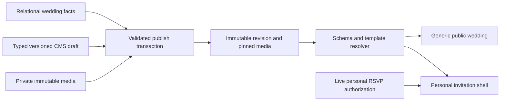

# CMS v2 and premium wedding website plan

**Current DEL-04 / D-045:** DEL-03b.1 owner-accepted 14/14. Published Enchanted now reuses existing 5C private greeting/self-dependent form and transactions; guest state stays outside immutable CMS snapshots/generic props. 427 SQLite/45 InnoDB/58 frontend checks pass. Owner DEL-04 acceptance pending; production/5D and full DEL-07 remain inactive/deferred. Loader/first Hero handoff and FRONT/LEFT/RIGHT waypoint contract unchanged. [Exact contract, commands and walkthrough](del03a_draft_persistence_contract.md#11-del-04--personalized-enchanted-rsvp-integration). Earlier closeouts retain their historical scope.

**Latest DEL-03b.1 / D-044:** focused empty-photo/direct editor publishing/desktop smooth nav and original loading-bird/Hero handoff delivered. 87 SQLite tests/820 assertions and 51 distinct frontend/browser/contract cases verified; owner review pending. [Exact contracts and evidence](del03a_draft_persistence_contract.md#10-del-03b1--focused-preview-publishing-and-loader-polish). First-landing only; DEL-04, full DEL-07 prototype/scroll flight and production gates stay separate.

**Latest 2026-10-22 / D-043: DEL-03a.2 owner-accepted (17/17); DEL-03b implemented and verified, pending its own owner acceptance.** Existing immutable publisher now supports controlled generic Enchanted snapshots/current-visible media, saved-state owner workflow, escaped fallback and mobile smooth/hash navigation. 427 SQLite/31 InnoDB/47 frontend cases pass; production and personal Enchanted remain denied. [Exact contract, commands, screenshots, isolated walkthrough and DEL-04 dependencies](del03a_draft_persistence_contract.md#9-del-03b--immutable-publishing-and-public-wedding-website). Stop after DEL-03b; following latest/historical paragraphs retain their execution-date scope.

Historical closeout 2026-10-22 / D-042: **DEL-03a.2 final UX polish/waypoint foundation implemented; owner review pending.** One linked warning summary, notice backgrounds, empty-gallery guidance, accessible mobile menu in live/saved previews, subtle reduced-motion-aware dissolve and stable section/milestone markers/discovery. Outstanding slideshow on/off/5–8–12/hidden Gallery Save/reload checks pass; existing media/Fit/Fill/crop/focus/old source preserved. **120 isolated PHP passes/508 assertions; 63 distinct affected frontend/browser/contract cases verified**; types/scoped quality/build pass using approved temporary WASM tooling. [Exact evidence, screenshots and fresh preview](del03a_draft_persistence_contract.md#8-del-03a2--final-ux-polish-and-hummingbird-preparation). DEL-07 records FRONT/LEFT/RIGHT and the waypoint contract only; no bird/animation engine, public activation, development database operation or RSVP/5D change. Stop after DEL-03a.2. Earlier closeouts retain historical scope.

Current 2026-10-22 (D-040): **DEL-02e owner-accepted; DEL-03a persistent owner drafts/private preview implemented and automatically verified, pending manual acceptance.** [Approved DP-01–03, exact code/results and DEL-03b prerequisites](del03a_draft_persistence_contract.md#6-del-03a-implementation-and-verification-closeout-2026-10-22). Shared optional slots, canonical IANA timezone/default and fail-closed v1/template-transition policy are approved and implemented. Existing single draft/counter, private media and full source are reused; no public publication/customer activation or development migration/reset. Earlier evidence below is historical. D-034 auto-slide and full premium-template/commercial acceptance remain separate.

Historical visual-trial closeout: D-030 records approval of the B.2a desktop direction and authorizes the **complete CMS-B.2b visual trial**. Section 16 records its reusable story/countdown/gallery/entourage/RSVP delivery and actual verification. Full owner acceptance and all customer CMS integration remain pending; earlier implementation sections preserve their historical scope.

Historical B.2a visual scope (direction subsequently approved by D-030): D-029 authorizes the isolated **CMS-B.2a Enchanted Editorial** header/hero + first details slice. Section 15 records delivery/verification. Enchanted Weddings is preferred; Romantic Wedding Story is the secondary wedding-content reference, distinct from Floral Trial. Both visual trials remain owner-review pending. No customer CMS-v2 integration is enabled.

Prepared: 2026-10-20 as an architecture proposal. **CMS-A.1 contracts and CMS-A.2 persistence are implemented under D-026/D-027; the broader customer/visual/media design remains proposed.** D-024 approves prioritizing CMS v2/premium planning and postponing Seating, superseding the timing restriction in D-010/D-018. Milestone 5C remains manually accepted, individual RSVP active and legacy group authority retired. Remaining customer/media-delivery/design contracts and revised MVP/pilot scope still require approval.

**Current implementation status (D-026–D-028): A.1/A.2 are automatically verified; B.1a is an implemented isolated visual trial, pending owner design review.** Sections 12–14 record contracts, persistence, visual evidence and verification. Customer v2 paths remain unavailable; A.2 migrations have not been applied to development MySQL. Botanical Bloom uses provisional art; the other four intros are unimplemented. Final FD-01–FD-06 desktop/motion/fidelity/rights review and broader customer integration remain open.

Sources: [implemented architecture](../architecture.md), [decisions](../decisions.md), [canonical roadmap](../mvp_roadmap.md), [specification](../product_spec.md), [issue register](../risks_and_followups.md). 5D withdrawal remains required before the customer pilot and before any future Seating implementation; [W01–W06](milestone5d_invitation_withdrawal.md) remain unapproved. S01–S06 are unapproved; Seating is postponed, not cancelled. Internal Admin/assisted onboarding/manual payments, release security and pilot acceptance remain future requirements.

**Owner addendum (D-025):** Figma is a design specification source; require at least five customizable intro designs selectable independently of the website template. Names/visuals remain provisional. The [first official Figma trial specification](figma_first_trial_design_spec.md) records actual MCP inspection, screenshots, measurements, reusable units and deviations. This updates the proposal and batch plan only; final architecture and the first selected reference need approval before implementation.

## Current Premium Delight ordering — D-031 (2026-10-21)

[Premium Delight experience](premium_delight_experience.md) qualifies the **unimplemented** A–E work in this document. Approved direction: reusable content, preview-first guided editor/images, connected private drafts/previews/immutable publishing and holder/dependent-only personal RSVP **before** interactive story/accurate confirmation/music, lightweight 2.5D/hummingbird and five intros. Completed A.1/A.2/B trials retain their evidence; overall Enchanted direction is approved, full-template acceptance is not. Proposed DEL-01–10 slices are separately authorized work, not implementations.

The private hummingbird GIF supplies anatomical/motion inspiration only. Plan original or licensed colorful botanical SVG, independent fast blurred-wing stationary hover and slow short curved flight. Later prototype review on Enchanted precedes reusable integration. Music policy/limits, timezone and final visuals still require specific approvals. Video hosting/processing, AI assistants and WebGL are deferred from this cycle. DEL-01 now supplies the internal disabled-intro and known-section preservation contracts; customer integration and all new delight effects remain pending.

## 1. Reference review and current CMS findings

Current batch addendum (D-028): CMS-B.1a now implements an isolated Floral Trial/Botanical Bloom visual preview; see Section 14. The earlier A.2 stop/approval statements remain historical. No customer v2 activation or full design acceptance is implied; provisional art and FD-01–FD-06 review remain open.

Reference review attempted on 2026-10-20:

| Owner reference                                                                                   | Access and evidence                                                                                                                                                                                                 |
| ------------------------------------------------------------------------------------------------- | ------------------------------------------------------------------------------------------------------------------------------------------------------------------------------------------------------------------- |
| [Aldrin–Trish Canva](https://dreamweddesigns.my.canva.site/aldrin-trish/home#page-0)              | Reference viewer could not open it. Direct HTTP returned 200 and a JavaScript shell titled Home; extracted static content did not expose a reviewable invitation. Layout, assets and interaction were not verified. |
| [Rich–Ira Canva](https://dreamweddesigns.my.canva.site/rich-ira-wedding/home#page-0)              | Same limitation: reachable shell, without verifiable rendered content or interaction.                                                                                                                               |
| [Figma prototype](https://www.figma.com/proto/pkzNdGriZUkOzhTD4WvYG1/Wedding-Website--Community-) | Reference viewer could not open it. Direct HTTP returned a Figma client shell, not reviewable prototype frames.                                                                                                     |

The earlier three-reference review above remains historical and did not verify those designs. The later owner-supplied [first trial file](https://www.figma.com/design/ibQ6WfXWt7sG2oPiRzIRvP/Wedding-Invitation-App--Copy-.--Community-?node-id=0-1) was successfully inspected through official Figma MCP on 2026-10-20: context/screenshots for five frames, an attendance screenshot, local colors/components and prototype reactions. It contains a floral static intro and mobile wedding-app compositions, not five envelope experiences or a desktop responsive specification. See the [extracted specification](figma_first_trial_design_spec.md); select actual frames and approve missing responsive/motion details before implementation. Do not copy unlicensed artwork, fonts, music or photos.

Inspected Laravel 12.70.0 / Inertia Laravel 2.0.28, current Vue/TypeScript source and migrations:

| Existing implementation                                                                                                        | Preserve / change needed                                                                                                                                                                                                                                     |
| ------------------------------------------------------------------------------------------------------------------------------ | ------------------------------------------------------------------------------------------------------------------------------------------------------------------------------------------------------------------------------------------------------------ |
| `WebsiteDraft` / `website_drafts`: one row per wedding, schema version 1, JSON content, `lock_version`, private hero disk/path | Retain the one-draft model and optimistic save contract. Current schema accepts two plain-text messages and three visibility booleans, not arbitrary sections.                                                                                               |
| `UpdateWeddingInvitationRequest` and `WeddingInvitationController`                                                             | Preserve owner policy, unknown-key rejection, wedding-first locking, strict multipart booleans and stale rejection. Current multipart JSON decoding is capped at 16 KiB/depth 8; v2 needs an explicitly bounded separate contract, not an unlimited payload. |
| `InvitationEditor.vue` and `Preview.vue`                                                                                       | Live preview uses local form/object-URL state; saved preview is private. Both hardcode `ModernClassicInvitation`. Keep their saved/unsaved distinction and replace dispatch only for approved v2 paths.                                                      |
| `WeddingPublication` / `WebsiteRevision`                                                                                       | Existing draft/publication versions, fingerprint checks, immutable snapshot rows, atomic pointer updates and no-op publication provide the correct foundation. Fingerprinting/validation currently hardcode schema 1 and one hero photo.                     |
| `PublishedWedding`, `public/wedding.blade.php`, `public-invitation.ts`                                                         | Laravel delivers escaped body/metadata and Vue enhances it without a separate SSR server. All hardcode Modern Classic/schema 1. Add schema/template-specific dispatch and fallback parity, not another web application.                                      |
| `WeddingHeroPhotoProcessor` / private `wedding_photos` disk                                                                    | JPEG/PNG/WebP, 5 MiB/12 MP/6,000px input; GD/EXIF orientation/metadata removal; immutable 1,600px WebP output. Current cleanup protects draft and every historical revision. No multi-asset, audio/video processing or media table exists.                   |
| `Wedding::presentationData()`                                                                                                  | Canonical names, date, local time and two venue strings are relational. No explicit event timezone exists; current renderer formats a calendar date/time rather than a countdown instant.                                                                    |
| `PersonalRsvp`, `PersonalInvitation`, `PersonalRsvpForm`                                                                       | Self/dependents-only live authority is separate from immutable wedding content. Preserve authorization, opaque references, versions, atomicity, CSRF, limiters and privacy; replace the hardcoded invitation child, not the permission model.                |

No database records were inspected or changed. Existing engine evidence remains 23 passed isolated InnoDB cases; it does not verify future CMS/media races.

## 2. Proposed schema, registries and template contract



The published website and operational RSVP state meet only in the authorized personal presentation; credentials and responses never enter the CMS snapshot.

### Persistence and ownership

Keep the modular monolith and existing tables. Proposed additions, subject to CMS-01 approval:

- `website_drafts` and `website_revisions`: `template_key` and positive `template_version`, initially defaulting legacy rows to `modern-classic` / 1. Keep the existing `schema_version` column; do not duplicate these metadata fields inside content JSON. A template version is a rendering contract; a schema version describes content.
- `weddings.timezone`: validated IANA identifier, proposed default `Asia/Manila`. Keep existing wedding date/time; snapshot the timezone and the server-resolved start instant with published wedding facts. Date-only weddings have no countdown until a time is provided; never invent midnight. Validate ambiguous/nonexistent local times for supported zones rather than guessing an offset.
- `wedding_media_assets`: one immutable processed asset per UUID primary key, indexed wedding FK, kind, guarded disk/path, MIME, byte size, dimensions where relevant and timestamps. Proposed wedding FK RESTRICT prevents accidental media purge; ordinary lifecycle errors must remain understandable. Add duration metadata only when CMS-D enables audio/video. No generic media library, duplicate account key or delivery/analytics fields.
- `website_revision_media`: composite unique revision/asset reference with restrictive FKs. It pins published assets against cleanup without scanning every revision JSON. Foreign keys alone do not establish same-wedding ownership: publishing must validate both ends under the wedding lock. Retention/purge rules remain RF-010/RF-011.

Draft references can remain typed asset UUIDs in bounded JSON; the single current draft is rechecked under the wedding lock before cleanup. No draft-section tables, template database/CMS, theme tables or operational guest copies are needed. No migration/reset is executed by this plan. Review exact DDL before any later development application; disposable data does not justify dropping accepted records routinely.

### Code-owned contracts

Use a small static template catalogue and typed section definitions in the application, not a generic plugin framework:

- Template manifest: key/version, supported schema versions, supported/required section types, multiplicity, allowed ordering zones, approved theme/font tokens, interaction capabilities, Vue renderer, Blade fallback and stylesheet/Vite entry.
- Section definition: discriminated type, explicit allowed data keys, save/publish validation, bounded entries, defaults and safe public projection. PHP is authoritative; precise TypeScript unions mirror it. Test shared fixtures to detect contract drift; do not install a schema-codegen system initially.
- Every section and repeatable entry has a stable UUID within its containing document/list. The UI may allocate unsaved UUIDs; Laravel validates shape/uniqueness. These are content identifiers, never ownership credentials, CSS classes or database permission grants. Section array order is presentation order.
- Unsupported schema, template/version or type fails closed; no best-effort rendering of unknown JSON. Keep separate v1/v2 validators. Do not merely change `SCHEMA_VERSION = 2` and break existing drafts, snapshots and personal access.

Illustrative future stored row, not final persistence API syntax. For the narrower implemented A.1 contract, see Section 12 and the shared fixtures; optional media/music and theme overrides are deliberately not accepted by A.1:

```json
{
    "schema_version": 2,
    "template_key": "floral-trial",
    "template_version": 1,
    "content": {
        "theme": { "palette": "ivory-ink", "font_pair": "editorial-serif" },
        "experience": {
            "enabled": true,
            "intro_style": "botanical-bloom",
            "intro_version": 1,
            "intro_settings": {
                "opening_text": "A celebration awaits you",
                "open_label": "Open invitation",
                "font_preset": "script-serif",
                "palette_preset": "blush-terracotta",
                "theme_overrides": {},
                "variant": { "artwork_preset": "approved-botanical-01" }
            },
            "music": { "enabled": false, "asset_id": null }
        },
        "sections": [
            {
                "id": "00000000-0000-4000-8000-000000000001",
                "type": "welcome",
                "enabled": true,
                "data": { "message": "Join our celebration", "photo_id": null }
            }
        ]
    }
}
```

`floral-trial`, `botanical-bloom` and the example presets are proposed identifiers, not approved designs/assets. Website `template_key` and `experience.intro_style` are independent. Intro selection/version/settings live in validated `content.experience` in both draft and immutable published content, not guest/RSVP tables or a template-specific section. Enforce exact root/nested keys, type-specific object shapes, strict booleans, finite numbers, unique IDs/types and list limits. No arbitrary HTML, expressions, CSS, script, component names or upload paths. Use plain text and structured links; validated HTTPS venue/registry links are navigated directly, never fetched by the server. Reject credentials, unsafe schemes and unapproved embed hosts.

Proposed envelope: at most 16 singleton section types, 128 KiB serialized CMS content/depth 12, plain messages 500 characters, longer prose 2,000 per field. Save validates structure/safety and allows incomplete optional content; Publish additionally requires complete enabled sections, required wedding facts, compatible template, valid timezone and ready owned assets. Disabled content stays editable but is excluded from public HTML/JSON/media delivery. Bounds are proposals, not implemented limits.

### Versions, publication and backward compatibility

- Preserve `lock_version` per draft and wedding `publication_version`. Template/theme/order/media-reference changes participate in the same stale-save check. Fingerprints cover schema/template contract, canonical JSON, relevant wedding facts/timezone and immutable asset identities, never temporary URLs or browser playback state.
- Resolve/process media before long locks. For writes use Wedding first, then draft and media rows in deterministic order, then revision/bindings/pointer. Never acquire a media lock and then wait for Wedding. RSVP retains its existing Wedding → Group → Guests → Credentials → Delegations → Responses sequence; CMS work does not add an RSVP conflict gate.
- Publish validates current expected draft/fact fingerprint/publication versions in one transaction, creates a snapshot plus pinned media bindings, then switches the pointer. Identical publication is a no-op. Further draft edits and replaced files do not alter published content; failed publication changes neither snapshot pointer nor saved draft.
- Retain Modern Classic's v1 handler, renderer, styles and fallback unchanged; register it explicitly rather than silently converting rows. No bulk historical-data migration is needed. First premium usage may start a new v2 draft; changing an existing v1 draft requires an explicit owner-reviewed replacement/conversion policy (CMS-05), preserving its currently published snapshot until republish. No automatic downgrade or silent field loss. Compatible v2 template switches should retain unsupported sections privately and warn which are not displayed.
- Pin template rendering versions. Keep supported old renderers while referenced; a layout-breaking change gets a new template version. Snapshots freeze data, not an archival copy of deployed HTML/CSS; compatible security/accessibility fixes may still change output. Do not promise pixel-identical historical replay or build rollback/history UI now.

## 3. Typed sections and canonical data ownership

All maxima below are initial review proposals, not an approved product promise.

| Section / settings       | Typed content and proposed bounds                                                             | Data owner / rendering notes                                                                                                                                                                              |
| ------------------------ | --------------------------------------------------------------------------------------------- | --------------------------------------------------------------------------------------------------------------------------------------------------------------------------------------------------------- |
| Welcome / cover          | Plain introduction, optional image asset, optional decorative video/poster after CMS-D        | Couple names/date remain Wedding facts. Envelope message is a bounded experience setting, not arbitrary templating.                                                                                       |
| Countdown                | Enable flag; target derives from canonical date/time/timezone                                 | Server emits ISO UTC instant plus event zone; JS calculates remaining time, clamps at zero and refreshes after tab visibility changes. No duplicate editable date in CMS. Static date/time/zone fallback. |
| Our Story                | Up to 8 identified entries: title, optional date label, body, optional photo                  | Presentation JSON; no guest association.                                                                                                                                                                  |
| Gallery                  | Up to 24 identified images with alt text and optional captions                                | Media UUIDs, stable order; lazy images. Accessible optional lightbox, keyboard and close/focus behavior; no large gallery package initially.                                                              |
| Entourage                | Up to 12 identified role groups, each up to 20 identified display names                       | Published CMS names, not Guest IDs/RSVP records. Include only with permission; no contacts.                                                                                                               |
| Wedding details / venues | Ceremony/reception keyed details: address, directions text, validated map/directions links    | Existing venue strings remain canonical Wedding values. CMS adds presentation details without duplicating the editable venue name/date/time. No embedded maps or external geocoding initially.            |
| Timeline                 | Up to 20 entries: local time, optional date, title, short description                         | Use wedding date by default and its zone. Server resolves explicit instants where needed; no cross-midnight guessing.                                                                                     |
| Dress code               | Plain guidance, optional illustration, up to 8 validated color swatches                       | Attire palette is content, distinct from website theme colors; labels convey meaning without color alone.                                                                                                 |
| Gifts                    | Plain guidance and up to 3 labeled HTTPS registry links                                       | No platform payment gateway. Publishing bank details/QR/payment imagery requires a separate privacy/rights decision; do not expose private account/payment records.                                       |
| FAQ                      | Up to 15 identified question/plain-answer pairs                                               | Accessible disclosures; answers remain present in server fallback.                                                                                                                                        |
| Reminders                | Up to 10 short identified messages                                                            | Information only; no automated sending or deadlines enforcement.                                                                                                                                          |
| RSVP information         | Bounded invitation instructions                                                               | Personal shell owns actual response controls and safe identity data. Generic public page only explains using the personal link; no guest form/token/list.                                                 |
| Closing                  | Plain closing/sign-off                                                                        | Optional visibility; preserved privately when hidden.                                                                                                                                                     |
| Theme / interactions     | Approved palette/font pair, independent intro style/version/settings, explicit optional music | Code-owned tokens/capabilities; no font upload, arbitrary URL, global CSS or user scripts. Intro choice is separate from website template                                                                 |

First template fixes welcome and essential details in sensible positions and keeps personal RSVP reachable. Offer Show/Hide and Move up/Move down only in template-approved middle-section zones; do not require drag-and-drop. Hidden CMS RSVP copy must not disable the operational personal RSVP form. Optional sections are singleton blocks with bounded repeatable children; do not allow nesting arbitrary sections.

Start with approved palette/font presets. A later bounded color override may use named hex tokens with contrast validation; no general style editor. Customer portal stays Horizon Minimal monochrome and its theme remains independent of invitation design. Fonts and decorative artwork must be licensed and self-hosted where practical.

## 4. Media storage, processing and retention

- Preserve v1's private photo pipeline and paths. New assets use a non-serving private `wedding_media` disk/prefix and server-generated immutable keys. Authorize each upload/recovery through the wedding owner; never accept a path/disk as customer input. A UUID is an identifier, not access control.
- An upload creates a processed owned asset, not a draft change. Draft attachment happens only on explicit versioned Save. Use small independent uploads rather than a multipart form containing an entire gallery. Processing/upload failure leaves the saved draft/publication intact; safely orphaned uploads are private and eligible for delayed cleanup.
- Reuse image orientation/metadata stripping and current 5 MiB/12 MP/6,000px validation. Initially retain the proven 1,600px static WebP output; preserve aspect ratio/alt text and allocate dimensions to avoid layout shifts. Responsive derivatives can follow measured need; do not silently raise existing limits. Proposed current-document limit: 32 distinct image assets including gallery; storage/history quota requires CMS-03 approval.
- Ready asset bytes/metadata never change under an existing UUID. Replacement makes a new asset. Publication pins all retained snapshot references, including private disabled content. **Public media delivery checks the current published revision's visible projection**, not merely any historical/pinned binding. Hidden, unreferenced and historical-only media stay private. Unpublish removes page/media access; already downloaded copies cannot be recalled.
- Draft preview assets require current owner authorization; no reusable public draft URLs. Public asset URLs derive from published slug/asset identity and never contain a personal token. No internal paths, contacts or secrets enter props.
- Pruning is dry-run-first, grace-period based and rechecks the current draft plus all revision bindings under Wedding lock. Foreign-key restrictions backstop pinned assets; failed/uncertain commits defer cleanup. Keep RF-010's historical retention issue open; never delete all unreferenced-looking JSON assets blindly.
- Audio/video delivery needs authenticated draft versus published-only checks, correct MIME/nosniff/private headers and tested HEAD/byte-range support for seeking. Current WebP streaming is not automatically a safe/efficient video delivery implementation.

## 5. Independent introductions and progressive enhancement

### Shared contract and five distinguishable variants

Recommend a small Vue `InvitationOpening` host around an independently resolved website renderer, with separate visual components where their structures differ. Use native CSS transitions and approved licensed assets; no animation dependency. The host owns state `closed → opening → open`, Open/Skip/Replay, focus, cancellation and music handoff. It never grants authentication or RSVP authority. The intro manifest owns key/version, compatible schema versions, settings allowlist/defaults/bounds, curated fonts/palettes/assets, capabilities, renderer/fallback and approved design-spec references. All five must compose with every supported v2 website template; choosing an intro does not select another website template.

The following are **proposed art directions**, not five existing inspected/approved Figma designs. Final names, geometry, timing and asset choices require reference approval for each design:

| Proposed style/key                              | Distinct structure and opening                                 | Variant-only settings/capabilities                                                                                    | Reference status                                                         |
| ----------------------------------------------- | -------------------------------------------------------------- | --------------------------------------------------------------------------------------------------------------------- | ------------------------------------------------------------------------ |
| Royal Wax Seal / `royal-wax-seal`               | Sealed layered envelope; activate seal, lift flap, reveal card | Curated seal/monogram and liner presets; bounded seal accent; no photo slot initially                                 | Closed/open/mobile/desktop frames and motion pending                     |
| Classic Ivory Letter / `classic-ivory-letter`   | Letter sleeve with a sliding paper invitation; no wax seal     | Curated paper/edge and letter-heading presets                                                                         | Frames and motion pending                                                |
| Botanical Bloom / `botanical-bloom`             | Floral-framed cover, foliage reveals the invitation            | Licensed artwork preset and bounded botanical accent; no arbitrary uploaded SVG                                       | `81:146` candidate static cover only; bloom motion/desktop still pending |
| Modern Folded Card / `modern-folded-card`       | Two geometric panels unfold around a central card              | Curated fold direction/edge treatment and bounded panel accent                                                        | Frames and motion pending                                                |
| Romantic Photo Reveal / `romantic-photo-reveal` | Photo-backed cover opens through a curtain/mask reveal         | Optional owned processed photo, alt text, bounded focal/crop preset and readability scrim; curated fallback if absent | Frames and motion pending                                                |

These differences must be visible in approved closed/open screenshots and interaction; five palette swaps of one envelope do not satisfy acceptance. A sixth style adds one manifest/settings validator/renderer/fallback/spec/test data set using the same host/editor/publisher contract, without redesigning storage or introducing template-specific intro branches.

### Settings, ownership and lifecycle

- Common editable appearance: bounded `opening_text` (proposed 500 characters), `open_label` (60), `font_preset`, `palette_preset`, allowlisted `theme_overrides` (semantic background/surface/text/accent/on-accent only) and a discriminated `variant` object. Exact presets, token values and color-override bounds remain CMS-04 approval items. Validate contrast against actual text roles; decorative accents cannot become illegible text. No arbitrary CSS, markup, font URLs/uploads, remote image paths or component names.
- Couple names are editable canonical Wedding facts, shown in the intro from the same preview/published presentation as the website. Link the intro editor to the existing wedding-name editor; do not create independent conflicting names inside each intro. If separate display aliases are desired, approve their semantics first. Published names are frozen facts; draft name changes do not alter the current revision.
- Typography/colors/copy are common; seal/liner, paper, botanical art, folds and photo/focal/scrim controls are variant-specific. Artwork is a code-owned licensed preset; photo IDs refer only to processed assets of the authorized wedding. The host sees safe presentation data, never credentials/guests/responses. Operational opening state is not CMS content.
- Store selected `intro_style`, pinned `intro_version` and validated `intro_settings` in `content.experience` in the current draft and immutable published snapshot. Existing `schema_version`, website template version, draft/publication counters remain separate. The canonical fingerprint includes the entire intro contract/settings and referenced immutable media. Saving intro changes uses the existing wedding-first transaction/stale-save contract. Publish reloads/revalidates the saved selection/settings and pins assets atomically; unsaved preview cannot become published content.
- Unknown style/version/settings, incompatible schema and cross-wedding assets fail closed. Incomplete optional media may remain in a structurally valid draft but enabled publishing requires its selected style's completed requirements or explicitly approved fallback. Publish failure leaves draft/publication intact. Identical content remains a no-op; republish and unpublish keep current immutable-history behavior.
- Template switching preserves the independent intro selection/settings; intro switching preserves the website and its content. The proposed editor carries common settings across style changes, confirms removal/reset of incompatible variant settings, and previews before Save; it does not silently reinterpret photo data as artwork. Keep unsupported inactive variant data out of the selected settings object. Cancel leaves the saved selection intact.
- Keep v1 Modern Classic rows and renderers unchanged, implicitly without a new intro. Do not enable v2 intros by adding unknown keys to schema 1. Existing-customer conversion remains CMS-05; independent selection is a v2 contract and must not require restyling Modern Classic.

### Interaction and progressive enhancement

- Server HTML contains the cover plus real wedding content and a working link to the content. Without JavaScript, that link/normal scrolling reveals the complete static invitation. Do not globally hide content until JS happens to succeed.
- After handlers are ready, enhance to the closed-envelope interaction. Use native labeled buttons, Enter/Space/touch, visible focus and clear skip access; never a mouse-only clickable illustration. Decorative envelope layers are aria-hidden. Manage focus to the main heading after opening; remove temporary inert/scroll locking even if an animation is cancelled.
- Animate each variant's approved geometry with transforms/opacity; the earlier 600–900ms suggestion is not a source measurement or universal setting. The trial cover has no specified transition; obtain approved states/easing/durations before adding motion. Do not wait for every gallery image, music or video before allowing access. Handle missing transition events with a bounded completion fallback; rapid clicks must not restart it or trigger duplicate audio.
- Reduced-motion uses an immediate reveal/short fade and a static background; Skip always works. Continuous video has an accessible Pause control. No parallax/scroll hijacking. Respect small screens, safe areas and 390px layouts.
- Opening state stays in component memory. Do not put bearer URLs or guest identity in localStorage/sessionStorage, analytics, referrer URLs, opening-state query strings or history. Do not persist an opened state keyed by the full invitation URL. Personal greeting derives only from authorized backend data; no user-supplied expression substitution.

Provide Replay opening in preview and an unobtrusive accessible replay control for visitors after reveal. Replay resets only intro UI, never answers/access, saved draft, navigation history or publication. Restore focus sensibly; replay/skip must not restart a paused soundtrack or create a second audio element. Music is owned once by the shared experience host, optional/off by default; explicit consent triggers playback directly from the user gesture. Reduced motion uses immediate reveal on both Open and Replay. Final control placement requires reference approval. No-JS shows full readable content with ordinary links; RSVP submission retains its existing JS requirement.

### Figma-to-Vue quality contract

Every website template and intro variant needs a design specification before implementation: source file/frame IDs and dated source screenshots; target viewport sizes; section order/layout; font files/weights/licensed sources; semantic colors; measured spacing/sizes; images/vectors and asset rights; responsive rules; closed/open/skip/replay/failure/reduced-motion states and transition values; required CMS fields; and explicit deviations. Mark absent evidence unknown rather than inventing it. The [first trial extraction](figma_first_trial_design_spec.md) starts that record; it is not yet complete/approved for desktop, assets or intro motion.

Inspect actual Figma context/screenshots/variables/component properties through official MCP when available; use explicit owner screenshots/assets and measured specifications if disconnected. Generated code is reference material, not production Vue. Build section by section with Vue 3 + TypeScript, existing Laravel/Inertia/public Blade conventions, semantic responsive HTML/CSS, reusable components/tokens and existing dependencies. Use static assets only when needed and licensed; never use source screenshots as the implemented page or temporary Figma URLs as runtime assets.

Capture actual browser screenshots with matched viewport, content, fonts/assets and opening state. Compare against dated Figma screenshots; report geometry/type/color/crop/motion discrepancies with severity, fix and retest evidence. Resolve material differences before owner approval and record remaining accepted deviations. Never claim high fidelity from code inspection or tests alone. Owner approval is separate for each of the five completed designs and the website trial.

## 6. Music, video and runtime approval

Current direction under D-031: optional licensed music is planned, subject to the policy/runtime gate in [Premium Delight Section 6](premium_delight_experience.md#6-optional-music-policy-before-implementation). Video hosting/processing below is retained historical evaluation, **not current-cycle implementation scope**. A.2 is image-only; no audio schema/delivery capability is implied.

Begin CMS-B with still images and the envelope; CMS-D adds optional media only after capability/rights approval.

- Music is off by default for visitors. Provide a clearly labeled Open with music action and a quiet/skip alternative, or a separate Play music control. Call `play()` directly from that explicit user event, not after awaiting an opening animation/network request. Handle the returned rejection and keep a useful Play control; blocked audio never blocks the website or RSVP. Pause/mute and accessible current-state feedback remain available.
- Decorative background video is muted, inline and optional, with a poster fallback. Load it after opening/intent, pause when hidden/offscreen and fall back for reduced motion/data-saving where detected. A single background loop should not become a whole-page download prerequisite. Do not layer two audible sources.
- Prefer a small **licensed, preprocessed self-hosted catalogue** for initial music/video. Coupled uploads later require real codec/container/duration/dimension inspection, metadata removal and bounded transcoding/probing; extension/MIME checks alone do not establish those properties. Owner-uploaded music additionally requires rights guidance. No arbitrary YouTube/Spotify/Canva embeds or server fetch of customer media URLs.
- Candidate caps for approval: MP3 audio ≤5 MiB/5 minutes; silent MP4 H.264 decorative video ≤15 MiB/30 seconds/720p, with poster. These are not active supported formats/limits. Confirm actual PHP/web upload limits, processor availability, memory/time budgets, storage and seek delivery before enabling uploads.
- GD does not process audio/video. FFmpeg/ffprobe and any queue/runtime requirements need explicit approval before installation or infrastructure work. If unavailable, keep custom uploads unavailable with a clear explanation and use approved curated assets; do not claim arbitrary video is safely supported. Informational audible videos need captions/transcripts and can remain deferred rather than inventing another media subsystem.

Browser policy varies: explicit interaction does not guarantee playback, and reduced-motion preferences must be honored. See [MDN autoplay guidance](https://developer.mozilla.org/en-US/docs/Web/Media/Guides/Autoplay), [video behavior](https://developer.mozilla.org/en-US/docs/Web/HTML/Reference/Elements/video) and [reduced motion](https://developer.mozilla.org/en-US/docs/Web/CSS/Reference/At-rules/@media/prefers-reduced-motion). Test actual mobile Safari/Chrome rather than relying on a desktop mock.

## 7. Guided customer editor and CSS boundaries

Keep Vue 3/TypeScript/Inertia and existing wedding navigation. The multi-section editor merits a dedicated workspace; short asset/entry edits use accessible dialogs. Proposed areas: **Welcome & Cover; Photos & Videos; Story & Entourage; Wedding Details; Music & Interactions; RSVP Information; Preview & Publish**. Show only capabilities supported by the selected template/current delivery phase. Keep disabled/unavailable media from masquerading as working features.

- One clear Save draft action and unsaved indicator; no background autosave in the first batch. Debounce local preview updates, keep stable section IDs and preserve entries/scroll on validation errors. Local preview does not publish or overwrite saved data. Attach uploads only on successful save; revoke local object URLs on replacement/unmount.
- Wedding Details edits canonical facts through their existing authorized service/form, with clear save behavior; do not maintain a second date/time in JSON. Publish fingerprints cover independently changed facts so stale preview cannot silently publish them. Show saved versus unsaved preview accurately.
- Use a same-origin, owner-authorized preview frame for public stylesheet/font isolation and realistic mobile/desktop widths; reuse the same template components. Unsaved DTO updates travel in memory through a small typed `postMessage` contract checking exact origin, frame source and a per-load channel. No CMS payload/token in URLs, history or browser storage. This is CSS isolation, not a security sandbox for arbitrary user code. Disable real RSVP writes and use clearly marked synthetic respondent previews; never recover a real credential to preview a template.
- Public CSS is template-prefixed/root-scoped, loaded only for the selected renderer; no global body/heading selectors that restyle the portal or Modern Classic. Self-hosted font tokens are independent of portal Geist/fallback. Envelope is a shared interaction with template-owned appearance, not a global invitation redesign.
- Avoid raw JSON/version/component terminology. Use concise labels, helpful content examples, field-specific errors, sensible defaults, keyboard Move controls and explicit media/publishing consequences. Template selection explains unavailable sections and possible draft loss before any cross-schema replacement.
- Apply Horizon Minimal only to portal chrome/editor: monochrome hierarchy, restrained containers, existing controls/themes, visible focus, confirmations and no overflow. Future implementation must reread SKILL/spec/evals and verify 1440/1024/390px, light/dark, keyboard and every hard rule with applicable score ≥90. This planning task has no rendered UI/eval pass claim.

## 8. Public rendering and personal RSVP compatibility

Keep Laravel Blade HTML/OG delivery with Vue enhancement. Introduce a schema/template resolver returning a strict public presentation DTO, then dispatch to matching Blade/Vue renderers. Share section projection/formatting, test fallback parity and escape text/JSON. A second Node/Inertia SSR server is unnecessary for this design; reconsider only with measured justification and approval.

The body and embedded data must exclude hidden content, storage paths, ownership/payment data and unrelated guests. Personal `/rsvp/{token}` uses the same published template DTO plus **only** `PersonalRsvp`'s current authorized holder/dependents and response state. Public `/w/{slug}` has no guest response controls/list. Publishing template content cannot grant or snapshot RSVP authority; content changes do not reset answers/access versions. Republish changes the wedding website seen by existing active personal links.

Keep the same CSRF bootstrap, protected submit endpoint, strict targets, per-guest/access versions, atomic representative submissions, no-op retries, digest/IP limit isolation, no-store/noindex/no-referrer policies and application redaction. Never include the personal token in canonical/OG/media URLs, normal props, logs or analytics. External map/registry links use noreferrer/noopener; avoid third-party embeds/fonts/trackers making automatic requests from personal invitations. Generic metadata contains no guest identity. No link analytics or delivery automation.

5D later extends active guest eligibility in the RSVP domain, not CMS content. The template shell must handle unavailable/stale authority and allow the form's current privacy clearing behavior. Envelope interaction never adds group-wide authority, a new credential format or a bypass for publication checks. No-JavaScript renders published content and authorized saved statuses; response submission remains JavaScript-dependent under RF-005, without claiming that limitation was fixed by CMS work.

## 9. Incremental delivery and verification

**Historical proposal, qualified by D-031:** the tables below retain the original A–E and intro-first proposals as planning history. Use [Premium Delight Section 9](premium_delight_experience.md#9-incremental-roadmap-and-parallel-work) for current future delivery order: main CMS/content/editor/publication/personal RSVP first; delight then five separately approved introductions. Do not start an intro-first/customer activation slice from these historical rows. No implementation is authorized by this plan.

| Batch                                 | Small coherent scope / exit evidence                                                                                                                                                                                                                                                                                                                                          |
| ------------------------------------- | ----------------------------------------------------------------------------------------------------------------------------------------------------------------------------------------------------------------------------------------------------------------------------------------------------------------------------------------------------------------------------- |
| CMS-A — contracts/foundation          | Explicit v1/v2/template dispatch, typed validators/DTOs, reviewed metadata/timezone/media schema as needed, strict projection and fixture/model tests. V2 remains unavailable until its complete renderer/publisher path exists; accepted v1 remains functional. No bulk conversion/reset.                                                                                    |
| CMS-B — Figma website and five intros | Approve first actual frames/specifications, then deliver welcome/details/closing with one independent intro, processed images, private live/saved preview, versioned save/publish, public HTML and authorized personal shell. Deliver the other four distinct intros in separate approved slices, each with screenshot/accessibility/regression evidence and owner acceptance |
| CMS-C — structured sections           | Story, gallery, entourage, venues/directions, timeline, dress code, gifts, FAQ/reminders and bounded visibility/order. Add sections incrementally with save/publish validation and Blade/Vue parity. Keep personal RSVP operational slot outside editable authority.                                                                                                          |
| CMS-D — music/video/media             | Approve catalogue versus uploads, licenses, quotas and runtime. Extend private asset processing/delivery/controls, failure states, pruning/pinning and actual codec/range/mobile checks. No unsupported custom-media promise.                                                                                                                                                 |
| CMS-E — guided editor/publishing QA   | Refine grouped editor, approved theme controls/template choice, unsaved/preview/publish clarity, accessibility/performance, full regression and owner acceptance. This completes the vertical slices; it is not the first authorization/publication test.                                                                                                                     |

Historical concrete slices (superseded for unimplemented sequencing by D-031; completed evidence in Sections 12–16 stands). Future intro work uses INTRO-01–05 within DEL-09; the old proposed “B.2–B.5” intro labels must not be confused with delivered Enchanted B.2a/B.2b:

| Slice                                 | Scope and approval/evidence gate                                                                                                                                                                                                                                                                                                                                                                                       |
| ------------------------------------- | ---------------------------------------------------------------------------------------------------------------------------------------------------------------------------------------------------------------------------------------------------------------------------------------------------------------------------------------------------------------------------------------------------------------------- |
| CMS-0 — reference/spec approval       | Owner approves final architecture, independent intro contract, first selected source frames and trial deviations; complete desktop/mobile/motion/rights gaps in the trial spec. Inspect each later intro reference separately. No implementation before the architecture and first reference are approved                                                                                                              |
| CMS-A.1/A.2                           | Extend foundation with separate website and intro manifests/versioned discriminated settings; preserve v1. Review persistence/media DDL separately; do not enable incomplete v2 paths                                                                                                                                                                                                                                  |
| CMS-B.1 — first Figma vertical slice  | Recommended `81:146` botanical cover plus `2:70` hero/event cards and compatible closing/RSVP information. Section-by-section Vue/Blade delivery, independent selectors, live/saved preview, versioned Save/Publish and personal shell adapter. No guest List/feed or free-entry registration. Resolve FD-01–FD-06 before accepting visuals                                                                            |
| CMS-B.2–B.5 — remaining introductions | One distinct approved reference and isolated delivery per Royal Wax Seal, Classic Ivory Letter, Modern Folded Card and Romantic Photo Reveal (order provisional). Reuse common host/settings/editor, implement different structures where needed. Each slice includes edit/preview/save/publish, matching screenshots, desktop/mobile/reduced-motion/keyboard/no-JS, regression evidence and individual owner approval |
| CMS-C — source-backed rich content    | Add `12:9` story without guest messaging and `16:95` gallery/approved lightbox first, then other separately approved sections. Review their detailed source frames before coding; do not treat unseen source nodes as verified                                                                                                                                                                                         |
| CMS-D                                 | Optional single-host music handoff/video only after rights/runtime approval; quiet/no-media operation remains complete                                                                                                                                                                                                                                                                                                 |
| CMS-E                                 | Validate all five intros against every available v2 website template, independent selection, versioned publication and retained snapshots. Use Modern Classic as an unchanged baseline; test conversion only if CMS-05 is approved. Obtain website and all five design acceptance records                                                                                                                              |

Each usable slice includes the guided editor controls it needs; editing/preview without code changes must not wait until CMS-E. Common editor group: Intro style, shared copy/fonts/palette, variant-specific fields, Replay, live/saved viewport previews, Save status and Publish summary. Website template is a separate selector. Add a sixth intro by its manifest metadata and existing typed controls, not a sixth editor page.

Test strategy:

- Laravel isolated fixtures: v1 unchanged; v2 allowed/unknown types/keys, duplicate IDs, bounds/incomplete drafts/enabled publish requirements; schema/template incompatibility; cross-account media/read/write denial; cross-wedding refs; hidden-content/media redaction; strict URLs/XSS; immutable bytes/snapshots, stale/duplicate saves and publish, failure rollback and unpublish access. Test all visible versus pinned/history cases and safe orphan cleanup.
- Time: freeze the clock; test Manila and a DST zone, browser-zone differences, missing time, ambiguous/nonexistent local times, countdown expiry and visibility resume. Server facts/instant and client display must agree.
- Existing browser harness plus synthetic fixtures: closed/open/skip/rapid click, no JS, keyboard/focus/reduced motion, blocked audio, missing assets, mute/pause, authorized self/dependents only, private headers/HTML/JSON/metadata, unsaved preview message validation, URL/history privacy, safe image/media upload path and public fallback parity. Verify Modern Classic output and owner/guest/Attendance regressions.
- Media: storage fakes for contracts, real processing fixtures for image orientation/metadata/codecs; actual isolated HTTP multipart, byte ranges and target mobile browsers for runtime claims. Never describe synthetic file mocks as proof of deployment support.
- Real InnoDB independent workers: draft/media attach versus publish, replace/prune versus pinned revision, first save, duplicate publication and unpublish/media reads, alongside current RSVP/publication schedules. The 23 historical passed cases stay evidence only for their existing scope; new races remain unverified until executed on a verified disposable target.
- Every implemented batch runs affected/full isolated Laravel tests as warranted, frontend/browser, TypeScript, ESLint, Prettier, Pint, build and relevant visual checks. Proposed performance budgets: no horizontal overflow at 390px, lazy below-fold gallery, bounded initial image payload and no required audio/video download to read/respond. Agree numeric network budgets after the first original design is approved and measured.

Owner acceptance: choose/customize the premium template, preview unsaved and saved content, publish/share signed out, open/skip with and without motion/music, check permitted personal responses, change draft/media without changing publication, republish, unpublish and verify access/retention. Check actual phone browsers, slow/failing media, long names/text, live timezone/countdown, light/dark portal and keyboard. Do not mark CMS milestones accepted from automated tests alone.

## 10. Decisions requiring owner approval

| ID     | Recommendation / unresolved choice                                                                                                                                                                                                                                              |
| ------ | ------------------------------------------------------------------------------------------------------------------------------------------------------------------------------------------------------------------------------------------------------------------------------- |
| CMS-01 | Approve typed schema 2, code-owned manifests, metadata/timezone fields and media/reference tables; no generic builder or database template engine.                                                                                                                              |
| CMS-02 | Approve first premium design/name and initial sections using actual Figma frames. Review the first-trial extraction and CMS-11 deviations; supplied file/page is not yet approval of a child frame, motion, desktop composition or asset rights                                 |
| CMS-03 | Approve field/repeatable/image bounds, storage/history quota and retention costs; current image security limits stay unchanged.                                                                                                                                                 |
| CMS-04 | Approve curated palette/font presets and exact bounded semantic token overrides/contrast rules; fixed versus movable section zones and optional intro/none behavior. Five independent intro designs are approved direction, with detailed settings/replay in CMS-10             |
| CMS-05 | Approve Modern Classic v1 support and explicit handling when selecting premium for an existing draft. Recommend keep v1 editable/publishable unchanged; no automatic conversion or silent loss, and keep published content until explicit republish.                            |
| CMS-06 | Approve `Asia/Manila` default, event timezone editing and no countdown for date-only weddings; canonical schedule/date source and DST validation.                                                                                                                               |
| CMS-07 | Approve curated licensed audio/video first versus custom uploads with separately approved processing/runtime; media caps, music opt-in and handling informational videos/captions.                                                                                              |
| CMS-08 | Approve privacy/publication expectations for entourage/story/gallery/gift information, rights to publish assets and no third-party embeds by default. Public media is intentionally public once published.                                                                      |
| CMS-09 | Approve the concrete CMS delivery scope and revised pilot/MVP inclusion. Proposed next work is CMS-A–E, then required 5D, scoped M7/M8 and M9; Seating stays parked pending a new priority/scope decision. Its removal from original MVP/pilot requirements is **not** assumed. |

Additional decisions requiring approval:

| ID     | Detailed proposal requiring approval                                                                                                                                                                                                                                                                       |
| ------ | ---------------------------------------------------------------------------------------------------------------------------------------------------------------------------------------------------------------------------------------------------------------------------------------------------------- |
| CMS-10 | Exact independent intro JSON/manifest/version contract; canonical-name source, common/variant controls, style-switch reset confirmation, bounded color overrides, visitor Replay and optional music handoff. D-025 approves five independent customizable intros as direction, not these technical details |
| CMS-11 | Select trial intro `81:146` and website `2:70`, approve FD-01–FD-06, initial section/navigation choice and missing desktop/motion/rights specifications; approve reference frames separately for the other four designs. Each completed design needs its own screenshot-based owner acceptance             |

Approved now: priority pivot/postponement of Seating (D-024), Figma fidelity/five independent intros direction (D-025), and **only the CMS-A.1 internal subset** of CMS-01/CMS-10 plus initial reference selections `81:146`/`2:70` (D-026). No full CMS-01–CMS-11, FD-01–FD-06, W01–W06 or S01–S06 approval is inferred. Preserve 5C; 5D remains required before pilot. The canonical roadmap must obtain a decision on Seating's pilot placement before final release/pilot acceptance. Onboarding/cardinality P-009 remains separate.

## 11. Original first-batch recommendation and remaining acceptance

**CMS-A.1 — contract and dispatcher foundation only, after final architecture and first reference approval:** recheck source/status; introduce separate minimal code-owned website/intro manifests, explicit schema-1 handler and schema-2 DTO/validation contract for independent intro selection/settings, welcome, details, closing and RSVP information; add isolated allowlist/compatibility/public-projection fixtures and tests. Keep schema-2 saving/public rendering unavailable until its complete paths are ready. Preserve all Modern Classic behavior and personal RSVP authority.

Acceptance coverage must include five actually distinguishable designs; intro/template changes in both directions without coupling; editing copy/names/fonts/palettes/supported media in preview without code changes; unsaved versus saved versus published state; stale save/publish rejection and rollback; snapshot-pinned intro versions/settings/media; hidden/cross-wedding asset denial; long text, failed assets, Open/Skip/Replay/rapid clicks, keyboard/mobile/desktop/reduced motion and no-JS content; optional blocked music; v1 Modern Classic plus personal holder/dependent/stale/revoked/unavailable regressions. Run matching-viewport browser comparisons and resolve material discrepancy reports before requesting owner acceptance for each completed design. Five concepts in a plan are not five accepted implementations.

The original planning task above changed documentation only. D-026 subsequently authorized and delivered the narrower internal A.1 scope recorded below, without replacing live v1 dispatch. Review exact persistence/asset DDL as CMS-A.2 after separate approval. No premium UI, new media formats, dependency installation, development database reset/migration, personal credential changes or live activation in A.1. Implement subsequent batches only through separately approved scope.

Framework guidance reviewed through Laravel Boost: [strict nested array validation](https://laravel.com/docs/12.x/validation#validating-arrays), [transactional pessimistic locks](https://laravel.com/docs/12.x/queries#pessimistic-locking) and [private filesystem storage](https://laravel.com/docs/12.x/filesystem#file-visibility). These APIs support the design; they do not replace tenant authorization, byte-level media verification or isolated engine tests.

## 12. Implemented CMS-A.1 — internal contract foundation

Delivered 2026-10-20 under D-026. Automatically verified, **not a completed visual design or new manual acceptance**. Modern Classic and 5C remain accepted. No customer v2 workflow is available.

### Introduced files and responsibilities

| File                                         | Contract                                                                                                                                                                                                                                                         |
| -------------------------------------------- | ---------------------------------------------------------------------------------------------------------------------------------------------------------------------------------------------------------------------------------------------------------------- |
| `app/Services/WebsiteTemplateManifest.php`   | Readonly website key/version/schema/sections, renderer/fallback identities, bounded theme capabilities and availability                                                                                                                                          |
| `app/Services/IntroductionStyleManifest.php` | Readonly independently compatible intro key/version/schema, common fields, variant allowlists, reserved renderer/fallback and availability                                                                                                                       |
| `app/Services/WebsiteDesignRegistry.php`     | Explicit modern-classic v1/schema 1 and reserved floral-trial v1/schema 2; five reserved intro v1 identities. Unknown/incompatible versions give controlled validation errors. Compatibility follows schema capabilities, without coupling intro to website keys |
| `app/Services/CmsV2Contract.php`             | PHP-authoritative staged strict validation; no endpoint or persistence/publication activation                                                                                                                                                                    |
| `app/Services/CmsV2Document.php`             | Private constructor/validated factory, readonly content, round-trip private content and safe visible-only projection                                                                                                                                             |
| `resources/js/types/cms-v2.ts`               | Readonly manifest/content types and intro/section discriminated unions; no runtime client validator or customer UI                                                                                                                                               |
| `tests/Fixtures/cms-v2-contracts.json`       | Shared baseline, five variant configurations, 9 valid cases, 50 invalid cases and expected safe projection                                                                                                                                                       |
| `tests/Feature/CmsV2ContractTest.php`        | Registry/independence/compatibility, PHP fixture matrix, bounds/required keys, nonmutating hidden-content projection                                                                                                                                             |
| `tests/Feature/CmsV2AvailabilityTest.php`    | Existing v1 save/publication preservation, stored-v2 private preview/publication rejection and generic/personal v2 snapshot denial                                                                                                                               |
| `tests/Frontend/CmsV2Contracts.test.mjs`     | Existing TypeScript compiler checks the same fixture literals, including expected structural errors; no schema-generation dependency or emitted files                                                                                                            |

Only `modern-classic` is available; all five intros and `floral-trial` remain unavailable. Reserved `reserved:` renderer/fallback identifiers are deliberate contract identities, not paths to implemented views. No existing application/route/model/provider/Vue/Blade file was changed; existing v1 dispatch remains the live schema handler. There are no new routes, selectors, migrations or dependencies.

### Exact internal v2 subset

Root keys: `schema_version: 2`, `template_key: floral-trial`, `template_version: 1`, `content`. Content has exactly `theme`, `experience`, `sections`. Website and intro versions are strict JSON integers; booleans are strict booleans. Unknown root/nested keys, section types, versions, fonts, palettes, media paths, ownership, guest/response/permission data and future capabilities are rejected rather than silently dropped.

- Theme: reserved `palette` (`ivory-ink`/`blush-terracotta`) and `font_pair` (`editorial-serif`/`script-serif`). These names do not install or approve a font/palette visual design. No CSS, raw color overrides, font URL/upload or arbitrary markup.
- Experience: `intro_style`, strict `intro_version: 1`, `intro_settings`. Settings: opening text up to 500 characters, required open label up to 60, curated font/palette presets and exact variant object. Intro appearance presets may differ from website theme; there is no forced synchronization.
- Variant settings: Royal Wax Seal has round-monogram seal/plain liner; Classic Ivory Letter has ivory paper/straight edge; Botanical Bloom has reserved botanical-default artwork; Modern Folded Card has horizontal/vertical fold plus straight edge; Romantic Photo Reveal has center/top/bottom focal and readable scrim presets. These are internal enum values, not approved art, geometry, motion or licensed assets. No photo IDs/uploads are accepted in A.1; owned-media references require A.2 and later renderer approval.
- Sections: zero to four singleton typed entries with stable lowercase UUID IDs, unique IDs/types, strict enabled flag and typed data. `welcome`, `closing`, `rsvp_information` accept one plain message up to 500 characters. `event_details` accepts zero to two entries with list-scoped unique UUIDs/kinds (`ceremony`/`reception`), address up to 500, directions up to 1,000 and nullable HTTPS map link up to 2,048 without user credentials/unsafe characters. Names/date/time/venue names remain canonical relational wedding facts, not duplicated CMS fields.
- The whole JSON document is bounded to 128 KiB using PHP JSON encoding and depth 12. Structurally valid incomplete drafts may have empty messages/lists; this is not a publish-readiness validator. Future enabled-section/media/fact requirements must be applied inside approved publish transactions.
- `publicContent()` returns validated theme/intro plus visible ordered sections only, omitting disabled copy and root schema/template metadata. The value cannot carry guest IDs, credentials, responses or authority fields. It is not an HTTP response, an asset delivery grant, an HTML escaping layer or permission to publish. Future renderers still require contextual escaping and asset ownership/visible-revision checks.

Story/entourage/gallery/countdown, media IDs, music/video, raw theme overrides and extra sections are not accepted yet. Extend explicit versioned allowlists/unions in separately approved batches with new shared fixtures; do not switch to arbitrary blocks or duplicate CMS implementations. Runtime validation stays in PHP; TypeScript covers structural agreement, while PHP owns UUID/length/URL/uniqueness bounds.

### Executed checks and results

PHP 8.2.33 / installed Laravel 12.70.0; package/API guidance checked against installed code and Laravel Boost. Tests used the existing temporary runner located by `$env:TEMP/rsvp-access-fix-path.txt`: temporary extension scan/storage/config/key, `APP_ENV=testing`, SQLite `:memory:`, array cache/session, `SESSION_PATH=/`, personal mode. No development MySQL records or migration state were accessed/changed. Underlying commands executed by that runner:

- `php artisan test --compact --filter=CmsV2` — **67 passed / 131 assertions**.
- `php artisan test --compact` — **376 passed / 2,747 assertions / 23 opt-in MySQL skips**. Historical 23-case InnoDB evidence remains dated; no new engine/race verification is claimed. An initial focused run found a test-fixture relationship typo (`members` instead of existing `users`), corrected before the passing rerun; no application defect was involved.
- `node --test tests/Frontend/CmsV2Contracts.test.mjs tests/Frontend/ModernClassicInvitation.test.mjs` — **6 passed / 0 skipped**.
- `npm.cmd run typecheck`, `npx.cmd eslint .`, `npm.cmd run format:check`, `node_modules/.bin/prettier.cmd --check tests/Frontend/CmsV2Contracts.test.mjs tests/Fixtures/cms-v2-contracts.json`, `php vendor/bin/pint --dirty --format agent`, `npm.cmd run build`, `git diff --check` — pass.

Pint formatted only the new A.1 PHP files. Task-start SHA-256 comparison confirms pre-existing application/resources/tests/database/routes/config files remain unchanged. Full Laravel results include personal RSVP/delegation, Attendance, draft/preview/publication and tenant boundaries. Browser screenshots/Horizon visual scoring were not rerun: no UI changed. Figma references were reused from the audit; no assets downloaded or fidelity/motion/rights claims made. No development server stopped, commit or push.

### Remaining dependencies and next batch

**Stop after A.1. Next recommended: separately review/approve CMS-A.2 persistence/media design and exact migration scope.** Decisions still needed: template metadata defaults/constraints on draft/revision rows; immutable owned assets/revision bindings; visible-only delivery/private preview; reference pinning/pruning, quotas/retention and rollback/races; v1 conversion policy; if/when timezone fields are needed. Do not migrate/reset development data or activate v2 without a separately approved complete path.

CMS-01/CMS-10 are approved only for the internal A.1 subset above. Remaining CMS-01 persistence, CMS-02 design/initial sections/navigation, CMS-03 limits/quotas, CMS-04 final fonts/palettes/contrast/overrides and editor movement/optional intro, CMS-05 conversion, CMS-06 timezone/countdown, CMS-07 AV runtime, CMS-08 public-content/asset rights, CMS-09 revised pilot scope, remaining CMS-10 customer switching/replay/music and CMS-11/FD-01–FD-06 design gaps stay open. Frames `81:146` and `2:70` alone are approved references, not resolved deviations or completed designs.

CMS-B visual implementation remains pending reference-gap/final architecture/rights approval and separate authorization. Five intro identities remain reserved, not completed. Preserve 5D before pilot and future Seating, parked Seating, M7/M8/M9 obligations and prior Modern Classic/5C acceptance. RF-026–RF-028 runtime/security/design risks remain open; this task's documentation scope does not close them or rewrite their historical planning evidence.

## 13. Implemented CMS-A.2 — minimal persistence and image foundation

Delivered 2026-10-20 under D-027. **Backend persistence only, automatically verified; not a customer CMS-v2 activation or completed Figma design.** CMS-A.1 remains complete. Schema-v1 Modern Classic and personal RSVP remain the accepted live workflows. The A.1-only approval/next-step statements in Section 12 are historical batch evidence, superseded only to this A.2 scope.

### Exact additive schema

| Table                                 | Added contract and constraints                                                                                                                                                                                                                                                                                               |
| ------------------------------------- | ---------------------------------------------------------------------------------------------------------------------------------------------------------------------------------------------------------------------------------------------------------------------------------------------------------------------------- |
| `website_drafts`, `website_revisions` | Required `template_key` VARCHAR(64), default `modern-classic`; required `template_version` UNSIGNED SMALLINT, default 1. Existing schema/save/publication versions, JSON, hero columns, facts, snapshot pointer, timestamps and indexes are preserved. No template indexes are needed for current wedding/primary-key reads. |
| `wedding_media_assets`                | UUID primary key; required indexed `wedding_id` FK to weddings, ON DELETE RESTRICT; image-only enum `kind`; required disk VARCHAR(64), path VARCHAR(255), MIME VARCHAR(64), unsigned integer `byte_size`, unsigned small integer width/height; normal timestamps; unique disk/path prevents storage alias rows.              |
| `website_revision_media`              | Required `website_revision_id` bigint FK and `wedding_media_asset_id` UUID FK, both ON DELETE RESTRICT; composite primary key prevents duplicate references; asset lookup index supports reverse references/FK. No extra ID, timestamps, tenant key or derived reference counter.                                            |

Migrations: `2026_10_20_112443_add_template_metadata_to_website_documents`, `2026_10_20_112443_create_wedding_media_assets_table`, `2026_10_20_112444_create_website_revision_media_table`.

Metadata defaults preserve old Modern Classic semantics without converting content to schema 2 or rewriting historical JSON/fingerprints. SQL storage is not a database template registry: code-owned manifests enforce supported key/version/schema combinations at the new snapshot boundary. MySQL unsigned fields reject negative/out-of-range values in strict mode but allow zero; SQLite does not enforce unsigned ranges. Positive supported template versions and positive image bounds are application contracts, not claimed SQL CHECK constraints. No timezone, intro columns, withdrawal fields or audio/video metadata were added.

Existing applied migration files are unchanged. The new `down()` methods drop the added schema and therefore lose its populated data if executed; they are not a production data-recovery policy. Test upgrades/rollback run only on disposable SQLite. **No development MySQL migration or reset occurred**, and none is required for the accepted v1 runtime to continue working.

### Models, storage and internal write boundary

- `WebsiteDraft` adds metadata fillable/casting; `WebsiteRevision` adds the version cast and typed media relation; Wedding gains a lazy media relationship. No model defaults inject new columns into legacy inserts. Current routes, v1 schema guards, publisher, renderer, hero processing and personal RSVP were not changed.
- `WeddingMediaAsset` has UUID identity, guarded ownership/storage metadata, hidden disk/path/wedding/pivot values and typed wedding/revision relationships. Model updates are rejected; pinned-asset deletion is rejected. New immutable bytes require a new asset identity. Deleting an unreferenced metadata row performs no file cleanup.
- `WeddingImageAssetStorage` owns the disk and `weddings/{wedding}/images/{uuid}.webp` convention. Creating a model validates image/WebP, positive size up to 5 MiB, dimensions 1–1,600 and the exact generated private path. This validates **metadata**, not file bytes, processor provenance, rights or file existence. Future upload/processing adapters must supply verified values; no upload/registration endpoint is added here.
- The `wedding_media` local disk is private, non-serving, throws on failure and uses `storage/app/private/wedding-media`. The separate existing `wedding_photos` disk and pipeline are untouched. An isolated synthetic file was written under the temporary test storage root; anonymous `/storage` access was denied (403 by the existing signed local-storage route). This creates no public media endpoint or recovered URL.
- `CreateWebsiteRevision::create()` is an **internal persistence adapter**, accepting a scoped Wedding, an unsaved prepared snapshot and server-derived asset UUIDs. It validates template/schema/content and distinct references, locks Wedding first then owned assets ordered by ID, rechecks metadata/ownership, and inserts the revision plus references in one transaction. Foreign-account and same-account/foreign-wedding images are rejected before writes. A fresh snapshot object per attempt avoids mutating the caller or carrying rolled-back model state into retries. It does not allocate publication state, authorize an HTTP caller, switch the published pointer or make reserved renderers available. Future authenticated publishing must supply owner authorization/completeness/fingerprints and derive references from validated content.
- `WebsiteRevisionMedia` is a guarded custom pivot. Inserts require a new-snapshot transaction context and verify both owners; ordinary attach to an existing relation, mutation and detach are rejected. Current reference sets have no amendment API. Existing revision model immutability remains intact. These model/service restrictions do not prohibit privileged raw SQL; ordinary FKs establish existence/retention/uniqueness, **not same-wedding ownership or database-trigger immutability**.
- `WeddingMediaAssetFactory::for($wedding)` creates isolated synthetic metadata and no files/credentials. Existing draft/revision factories supply prepared snapshot fixtures; reference fixtures use the transactional creation adapter rather than an unsafe independent pivot factory. Shared PHP/TypeScript CMS-A.1 contracts did not change.

### Observed verification

Process-only test configuration: testing environment, in-memory SQLite, blank DB URL, array cache/session, sync queue, synthetic application key and separate temporary storage/config/route/event/package caches. PHP extension scan loads SQLite/EXIF with 256 MiB memory; global php.ini, normal .env and the running server were not changed. `SESSION_PATH=/` overrides an inherited Git path in the test process only.

- `php artisan test --compact --filter='CmsPersistence|CmsMediaPersistence|CmsV2'` — **120 passed / 271 assertions / one opt-in MySQL skip** (A.1 plus new persistence coverage).
- `php artisan test --compact` — **429 passed / 2,887 assertions / 24 opt-in MySQL skips**. Covers guest/RSVP/delegation, Attendance, publication/preview/photo and tenant regressions. An earlier full run before adding the private-disk contract passed 428/2,881; only the final 429 result covers the complete batch.
- New A.2 coverage includes additive upgrade/default/null preservation, unchanged v1 runtime after removing all A.2 schema, independent intro JSON round trip, unsupported metadata, offline MySQL DDL, guarded/hidden metadata, same-wedding checks, duplicate/missing references, restrictive raw deletes, image-only storage, immutable relations and rollback after a reference insert failure. V2 remains blocked by the existing A.1 availability tests.
- `php vendor/bin/pint --dirty --format agent`, all 15 affected PHP syntax checks, eight-document Prettier check, 55 local file links and `git diff --check` pass. Task-start fingerprints preserve all unrelated existing work. No frontend/shared types changed, so frontend/browser/TypeScript/ESLint/Vite or visual-fidelity checks were not rerun for A.2. Targeted `CmsMediaPersistenceTest --filter=test_image_storage_is_private` also passes (one test / six assertions) against the actual private-root storage path.
- **Engine separation:** 23 older cases previously passed on isolated InnoDB; they are skipped/not rerun here. New `CmsPersistenceMySqlTest` adds one opt-in prepared-target constraint case, currently skipped because no target was selected. It refuses development/unknown names and nonlocal hosts, checks connected database/InnoDB/strict mode, uses a transaction and never migrates/resets schema. New CMS/media concurrency schedules remain unverified; offline DDL is not InnoDB proof.

Initial verification caught new-fixture issues (deferred factory ownership resolution and an order-sensitive schema-cache assumption), an encoded-JSON copy bug in the new adapter and Windows test-runtime setup errors; these were corrected before the final runs. No old production/RSVP behavior was changed to bypass failures. Windows local visibility reporting also returned a POSIX-style public result despite private configuration; the test verifies the applicable private-root/no-serving/HTTP-denial contract instead. **Windows reporting is not proof of filesystem ACLs; production permissions remain RF-013/M8 work.**

### Stop boundary and remaining dependencies

CMS-A.2 is complete to this verified persistence scope; stop before CMS-B. No uploads, new processing, audio/video, delivery, pruning jobs, template switching, v2 save/publish/rendering, intro animation or customer controls are enabled. Future media delivery must check **current visible published references**, not merely this table's pinned/historical rows. Draft attachment, byte verification, cleanup races, quotas/retention/rights, conversion and deployment remain open (RF-010/013/026/027).

CMS-B's first Figma website trial remains pending separate scope/implementation approval: resolve FD-01–FD-06, final architecture, responsive/desktop adaptation, motion, safe exclusions, font/artwork rights and comparison criteria. `81:146`/`2:70` are approved initial references only; **all five introduction designs remain unfinished/unavailable**. Fixture visual work can use isolated migrated databases; applying these additive migrations to development requires a separate verified-target approval and does not require a reset. 5D stays required before pilot/future Seating; Seating is postponed and S01–S06 remain unapproved. Unresolved credential/logging/key/retention/release findings remain open.

## 14. CMS-B.1a — isolated floral visual trial

Delivered 2026-10-20 under D-028; **provisional visual trial, pending owner design review, not CMS-B acceptance**. The readiness check preceded implementation. Official Figma MCP context/screenshots for 81:146/2:70 confirmed source measurements; [FD evidence and comparison](figma_first_trial_design_spec.md#8-cms-b1a-implemented-visual-trial) distinguish source geometry, responsive/motion/accessibility adaptations and substantial asset substitutions.

### Delivered composition and activation boundary

- `InvitationOpening.vue`: independent slot composition, guarded Open/Skip/Replay state, main/Open focus handoff, 420ms nonblocking reveal and reduced-motion override. No music, video, wax-seal geometry or other intro variants.
- `introductions/BotanicalBloomIntro.vue`: floral cover, canonical names, validated-contract opening copy, script typography, Open and Skip.
- `floral-trial/FloralTrialInvitation.vue` / `FloralEventCard.vue`: resolved hero input with failure fallback, monogram, responsive ceremony/reception cards, HTTPS map links, closing and informational RSVP. No public roster/registration/attendance form.
- `types/floral-trial.ts`: display-only input assembled from existing CMS-v2 unions, canonical wedding facts, resolved hero and formatted event facts. It does not change the persisted CMS schema or grant operational authority. `floral-trial.css` isolates palette/font names/styles. Original provisional SVGs and licensed locally served font binaries/OFL texts include [provenance](../../resources/assets/floral-trial/ASSET_SOURCES.md).
- `tests/Frontend/fixtures/floral-trial-*` / `FloralTrialFixture.vue` and `floral-trial-preview.mjs`: synthetic content outside components, loopback-only standalone Vite preview, monochrome Replay/theme toolbar, long/missing-image fixtures and semantic no-JS fallback. No Laravel route, credential, customer data or database access. No production entrypoint/registry changes; **floral-trial and botanical-bloom remain unavailable in customer workflows**.

Run `node tests/Frontend/floral-trial-preview.mjs`; inspect `http://127.0.0.1:5195/floral-trial.html`. `?canvas=1` hides toolbar; `?case=long`/`?case=missing` exercise fixtures. The server is separate from the running application and was started for owner review. Stop with Ctrl+C when launched in a terminal. Production builds exclude the trial because no application entrypoint imports it.

### Verification

- `node --test tests/Frontend/FloralTrial.browser.test.mjs` with existing cached Playwright and installed Edge: **6 passed / 0 skipped**. Actual screenshots/geometry/fonts/images at 414/390/768/1024/1440px; keyboard, Open/Skip/Replay/rapid clicks, reduced motion, long names, missing photo, private fixture headers, local-only requests, no-JS content and light/dark preview controls pass.
- Full frontend/browser regression command: PowerShell enumerates `tests/Frontend/*.test.mjs`, then `node --test --test-concurrency=1 $taskTestFiles`, using `QA_ISOLATED_SQLITE=1`, `QA_RSVP_MODE=personal`, a separate loopback PHP server and existing cached Playwright/Edge. **35 passed / 0 failed / 0 skipped** after correcting the isolated server setup. Includes Modern Classic, real 3,785,568-byte multipart PNG/save/reload/rejection/text-only, guest CRUD/search/navigation, publication, personal RSVP/delegation/CSRF/stale/revocation/privacy, Attendance and RSVP Access clipboard regressions. No development server/database is used.
- `npm.cmd run typecheck` and `node_modules/.bin/vue-tsc.cmd --noEmit -p tests/Frontend/fixtures/tsconfig.json` pass. `node_modules/.bin/eslint.cmd .` passes. `node_modules/.bin/prettier.cmd --check resources` passes; affected fixture/docs formatting and whitespace checks are also required before closeout.
- `npm.cmd run build` passes (Vite 6.4.4, 2,047 modules); unchanged production inputs contain no Floral Trial entry. The standalone browser harness compiles/exercises the new components directly. No new dependency or production SSR infrastructure.
- Horizon evaluation is scoped to monochrome fixture controls; floral template is explicitly outside portal palette rules. See FD Section 8 for scored/hard-rule evidence. No live portal/overlay redesign.
- No PHP/backend/shared operational contracts changed: Laravel PHPUnit/Pint/PHP syntax checks were not rerun for this frontend-only batch. The isolated HTTP browser regressions exercise real existing controllers/authorization/publishing/RSVP/Attendance; they are distinct from fixture-only visual tests. A.2 historical full Laravel result remains **429 passed / 2,887 assertions / 24 opt-in MySQL skips**, not a new run. Prior 23 InnoDB passes remain historical; no new engine/race claim.

The temporary application browser host uses a newly created SQLite file and separate storage/cache/sessions, a synthetic key, process-only SQLite/EXIF/256M and `/` session path. It initially used the wrong router working directory, then the default 2MiB PHP upload cap; the harness was corrected to the public directory and **process-only** 5MiB upload/8MiB post values. No global configuration, normal `.env`, customer data or development MySQL changes. The upload-cap failure is test setup, not a floral/application change.

### Remaining B.1b dependencies — not authorized here

Obtain owner review of trial desktop/motion/navigation/contrast and final licensed floral/photo assets; significant substitute imagery prevents final fidelity acceptance. Approve connected guided editor/live and saved previews, current-visible media delivery, complete immutable v2 publishing dispatch and escaped server fallback, plus personal holder/dependent RSVP adapter and privacy/stale/tenant regressions. Production fonts need a delivery/subsetting decision. No CMS-C, AV/music, other four intros, withdrawal or Seating work was implemented. 5D remains required before pilot; S01–S06 remain unapproved. RF-026–RF-028 and existing credential/log/key/retention/release risks remain open.

## 15. CMS-B.2a — Enchanted Editorial first visual slice

Delivered 2026-10-20 under D-029: **isolated visual trial implemented/automatically verified; owner visual acceptance pending**. CMS-A.1/A.2 stay complete to their existing scope; B.1a remains a separate provisional trial. Customer CMS-v2 saving/publishing stays unavailable. No backend registry/validator/persisted schema or Modern Classic/RSVP/Attendance behavior changed.

### Source, composition and assets

Official Enchanted Figma MCP returned its Starter-plan tool-call limit. The verified owner screenshot is 1920 × 7936; source font identities, layers, artwork licenses and mobile rules are unverified. [Design findings/discrepancies](figma_first_trial_design_spec.md#9-cms-b2a--enchanted-editorial-source-and-browser-comparison) identify screenshot estimates versus implementation choices. Romantic Wedding Story is secondary wedding-content inspiration, not the Floral Trial. No screenshot is a website asset.

Four components in resources/js/components/wedding/enchanted-editorial: EnchantedEditorialInvitation (identity/nav/hero/composition), EnchantedWeddingDetails (first editorial section + ceremony/reception), EditorialPhoto (bounded crop/focal/failure handling), EnchantedBotanical (original decorative SVG). Separate prefixed CSS and EnchantedEditorialPresentation isolate this template. Typed synthetic names/date/time/venues are in the fixture; reusable components do not hardcode wedding facts. Existing CmsEventEntry supplies directions/map fields. No form, public guest roster, real personal credential, RSVP authority, intro, gallery, music or extra content section.

The owner confirmed family prenup photos are used with their sister's permission. Four originals remain private/unmodified and only explicitly allowlisted files are served. Cormorant Garamond and reused Roboto are locally served under retained OFL licenses; serif is a source-font substitution. [Asset provenance](../../resources/assets/enchanted-editorial/ASSET_SOURCES.md) records permission, origins, hashes and distribution limits. No source botanical assets are copied. Production font subsetting/WOFF2 and any commercial demonstration-image rights remain later gates.

### Local preview and visual evidence

Run: node tests/Frontend/enchanted-editorial-preview.mjs

Open http://127.0.0.1:5196/enchanted-editorial.html. It binds 127.0.0.1, disables broad CORS/publicDir, allowlists only hero/couple-portrait/couple-closeup/romantic-photo from private storage, and excludes storage from Vite filesystem access. Photo/HTML responses are private/no-store/no-referrer/noindex/nosniff. Unknown or nonallowlisted paths and generic @fs private-storage probes are rejected. Not a production server/security certification. No Laravel route/database or production entrypoint imports it.

Query cases: canvas=1 hides chrome; case=alternate swaps portrait/landscape slots; case=long uses long names/venues; case=unbroken stresses wrapping; case=missing removes photos. Server-side fixture renderToString plus Vue hydration provides styled, readable synthetic content/navigation without JavaScript; no new production SSR infrastructure.

Private evidence lives in storage/app/private/dev-preview/enchanted-editorial/qa/: comparison.html, source-comparison-1920.png, measurements.json, default-390/414/768/1024/1440/1920.png, alternate-390/1440.png, long-390/1440.png, unbroken-390/1440.png, missing-390.png, keyboard-390.png, no-javascript-390.png and controls-light/dark-390.png. These contain private family photos and remain ignored, not tracked documentation artifacts.

At 1440px the implemented 80% container begins x144; hero photo is approximately 636 × 513 at x660/y227, with a 184 × 239 inset. At 1920px the container starts x192, main photo is 848 × 684 with 246 × 319 inset. At 390px the main photo is 321 × 309, inset 103 × 134; copy is a deliberate single-column layout. These are **browser measurements**, not Figma values. Reviewed source/browser comparison preserves asymmetric columns, dominant photos, small overlaps, curved corners, warm surfaces and botanical transitions. Source hero cutout, texture, font/ornament assets and agency copy are intentionally not reproduced. Details are taller because they contain real invitation/event information. Long names increase height rather than truncating saved facts.

### Verification and limitations

- New: node --test tests/Frontend/EnchantedEditorial.browser.test.mjs with QA_PLAYWRIGHT_MODULE, QA_BROWSER_EXECUTABLE and QA_ENCHANTED_PHOTOS=1: **7 passed, 0 failed, 0 skipped**. The existing cached Playwright/installed Edge are used; no dependency installed. Actual photographs, not mocks, are checked in the photo cases. Includes 390/414/768/1024/1440/1920, crop variants, long/unbroken text, missing/pre-hydration failed images, keyboard anchors/visible focus/44px targets, no-JS render, private files/headers and dark/light preview controls. First run caught an uppercase assertion mismatch and a real early image-error event gap; fixed and all seven rerun successfully.
- Existing: node --test --test-concurrency=1 tests/Frontend/CmsV2Contracts.test.mjs tests/Frontend/ManualQaRegression.test.mjs tests/Frontend/PersonalRsvpUi.browser.test.mjs tests/Frontend/FloralTrial.browser.test.mjs: **20 passed, 0 failed, one skipped**. The skipped ManualQaRegression actual multipart HTTP case needs its separately isolated PHP/SQLite host; not run in this frontend-only batch. It retains historical B1 pass evidence. node --test tests/Frontend/ModernClassicInvitation.test.mjs: **5 passed, 0 skipped**. Total executed passes across these selections: **32**, not a rerun of the full connected application suite.
- npm.cmd run typecheck; node_modules/.bin/vue-tsc.cmd --noEmit -p tests/Frontend/fixtures/tsconfig.json; node_modules/.bin/eslint.cmd .; node_modules/.bin/prettier.cmd --check resources/ plus affected fixture/doc formatting; npm.cmd run build: pass. Production Vite 6.4.4 builds 2,047 modules; trial excluded from production imports. PHP/Laravel/Pint not rerun because no PHP/backend/shared operational files changed. No database access/reset/migration, customer record or credential changes. Historical 23 InnoDB passes + new A2 MySQL constraint gap stay distinct.
- Horizon Minimal applies only to the fixture toolbar. Applicable hard rules pass; no modal/CRUD changes. System light/dark monochrome controls, visible focus/44px links, containment and reduced motion checked; serif/copper invitation is outside portal palette rules. Applicable score: **39/43 = 91%**. Passed COLOR-001/003, TYPE-002/003, LAYOUT-001/003, COMP-001/003, THEME-001, MOTION-001, A11Y-001 and RESP-001; four TYPE-001 points withheld for unavailable Geist/system fallback. Primary/destructive buttons, rounded panels, CRUD, tables, sidebar, modal and explicit-theme persistence rules are N/A for this read-only link toolbar. Applicable hard rules 001/004–008 pass; 002/003 are N/A. No production portal design claim.
- Chromium/Edge desktop and emulation are not real-device or screen-reader owner acceptance. Exact Figma type/asset fidelity, final crop/spacing and mobile adaptation approval remain pending. Photo permission supports local demonstration, not stock redistribution. No customer publishing/served-media/personal-RSVP template integration has been verified for this renderer.

### Future reusable contracts and next gate

Display-only candidate interfaces: photographic hero (canonical names/date, welcome copy, owned resolved main/inset photos); editorial message/details (heading/plain text, optional two images, existing event_details fields). Photos use width/height/alt and four curated focal presets; placement/curves belong to template CSS. Persisted future fields must use validated owned media IDs, not arbitrary URLs/disks/paths. Stable section IDs, bounded copy, supported template version, visible published media resolution and immutable snapshots must be integrated under a separately approved batch; do not extend the current A.1 document union silently.

Next: owner reviews this slice and requests refinements first. Recommend a separately authorized alternating Our Story visual slice reusing the photo/composition primitives and a proposed bounded story contract. Do not automatically implement it, other intros, customer editor/publishing, CMS-C/D, withdrawal or Seating. QA-CMS-05–08/MY-24 and applicable race/privacy gates remain before customer activation; 5D before pilot and S01–S06 remain unapproved.

## 16. CMS-B.2b — complete Enchanted visual website

Delivered 2026-10-21 under D-030. **B.2a desktop direction is owner-approved; the complete template/mobile/interactions remain pending owner acceptance.** This is a local visual trial, not CMS-v2 customer activation.

### Composition and proposed contracts

Preserved the hero/photographic treatment. Added EditorialStory, WeddingCountdown, EditorialGallery, EditorialEntourage and EditorialRsvpClosing; the existing details renderer remains unchanged. Typed ordered/enabled section inputs drive composition and matching navigation; empty optional narrative/collections omit gracefully. Fixtures cover short/long stories, 48 extra sponsors, missing sections/images, long names/venues, portrait/landscape photos, reverse photo order and section reordering. No template-specific editor, arbitrary layout controls or private guest-list-derived names.

| Proposed presentation section | Inputs / future validation boundary                                                                                                                                                                                                                                                        |
| ----------------------------- | ------------------------------------------------------------------------------------------------------------------------------------------------------------------------------------------------------------------------------------------------------------------------------------------ |
| story                         | Stable section ID, enabled, plain heading/eyebrow, paragraph list and optional resolved main/inset images. Recommend bounded paragraphs/copy and owned media references in a future PHP contract.                                                                                          |
| gallery                       | Stable item IDs, ordered photo/alt/caption entries; six supplied photos in this trial. Future PHP must validate item count, unique IDs, lengths and owned visible media; do not persist fixture URLs.                                                                                      |
| entourage                     | Stable role-group/person IDs, custom group titles and names. Suggested group/person/count bounds require approval/validation; no automatic lookup from private Guests/RSVP. Empty groups are omitted, long lists flow normally.                                                            |
| countdown                     | Section labels only; canonical Wedding date/time plus explicit named timezone. No second editable date in CMS JSON. Approve relational timezone and immutable snapshot resolution before real integration.                                                                                 |
| rsvp_information              | Plain invitation/closing copy. Generic public page stays informational; a valid personal-credential adapter may later mount the existing PersonalRsvpForm with only authorized self/dependents and existing transport. No controls/credentials/response states are supplied in this trial. |

These are **proposed display contracts**, not an expansion of the active PHP/TypeScript CMS document union, database or registry. Future hidden/reordered content must be preserved by strict PHP validation and safe publication; the visual list is not a freeform page builder.

### Gallery, countdown and private media

Gallery manually wraps through six actual gallery-01.jpg–gallery-06.jpg files (the directory uses .jpg). Previous/next buttons, Home/End/arrow keys, six selection controls, touch/swipe, captions, lazy photos and missing-image fallback work. No autoplay. Bound contain framing preserves the complete photograph, including portrait inputs; native horizontal scroll/captions remain without JavaScript. Botanic linework is kept clear of text. Keyboard/native-button semantics follow the [WAI carousel guidance](https://www.w3.org/WAI/ARIA/apg/patterns/carousel/); no carousel package added.

Countdown resolves strict calendar date/time against the explicit IANA zone using [Intl formatToParts](https://developer.mozilla.org/en-US/docs/Web/JavaScript/Reference/Global_Objects/Intl/DateTimeFormat/formatToParts). Only the synthetic fixture supplies Asia/Manila by default. Missing/invalid or DST-ambiguous/nonexistent local times have no fabricated countdown. Future/exact/past dates, non-browser timezone, fractional offsets and clock updates are tested; timer stops at arrival/unmount. Static event date/time/zone is present without JavaScript; no fake frozen digits or live announcements each second. It is a device-clock-based presentation, not an RSVP deadline or server authorization mechanism. Approve server timezone/snapshot policy and DST validation before customer activation.

Exactly 11 original private photo files are allowlisted (four earlier + story + six gallery). [Asset provenance](../../resources/assets/enchanted-editorial/ASSET_SOURCES.md) records original hashes/dimensions and family permission. No photos moved to public/tracked assets or production bundles; no photo edits. Filesystem probes/unknown assets remain denied; private/no-store/no-referrer/noindex headers remain. The live application, development database and real RSVP services/routes are unchanged.

### Preview and visual evidence

Run node tests/Frontend/enchanted-editorial-preview.mjs and open http://127.0.0.1:5196/enchanted-editorial.html. The previous instance of this fixture alone was restarted to load the expanded asset allowlist/styles. Laravel, Floral preview and normal development servers were not stopped. Query canvas=1 hides chrome; case=alternate/long/unbroken/missing/minimal/short-story/long-story/many-sponsors/empty/reordered/single-photo/portrait-gallery exercise fixture variations. No test-mode server route is deployed.

Private captures: storage/app/private/dev-preview/enchanted-editorial/qa-b2b/default-{390,414,768,1024,1440,1920}.png. Also section captures for story/countdown/gallery/entourage/RSVP at 390/1440, all six gallery-0N-1440.png captures, long-story/many-sponsors/portrait-gallery/minimal/alternate/long/missing/no-JS and dark/light controls. B.2a evidence under qa/ is retained. The source screenshot is a comparison aid only. New complete-page sections are wedding-content adaptations, not newly measured Figma frames; source font/artwork and final fidelity remain qualified. Full scrolling owner acceptance, real devices and production payload/network measurements remain outstanding.

### Automated verification

- node --test tests/Frontend/EnchantedEditorial.browser.test.mjs with QA_PLAYWRIGHT_MODULE/QA_BROWSER_EXECUTABLE/QA_ENCHANTED_PHOTOS=1: **14 passed / 0 failed / 0 skipped** after final visual fixes. Includes all six widths, real six-file gallery visits, genuine browser touch injection, keyboard/focus/44px controls, portrait/missing/long/empty/reordered cases, no-JS rendering, escaped content, informational-only RSVP, timer cleanup, timezone/arrival behavior, photo allowlist/privacy and no artwork/heading overlap. Screenshots are real browser evidence, not mockups.
- node --test tests/Frontend/WeddingCountdown.test.mjs: **4 passed / 0 skipped**. Tests known instants including Manila midnight, UTC leap day, New York DST, Kathmandu fractional offset, invalid/nonexistent/ambiguous values and future/exact/past units.
- node --test --test-concurrency=1 tests/Frontend/CmsV2Contracts.test.mjs tests/Frontend/ModernClassicInvitation.test.mjs tests/Frontend/PersonalRsvpUi.browser.test.mjs tests/Frontend/FloralTrial.browser.test.mjs: **25 passed / 0 skipped**. Total relevant executed cases: **43 passed**. These are fixtures/renderers/contracts; connected Laravel HTTP/CSRF/authorization and MySQL suites were not rerun. Earlier B1 real-HTTP and A2 PHP evidence remain historical.
- Application and fixture TypeScript, full ESLint, affected Prettier/JS syntax/whitespace checks and npm.cmd run build pass; production Vite 6.4.4 transforms 2,047 modules and excludes both trials. No PHP changes, so Laravel/Pint are not applicable to this batch. No migrations/database commands or dependencies.
- Visual review found initial mobile art/text overlap; diagnosed equal-specificity rules loading in a different order after hydration. Section-qualified decoration rules fix this; text-range overlap assertions and captures verify it. Small text on champagne uses darker ink/muted tokens. The gallery mobile frame was tightened while retaining full images.
- One rerun initially failed before browser setup because Vite interpreted port zero as default 5173, colliding with another fixture. The Enchanted harness now selects an OS-assigned loopback port, keeps strict binding and closes on listen failure; fixed before the successful full rerun. No application logic, timeout or assertions were weakened.
- Horizon evaluation remains scoped to unchanged monochrome preview controls: applicable hard rules pass; 39/43 = 91%, system-font fallback deduction retained. It does not impose portal styling on the invitation.

### Next gate

Owner reviews the complete scrolling site, six gallery photos/crops, story/entourage lengths, countdown and mobile experience first. Then separately approve a small PHP-authoritative story/gallery/entourage contract + canonical timezone/media-resolution batch. Follow with reusable guided section editors, private upload/preview, immutable publication/template dispatch, escaped server fallback and personal RSVP adapter tests. Do not wire fixture URLs or bypass current validators. QA-CMS-05–09, QA-MY-24 and applicable media/ownership/transaction races must precede affected activation. No intro/music/video, 5D, Seating or other scope implemented; 5D before pilot and S01–S06 remain unapproved.

## 17. DEL-01 / CMS-A.3a — reusable content foundation

D-032 authorizes this internal batch only. Before shape changes, a read-only Boost aggregate query grouped schema versions in website_drafts/website_revisions: only schema 1 was present, **zero durable v2 documents**. No customer rows/content were read, no migration/data conversion performed and no development database writes occurred. Evolve internal schema 2 directly; do not accept the old implicit-enabled intro shape silently.

### Contracts and preservation

- PHP owns validation in CmsV2Contract; bounds are centralized as constants. Story has heading, four narrative paragraphs of up to 1,000 characters and optional ordered milestones (12 max). Milestones have lowercase UUID, strict enabled, title (140), optional description (600), optional/null precise year/date and optional/null image reference. Year is an integer 1–9999; date is a real YYYY-MM-DD date, not a timestamp or an inferred January 1.
- Gallery has heading and up to **10** ordered items (D-038 supersedes the original 24) with stable UUID/enabled, required structural image and optional caption (600). Image shape is asset_id UUID, plain alt (500), focal center/top/bottom/left/right and crop natural/portrait/landscape/square. Asset references and item IDs must be distinct within the gallery, including hidden entries; reuse in other sections/slots remains permitted. No URL/path/disk or free coordinates. **Ownership/bytes/delivery remain DEL-02 work**, never inferred from a UUID.
- Entourage has heading, up to 16 custom role groups and 250 people total, max 64 per group. Stable group/person IDs, strict group visibility, required role titles (140) and names (160). Person IDs are distinct across groups; names may repeat. No private guest/RSVP/contact/credential fields or fixed role enumeration. Public-copy entry is independent of the private guest list; structural validation is not automatic personal-data detection in free text.
- Seven singleton section kinds and the 128 KiB/12-level document budget remain bounded. Arrays define order. Unknown keys/types/versions and invalid hidden content reject instead of being removed. Optional sections/collections may be empty; a present entourage group needs at least one named person. No canonical wedding dates/venues or live RSVP state are duplicated.
- Experience is exactly {enabled:false}, or enabled:true plus the existing strict style/version/settings. The five registered intros remain unavailable; disabled is not a sixth design or a renderer. Synthetic Floral fixture adds the explicit true flag without changing its visuals.
- CmsV2Document retains full validated source via toArray(). withTemplate() changes only selection and returns a validated value; Enchanted/Floral round-trip preserves settings/sections/IDs/order. project()/publicContent() omit unsupported/disabled sections and disabled nested milestones/items/groups. **Never save a projection**. Hidden media refs do not grant delivery rights. Unknown/incompatible versions fail without changing the original value. Both current internal v2 templates share existing curated theme options; future incompatible theme presets need explicit handling.
- Enchanted is registered with all seven kinds, reserved renderer/fallback and available:false. TS readonly/discriminated unions match PHP; original/shared reusable JSON corpora drive acceptance/rejection and compiler checks. No template-specific editor or UI component was added. The B.2b display fixture is not a persisted CMS document.

### Executed verification

All Laravel commands use process-only APP_ENV=testing, sqlite :memory:, array cache/session, synthetic app key, SESSION_PATH=/, temporary LARAVEL_STORAGE_PATH/config/route cache paths and PHP_INI_SCAN_DIR loading SQLite/EXIF/256M. The first CLI-only extension attempt did not propagate to Artisan's test subprocess (three availability tests could not find the SQLite driver); the temporary scan directory corrected the harness and final runs below pass. No global PHP configuration changed.

| Command                                                                                                                                                                                                               | Observed result                                                                                                       |
| --------------------------------------------------------------------------------------------------------------------------------------------------------------------------------------------------------------------- | --------------------------------------------------------------------------------------------------------------------- |
| php artisan test --compact --filter='CmsPersistence\|CmsMediaPersistence\|CmsV2\|CmsReusableContent'                                                                                                                  | 199 passed / 417 assertions / one opt-in MySQL skip                                                                   |
| php artisan test --compact                                                                                                                                                                                            | 508 passed / 3,033 assertions / 24 opt-in MySQL skips                                                                 |
| node --test tests/Frontend/CmsV2Contracts.test.mjs tests/Frontend/ModernClassicInvitation.test.mjs                                                                                                                    | 7 passed / 0 failed / 0 skipped: two PHP/TS corpora plus five Modern Classic SSR cases; not connected browser testing |
| npm.cmd run typecheck                                                                                                                                                                                                 | Pass                                                                                                                  |
| node_modules/.bin/vue-tsc.cmd --noEmit -p tests/Frontend/fixtures/tsconfig.json                                                                                                                                       | Pass                                                                                                                  |
| node_modules/.bin/eslint.cmd .                                                                                                                                                                                        | Pass                                                                                                                  |
| node_modules/.bin/prettier.cmd --check resources tests/Frontend/CmsV2Contracts.test.mjs tests/Frontend/fixtures/floral-trial-content.ts tests/Fixtures/cms-v2-contracts.json tests/Fixtures/cms-reusable-content.json | Pass                                                                                                                  |
| php vendor/bin/pint --dirty --format agent app/Services/CmsV2Contract.php app/Services/CmsV2Document.php app/Services/WebsiteDesignRegistry.php tests/Feature/CmsReusableContentTest.php                              | Pass; limited to affected PHP paths                                                                                   |
| php -l on those four PHP files                                                                                                                                                                                        | All pass                                                                                                              |
| npm.cmd run build                                                                                                                                                                                                     | Pass; no customer template activation                                                                                 |

New reusable corpus: 20 valid and 51 invalid fixtures; eight additional projection/switch/availability/order/budget tests. Existing schema-v1 save/preview/publishing/RSVP/Attendance/privacy regressions pass in the full isolated suite. No fresh real-device/browser/visual or MySQL execution; historical 23 InnoDB passes remain evidence, the extra CMS constraint case and CMS/media races remain unverified. All 24 default opt-in skips remain accounted for.

### Stop boundary and next batch

DEL-01 completes internal contracts only. DEL-02 should separately approve a narrowly scoped processed-image upload/ownership/private-resolution adapter over A.2: code-owned storage and immutable assets, existing image safety/metadata bounds, authorized assignment/focal presets, cross-wedding and partial-failure cleanup tests. No public delivery or customer publishing until the current-visible snapshot pipeline is approved/tested. Shared editor components may follow against stable contracts; no per-template customer forms. Guided editor, timezone, live CMS-v2 saving/publishing/personal shell, music, hummingbird/2.5D and five completed intros remain pending. Full premium-template owner acceptance, 5D before pilot and existing security/media/rights gates remain open. No migration, development data/credential change, dependency install, commit or push.

Final closeout checks: 147 local document file/anchor links and 80 unique QA IDs/status totals validate; Markdown/source Prettier and git diff --check pass. The 597-file starting fingerprint comparison shows only 16 intended existing files changed and two deliberate fixture/test files added, with no removed/unrelated files. Controllers, routes, models, Vue components, configuration, migrations and pre-existing unrelated work are unchanged.

## 18. DEL-02a — secure reusable image foundation

D-033 authorizes this internal backend batch only. Reuse A.2's tables/models, DEL-01's reference shape and existing private disk **without a migration**. Development MySQL has not received the CMS persistence migrations; no new path is called by current customer workflows. No editor, HTTP endpoint, customer v2 saving/publishing, public asset delivery or RSVP change.

### Services and processing policy

- New `WeddingImageProcessor` extracts the proven hero GD normalizer; `WeddingHeroPhotoProcessor` delegates and retains its existing interface/storage/cleanup. JPEG/PNG/WebP actual bytes/MIME and decoded dimensions are checked, ignoring client MIME: upload ≤5 MiB, side ≤6,000px, decoded ≤12 million pixels. New `UploadWeddingImage` additionally requires an agreeing allowed filename extension; original filenames never determine paths.
- Correct all eight JPEG EXIF orientations plus PNG/WebP embedded EXIF, then resample onto a fresh canvas: static WebP quality 82, ≤1,600px long edge without upscaling, output ≤5 MiB. Original bytes/EXIF/GPS/comments/appended content are not retained. Existing GD/EXIF/codecs/256 MiB runtime requirements remain; no dependency/global PHP change. Bounded container chunks feed TIFF payloads to the native [PHP EXIF reader](https://www.php.net/manual/en/function.exif-read-data.php), following [PNG eXIf](https://www.w3.org/TR/png-3/#eXIf) and [WebP RIFF](https://developers.google.com/speed/webp/docs/riff_container); no custom TIFF parser.
- `UploadWeddingImage` reloads persisted ownership, authorizes the owner before processing and again under the wedding row lock, reserves a server UUID/unique path, writes private bytes and verifies them before commit. Return only `{id,kind,mime_type,byte_size,width,height}`. No draft/facts/publication mutation. Repeated uploads deliberately create distinct assets; no content deduplication promise.
- `WeddingImageAssetStorage::validate()` remains metadata-only for existing A.2 model/snapshot creation. New `metadata()` is allowlisted; `readVerified()` explicitly checks stored WebP size/type/dimensions/decodability. It is an internal primitive, not an authorization grant. No model/schema/configuration changes or general asset deletion method.

### Ownership and delivery boundary

`WeddingImageResolver::resolve()` validates an existing DEL-01 image reference, authorizes the persisted wedding owner and scopes UUID lookup to that wedding. `preview()` returns bounded verified bytes, **not a URL or HTTP response**. `validateDocument()` deduplicates/batch-loads every Story/Gallery reference in the complete validated source, including hidden/unsupported entries. Foreign, nonexistent, missing or corrupt images fail safely without paths. `CmsV2Contract::imageReference()` exposes the existing validator; JSON/TS shapes are unchanged.

Future draft/publish writers must revalidate inside their wedding-first transaction. Read-only validation is not atomic assignment. DEL-03 must derive/pin validated references, verify owned bytes and authorize public delivery using current visible publication content. `CreateWebsiteRevision` remains an internal metadata/reference boundary; hidden/historical pinning grants no public access. Future owner HTTP adapters need scoped policies, CSRF-protected bounded upload POSTs, real multipart/runtime-limit tests and private/no-store/nosniff previews. None are added here; no reusable upload has been verified through a live web runtime.

### Filesystem compensation and limitations

Uploads own the outer SQL transaction; ambient transactions are rejected before writes, and filesystem side effects are not automatically retried. Insert the immutable asset row first to reserve uniqueness; refuse any existing file without overwriting/deleting it. On failure, explicitly roll back and reacquire the wedding lock on the primary database. Delete only this operation's failed file when no committed UUID row exists. Any committed row keeps its bytes, including a lost commit acknowledgment; database/cleanup uncertainty defers deletion. Registered/pinned files are never compensation targets.

SQL and files are **not crash-atomic**: a killed process or deferred cleanup can leave a private unregistered orphan. No scheduler/deletion endpoint is introduced. [RF-030](../risks_and_followups.md#rf-030--image-upload-filesystemdatabase-recovery) and QA-RACE-09–11 track independent-worker collision, uncertain cleanup and crash drills before activation. Windows fake-storage POSIX visibility is not production ACL evidence; tests assert private write options/non-serving configuration and anonymous HTTP denial. QA-OPS-05 remains blocked on a deployment target.

### Verification and next batch

Commands ran with process-only `APP_ENV=testing`, in-memory SQLite, synthetic key/images, array cache/session, temporary storage/config caches and temporary SQLite/EXIF extension loading. No development `.env`, global PHP settings, database, family photographs or real credentials changed.

```powershell
php artisan test --compact --filter='WeddingImageUpload|WeddingHeroPhoto'
# 93 passed, 775 assertions, no skips
php artisan test --compact --filter='WeddingImageUpload|WeddingHeroPhoto|PruneWeddingHeroPhotos|CmsMediaPersistence|CmsPersistence|CmsV2|CmsReusableContent'
# 292 passed, 1,192 assertions, one opt-in MySQL skip
php artisan test --compact
# 555 passed, 3,327 assertions, 24 opt-in MySQL skips
php vendor/bin/pint --dirty --format agent app/Services/WeddingImageProcessor.php app/Services/WeddingHeroPhotoProcessor.php app/Services/WeddingImageAssetStorage.php app/Services/UploadWeddingImage.php app/Services/WeddingImageResolver.php app/Services/CmsV2Contract.php tests/Feature/WeddingImageUploadTest.php
# PASS; explicit paths protect pre-existing dirty PHP files
```

`php -l` passes on these seven PHP files. New `WeddingImageUploadTest` contains 47 expanded cases: formats, byte/MIME/extension rejection, corrupt/oversized/decode bounds, JPEG/PNG/WebP orientation/metadata, accurate metadata, foreign/spoofed wedding denial and authorization recheck, hidden references, immutability/retained references, repeated/colliding UUIDs, existing orphan preservation, ambient-transaction rejection, processing/partial-write/registration/commit failures, lost acknowledgment and deferred cleanup. Hero/prune/publishing/RSVP/Attendance regressions pass in the full suite. No frontend/shared types changed, so frontend tests/typecheck/lint/build and visual/browser checks were not rerun. No MySQL run: **23 historical InnoDB passes preserved; separate CMS constraint case still unverified**. New missing races are Planned, not extra skips.

Next proposed authorization: **DEL-02b shared guided editor/media-picker and focal/crop controls**, with separately reviewed authenticated upload/private-preview adapters. Resolve schema readiness, real HTTP/CSRF/limits/private-header and affected race gates before activating uploads. DEL-03 owns connected draft/private-preview/immutable publishing; customer v2 stays unavailable. D-034 records future couple-controlled **auto-slide default on** with visitor pause/manual controls and reduced-motion/background cleanup to design/test; no playback setting/UI changes now. Full premium acceptance, timezone, licensing, music/motion/hummingbird and five completed intros remain pending. Stop before DEL-02b, 5D or Seating.

Closeout consistency checks: all ten affected Markdown files pass Prettier; 156 local file/anchor links and 85 unique QA IDs/status totals validate; `git diff --check` passes. Starting fingerprint comparison: 599 files → 603, with 13 intended existing files changed, four PHP/test files added and no removals/unrelated modifications. Existing uncommitted work is preserved; no routes/controllers/models/configuration/migrations/Vue/shared types were changed. No commit or push.

## 19. DEL-02b — isolated guided editor and secure media picker

D-035 authorizes this batch only. Reusable editing controls and actual Enchanted preview are connected to DEL-02a through scoped owner HTTP adapters. **No CMS-v2 draft persistence, publication or normal customer activation.** No migration/schema change, development database operation, real credential issuance or family-photo upload/copy. DEL-01/02a remain verified foundations; Modern Classic and accepted personal RSVP remain unchanged.

### Editor, contracts and preview

- `weddings/CmsEditorPreview.vue` composes reusable `StorySectionEditor`, `GallerySectionEditor`, `EntourageSectionEditor`, `CmsImageField`, `CmsImagePicker`, `CmsRemoveButton` and `CmsPreviewFrame`. `types/cms-editor.ts` supplies mutable working-copy/view contracts over existing readonly CMS types; `lib/cms-editor.ts` supplies presentation/HTTP/error-label adapters. No template-specific customer editing form.
- Welcome copy is editable; names/date/venues reuse canonical wedding facts read-only. Story supports bounded paragraphs, optional milestones/date precision/photos, order and visibility. Gallery supports existing/uploaded image selection, captions/focal/crop, ordering and reference removal. Entourage supports custom role headings, people, order/visibility and explicit removal confirmations. PHP sends bounds and actual template capability lists; local visibility never deletes saved-in-memory source.
- Clone the starter document into component memory; section navigation and errors preserve it. Immediate preview is independent from debounced server validation (350 ms, canceled/stale-response guards). Server rejects unknown fields/types/limits and foreign references, including hidden sections; validation returns complete source plus projection **without saving either**. Human labels replace schema paths in displayed field errors.
- Main/story-cover photo assignments live in a separate typed **local preview slots envelope**. They are not silently added to persisted schema-v2 JSON. Milestone/Gallery image references use DEL-01 unchanged. DEL-03 must approve durable shared slots before saving. Current scope does not add countdown/timezone persistence, live template switching or RSVP submission; the preview's fixed display-zone preset is not a canonical publication decision.
- The actual Enchanted renderer runs inside an iframe with both existing template stylesheets, reactive props and section reveal without focus changes. Portal CSS/theme stay separate from invitation design. Optional curated crop/focal inputs frame photographs without altering original assets; old trial photographs without these options retain their layout. Story milestones are static text/photo projection, not DEL-05's future interactive timeline.
- Mobile switches between editing and the same live preview without resetting state. No Save/Publish/Apply action or false success. Before-unload warns about local edits; reload deliberately resets text/layout. Uploads are different: a confirmed upload stores a private asset in this isolated environment, reusable from the library even when removed from a section.
- D-034 remains approved future gallery auto-slide default on with a couple off option. This isolated gallery remains manual; no new playback setting or silent contract expansion. Music/hummingbird/motion/five introductions remain unimplemented.

### HTTP and security boundary

Controller: `CmsEditorPreviewController`; strict `CmsEditorPreviewRequest`; `CmsEditorPreview` boundary/error/header support; `EnforceCmsEditorPreview` middleware; `config/cms_editor.php`. Routes use existing scoped account/wedding ownership:

| Method | Suffix below `/accounts/{account}/weddings/{wedding}/cms-preview` | Effect                                                                                           |
| ------ | ----------------------------------------------------------------- | ------------------------------------------------------------------------------------------------ |
| GET    | `/`                                                               | Isolated Inertia editor; starter content/canonical facts, no saved v2 draft                      |
| GET    | `/images?page=N`                                                  | Twelve owner-scoped metadata/private-URL results per page                                        |
| POST   | `/images`                                                         | Multipart image → existing verified private processor/registration; 201 only after server commit |
| GET    | `/images/{asset}`                                                 | Owner-authorized verified WebP bytes, no direct filesystem/public URL                            |
| POST   | `/validate`                                                       | Strict document and local slot validation; **no draft/publish mutation**                         |

Default `CMS_EDITOR_PREVIEW_ENABLED` is false. Only an explicit parsed boolean true plus **local/testing** can enable these routes; production denies them even when flagged. Missing A.2 schema fails closed with private 503, never a fallback or automatic migration. No navigation entry is added to the normal portal.

Normal web CSRF remains. Requests use the current encrypted XSRF cookie (initial owner-token fallback); a renewed session can retry from the still-open editor. Upload/read/validation buckets are separate: 15/user + 60/IP uploads/minute, 240/user reads and 180/user validation checks. Genuine 429 includes Retry-After. All success/error responses carry private/no-store, nosniff, no-referrer/noindex and same-origin resource controls. Original paths/filenames and arbitrary disks/kinds are not returned or accepted. Application exception reporting omits private paths/traces. External access logs remain RF-008, not claimed redacted.

Only preview requests skip Laravel's automatic string trimming/empty-string-to-null conversion; strict CMS strings/nulls remain distinguishable. Existing request normalization is unaffected. Upload uses POST/FormData; PHP parses actual browser multipart bytes. Closing/aborting an upload may race a committed server operation: reopen the library before retrying. Compensation and crash limits remain DEL-02a/RF-030; no physical asset deletion or cleaner is added.

### Isolated preview and observed evidence

Run after the normal frontend build:

```powershell
npm.cmd run build
node tests/Frontend/cms-editor-preview.mjs
```

The command prints a random loopback URL and temporary `preview.json` containing a **synthetic** owner login. Use a private browser window. It verifies the effective SQLite target/storage beneath a newly created OS temporary `rsvp-cms-editor-*` root before applying migrations there, seeds only a synthetic couple, uses a unique session cookie and keeps file cache/sessions/images/logs under that root. It never modifies `.env`, normal Vite hot files or development MySQL. Ctrl+C stops only this preview host; rerunning creates a new isolated workspace, not a restored draft. Existing C:/php GD/EXIF/SQLite capabilities are used via process-only INI; this harness is for the current Windows environment.

Current verified preview: `http://127.0.0.1:54357/accounts/1/weddings/1/cms-preview`. Synthetic credentials/captures: `C:/Users/UNI-PRESIDENT/AppData/Local/Temp/rsvp-cms-editor-xyLEOo/preview.json`, `qa/` beneath that root. This is transient local evidence, not a production URL or permanent fixture database.

- `php artisan test --compact --filter='CmsEditorPreviewTest|CmsV2AvailabilityTest'`: **17 passed / 163 assertions** (14 editor cases plus three unavailable-v2 regressions).
- `php artisan test --compact`: **569 passed / 3,462 assertions / 24 MySQL skips**, using process-isolated in-memory SQLite/storage/cache/session.
- Full frontend/browser command: `node --test --test-concurrency=1 --test-reporter=tap` with every `tests/Frontend/*.test.mjs`: **63 passed / 0 failed / 0 skipped**. Set verified QA_ISOLATED_SQLITE/QA_RSVP_MODE/QA_BASE_URL, cached QA_PLAYWRIGHT_MODULE/installed QA_BROWSER_EXECUTABLE, QA_CMS_EDITOR_INFO pointing to the isolated preview.json and QA_ENCHANTED_PHOTOS=1. New editor cases exercise actual PHP HTTP, not mocked-only component success. One deliberate browser network-abort case verifies retry; successful requests always use real endpoints.
- App/fixture TypeScript, ESLint, scoped Pint, production build and changed-file formatting/syntax checks: **passed**.
- After the full 63-case run, stricter overlay reduced-motion/focus assertions found and verified two scoped accessibility corrections; all nine editor cases passed again. A final focused mobile reveal case passed after making the iframe reveal the edited section when switching views. These reruns are overlapping coverage, not additional distinct passing cases. Twelve changed PHP syntax checks, three JS syntax checks, app/fixture TypeScript, ESLint and scoped Pint pass. The guarded harness was also started/stopped against a second newly verified disposable SQLite root with explicit personal RSVP mode.
- Exact focused browser commands: `node --test --test-concurrency=1 --test-reporter=tap tests/Frontend/CmsEditor.browser.test.mjs` (9 passed); `node --test --test-reporter=tap --test-name-pattern='desktop/tablet/mobile' tests/Frontend/CmsEditor.browser.test.mjs` (1 passed); `node --test --test-reporter=tap --test-name-pattern='actual authenticated multipart' tests/Frontend/CmsEditor.browser.test.mjs` (1 passed after the last monochrome progress styling). Quality commands: `npm.cmd run typecheck`, `node_modules/.bin/vue-tsc.cmd --noEmit -p tests/Frontend/fixtures/tsconfig.json`, `node_modules/.bin/eslint.cmd .`, `node_modules/.bin/prettier.cmd --check resources`, scoped `php vendor/bin/pint --dirty --format agent`, per-file `php -l`/`node --check`, and `npm.cmd run build`; all passed. No further broad reruns were needed after these scoped corrections.
- Actual desktop 1440, transition 1024 and mobile 390 light/dark screenshots, separate mobile website view, dialog focus trap/Escape/restoration, no horizontal overflow and reduced motion are exercised. Captures use **synthetic photographs**; they do not grant new family-photo/commercial rights or full premium visual acceptance. Horizon evaluation: **94.1/100, all hard gates passed; existing Instrument Sans retained instead of Geist**.
- Fixed the initial blank iframe mount race and included both section/base stylesheets; fixed native blue checkboxes to semantic monochrome. The harness's isolation guard caught HTTP/CLI storage-path differences before editor access; router now sets and revalidates its explicit temporary storage root. Strict empty-string HTTP validation and separate rate buckets are regression-tested. No weakened assertions/timeouts.
- Horizon report is `qa/horizon-evaluation.json` under the isolated evidence root: all eight hard gates pass, 64/68 applicable weighted points (**94.1/100**). Instrument Sans remains the existing portal fallback instead of introducing Geist; shell branding/font polish stays RF-019. Unchanged sidebar/theme persistence, tables, login and church-specific styling are outside this surface's scored scope. Actual desktop/mobile images were inspected; this does not replace owner acceptance or physical-device/assistive-technology checks.
- Earlier full browser execution regenerated two synthetic Floral dark-control screenshots at their existing test output paths. Its harness now accepts QA_FLORAL_ARTIFACTS so subsequent isolated runs write to a separate temporary folder. Source/Figma images and private family originals are unchanged; no unrelated source work discarded.

Historical **23 InnoDB passes** stay preserved; the separate CMS constraint case and new media races remain unverified. No MySQL harness ran. New UI/HTTP evidence is QA-CMS-11; owner acceptance is QA-UI-18 pending. Current media access and failure checks do not close future published/draft delivery, actual deployment ACLs, crash reconciliation, real-device performance or licensing findings.

### Stop boundary and recommended DEL-03 scope

Owner can now inspect the isolated editor, upload/choose photographs, change copy/entourage, reorder Gallery/milestones, hide/show sections, check basic capability preservation and retry errors. Text/layout reload persistence is **not** available or promised. No customer data/development migration, v2 public renderer or personal-RSVP authority change.

Before DEL-03 implementation: approve durable shared hero/story slot and canonical timezone contracts, review schema readiness/activation and media quotas/retention, then connect full validated draft state with lock versions, private saved preview, immutable revisions/owned asset pinning and current-visible-only public delivery. Verify hidden/history-only media denial, snapshot isolation, stale saves/publications and new upload/publication/cleanup races on approved isolated engines before corresponding customer activation. Personal greeting/RSVP adapter remains its approved later integration gate. Complete-template owner review, all five intros, 5D before pilot, postponed Seating/S01–S06 and production security findings remain open. Stop here; no automatic DEL-03.

Closeout consistency: 163 local documentation file/anchor links and 87 unique QA IDs/status totals validate; affected Markdown/source formatting and `git diff --check` pass. Starting fingerprint comparison is 603 → 625 files: 22 intended additions, 16 existing source/document files changed, two regenerated synthetic Floral captures, no removals. No model/migration/dependency/normal environment changes or unrelated source modifications. The original uncommitted implementation remains intact; generated screenshot refreshes are identified above rather than claimed unchanged.

## 20. DEL-02c — isolated editor owner-QA fixes

Implemented 2026-10-21; owner retest pending. This refines DEL-02b only. No permanent CMS save, publication, personal RSVP submission, migration, development data change or production activation.

### Confirmed causes and corrections

- **Story:** Enchanted filtered Story by nonempty narrative paragraphs alone, dropping an enabled photo-only Story. The renderer now accepts narrative/milestone text **or a resolved photograph**. A truly empty Story still disappears; the old empty fixture retained a photograph and was corrected to contain neither text nor photos. Heading, paragraph, milestone, image and visibility edits retain the same shared source model.
- **Validation:** all server errors previously appeared in an alert above every tab. Keep strict full-document PHP validation, but show section errors only on the affected tab. A quiet expandable global summary links to the correct section/field, opens a collapsed role group and focuses its input. New person text stays a local pending entry until Enter/Add person; unfinished role groups remain invalid, but do not block editing unrelated sections. No invalid content is silently dropped or persisted.
- **Photos:** Wedding Details incorrectly reused slots.hero. The existing **local-only** envelope now has independently assignable hero/details/story CmsImageReference values. Details is optional at HTTP input for compatibility with already-open DEL-02b tabs. Missing hero/details use existing photo placeholders; Story uses its own slot, then its first enabled milestone photo, otherwise text-only. No cross-slot photo inheritance or physical asset deletion. The durable CMS schema is unchanged; proposed future shared slot roles are hero/details/story, each nullable and ownership-validated, subject to DEL-03 approval before persistence. No silent source conversion.
- **Visibility:** Closing was folded into RSVP information. It now projects to a separate typed presentation section and anchor. Either section can be shown alone. Old B.2b visual fixtures with a combined closing retain that presentation; operational RSVP authorization and Modern Classic are untouched.
- **Composition:** restrained responsive space between adjacent Gallery and RSVP, plus a separately padded Closing, retain the existing palette, typography, curves and renderer. No template redesign.
- **Entourage:** role groups have collapsible title/name-count/hidden summaries. Stable-ID removable name chips support Enter/button add, inline rename, duplicate names, drag-grip ordering and Alt + arrow keyboard ordering with live announcements/focus retention. Removal still confirms; role-group ordering/removal remains independent. Existing Guest Management tags and private guest records are unchanged.
- **Preview:** section selection locates the matching preview anchor, including Closing. Layout-relative coordinates resolve nested offsets. Keystrokes do not re-scroll a section already selected; returning from mobile preview still reveals the current section. Removed the capability-simulation dropdown from the normal editor. Existing PHP/TS projection tests retain unsupported-template preservation coverage without customer controls.

### Verification and preview

- Isolated memory SQLite: php artisan test --compact --filter='CmsEditorPreviewTest|CmsV2AvailabilityTest' — **18 passed / 169 assertions**. Added owned/foreign/unknown Details-slot checks and no draft/revision/duplicate asset writes. An initial new fixture omitted its wedding association; corrected before the passing run.
- Connected editor: **14 distinct cases passed**, including four new owner-QA cases plus a new navigation/transition case (nine prior cases retained). Execution: initial eleven-case run passed; focused photo/validation/chip run found one summary text-locator failure, fixed by locating its semantic summary, then that case passed; final navigation/transition case passed. The photo case overlaps the initial eleven and is not counted twice. One no-matching-case runner was stopped after discovering two cases had not been written to the file; those cases were restored and executed. No test timeout or assertion was weakened.
- Renderer/contracts: **21 distinct cases passed** across CmsV2Contracts.test.mjs, ModernClassicInvitation.test.mjs and EnchantedEditorial.browser.test.mjs. Initial run had 20 passes/one empty-fixture failure; after removing photos from the genuinely empty variant, the single affected multi-variant case passed. **35 distinct affected frontend/browser cases verified; no skips.** This is not a new full-suite result.
- Commands: node --test --test-concurrency=1 --test-reporter=tap tests/Frontend/CmsEditor.browser.test.mjs (initial eleven before the last three cases were added); subsequent --test-name-pattern='DEL02c photo-only|DEL02c validation|DEL02c name chip', then single validation and section-navigation patterns. Renderer command selects the three files above; its final focused pattern is optional/reordered. Use QA_CMS_EDITOR_INFO, QA_PLAYWRIGHT_MODULE, QA_BROWSER_EXECUTABLE and QA_ENCHANTED_PHOTOS=1 as in Section 19.
- App/fixture TypeScript, affected ESLint, Prettier, scoped Pint, both changed PHP syntax checks, browser JS syntax and production Vite build pass. Full Laravel/frontend suites were not repeated for this focused fix. DEL-02b's 569/63 full-suite results remain historical, not claimed as rerun.
- Actual 1440/1024/390 light/dark chips, keyboard dialogs/order/focus, no page overflow, mobile preview and full Gallery → RSVP → Closing captures verified. Transition tests assert bounded spacing, no overlapping section boxes and no scroll jump on keystrokes. Captures use synthetic uploads, with images decoded before full-page capture. Horizon: all eight hard gates pass; existing applicable 64/68 weighting remains **94.1/100**, Instrument Sans deviation retained. No physical touch-device or assistive-technology certification claimed; mobile has keyboard/button alternatives to mouse drag.
- Fresh guarded temporary SQLite/storage/session preview: http://127.0.0.1:55723/accounts/1/weddings/1/cms-preview. Login credentials are only in C:/Users/UNI-PRESIDENT/AppData/Local/Temp/rsvp-cms-editor-Zrj8gb/preview.json; captures in its qa directory. Start a new workspace with npm.cmd run build then node tests/Frontend/cms-editor-preview.mjs. Use a private window. No normal .env or development MySQL change.
- Historical **23 passed InnoDB cases**, the separate never-run CMS constraint and planned media races remain unchanged; no MySQL harness executed. Production logging/key/credential/retention/licensing concerns remain open. No commit/push or dependency installation.

Owner retest: Story text/photo/hide/show; three different photo assignments; invalid Entourage → Welcome → linked error focus; chip add/rename/reorder/remove and collapsed groups; RSVP/Closing independently; mobile section navigation and Gallery/Closing rhythm. Reload still resets text/layout, confirmed uploads remain private assets. DEL-03 durable slots/timezone, draft locking, snapshot/media publication and engine gates remain separately authorized work. Auto-slide, five introductions/music/hummingbird, 5D and Seating are not implemented here.

Final preservation check: 625 starting tracked/untracked nonignored files retained; 22 intended existing files changed (17 source/test files and five documents), none removed and no new nonignored files. QA register retains 87 unique IDs and unchanged status counts. New Horizon evaluation is qa/del02c-horizon-evaluation.json in the temporary preview root. Source formatting and git diff --check pass. Existing family originals, Modern Classic, personal RSVP services/routes and normal environment/dependency/migration files remain unchanged.

## 21. DEL-02d — editorial Story timeline and compact editor

Implemented 2026-10-21; **owner acceptance pending**. Isolated editor/visual trial only; no persisted CMS changes, public v2 activation, routes, migrations, development data changes, RSVP changes or new dependencies.

### Implementation and confirmed findings

- The PHP Story contract already stores ordered, stable-ID milestones with optional year/exact-date, description, visibility and owned photo references. WeddingImageResolver.validateDocument already inspects **every** milestone photo, including hidden content, and the private image response reauthorizes its wedding owner. The defect was frontend projection: milestones were flattened into paragraphs and only the first photo was reused as a main Story fallback. The adapter now projects narrative separately from individually resolved milestone photos. Existing main Story composition/fallback and DEL-02c independent photo slots remain intact; no media is duplicated or made public.
- Added EditorialStoryTimeline.vue below the existing composition. Its template-owned heading is “The Moments That Led Us Here”; no new CMS field. Enabled, named milestones render in saved array order, with real supplied year/date, title, optional description/photo; blank new rows and absent dates/photos create no website placeholders. Dates format in UTC from exact calendar strings; years remain years. Invalid/incomplete dates are not fabricated into valid labels. Main Story also renders when only valid milestone content is present. No interaction package or animation/timer added.
- Ivory/copper center-line/nodes, alternating desktop/tablet content and narrow-screen single-column entries use existing template typography. Semantic ordered content is readable without JavaScript in the isolated server-rendered fixture. The real customer/published v2 adapter is still unimplemented, so this is not a claim of public CMS activation or complete DEL-05a interactive navigation.
- Story editing uses stable-ID collapsible summaries with date/title/hidden/error information. New milestones expand/focus; Done editing collapses and restores summary focus without pretending to save. Arrow buttons or Alt + Up/Down reorder, announce changes and retain identity/focus; removal confirms. Server validation remains strict and errors on collapsed rows remain visible and linked to their fields. Choosing Year starts blank, not the current year; incomplete working values remain invalid until entered, rather than inventing dates. Versioned CMS shape and 12-entry bound are unchanged.
- Role groups start compact, new groups open for entry, and Done editing collapses. Summary-level ordering/removal stays available without opening fields; working name chips, duplicate names, Enter/button add, drag and Alt-arrow ordering remain unchanged. Hidden content and local pending name input survive navigation.
- At desktop widths (1024+), the editor workspace fits the available viewport, with section navigation **outside** the single left field scroller and an independently scrolling preview iframe. The initial sticky approach clipped a navigation row during visual review, so it was replaced before closeout. The focusable labeled field scroller supports PageDown and visible focus; dialogs remain portaled outside clipping ancestors. Resizing below the breakpoint restores natural page scrolling and existing Edit/Preview switching. Section changes still reveal content; typing does not jump the preview. Hero/Gallery presentation and personal RSVP remain unchanged.

### Verification evidence

- Process-only, guarded in-memory SQLite/storage/cache/session: php artisan test --compact --filter='CmsEditorPreviewTest|CmsV2AvailabilityTest' — **19 passed / 178 assertions**. New real processing/document validation case preserves ordered/hidden milestone refs, denies foreign media even when hidden, denies anonymous bytes, and confirms no draft/revision writes.
- Connected real PHP/SQLite editor: node --test --test-concurrency=1 --test-reporter=tap tests/Frontend/CmsEditor.browser.test.mjs — **17 passed / 0 failed / 0 skipped**. Includes all 14 prior cases and three new timeline/private-photo, compact milestone/validation/order and pane/many-group cases. Final affected pane/focus/layout rerun is recorded below; overlapping reruns do not increase distinct-case counts.
- Renderer/contract command selects EnchantedEditorial.browser.test.mjs, ModernClassicInvitation.test.mjs and CmsV2Contracts.test.mjs — **22 distinct cases verified**. Initial run: 21 passed, one assertion compared CSS-uppercase innerText with source date casing. Corrected to compare the actual date textContent and reran only --test-name-pattern='DEL02d twelve': **one passed**. No weakened date/ordering/layout assertion or timeout change. Twelve ordered moments, optional photos, long descriptions, mobile/desktop and no-JavaScript content pass. Total affected frontend coverage: **39 distinct passing cases, no skips**; not a rerun of the full frontend suite.
- App and fixture TypeScript, affected ESLint/Prettier, scoped Pint, changed PHP syntax, both changed browser JS syntax and production Vite build pass. Full Laravel and unrelated browser suites were not repeated; earlier DEL-02b full-suite evidence remains historical. No MySQL harness ran: retain **23 historical InnoDB passes**, the separate unverified CMS constraint, and planned media races.
- Real screenshots: desktop 1440/1024 light/dark panes, mobile 390 compact fields, actual uploaded-photo timeline, and full standalone 1440/1024/390 twelve-moment template. Keyboard dialogs/confirmation/focus, Alt-arrow ordering, PageDown scrolling, preview isolation, visible navigation after resize and no page overflow are checked. Horizon evaluation remains **94.1/100, all eight hard gates pass**, retaining Instrument Sans instead of introducing Geist. Physical-device touch/assistive-technology/performance acceptance remains open.

### Owner preview / stop boundary

Current guarded workspace: http://127.0.0.1:60903/accounts/1/weddings/1/cms-preview. Synthetic login: C:/Users/UNI-PRESIDENT/AppData/Local/Temp/rsvp-cms-editor-CEuMtJ/preview.json; captures: its qa directory. Start fresh with npm.cmd run build then node tests/Frontend/cms-editor-preview.mjs. It migrates only a newly verified disposable SQLite target and never normal development MySQL. Use a private window. Open Our Story, enter narrative/milestones/photos, then Done editing; verify collapse/reorder/hide and both scroll panes. The starter deliberately has no invented milestones. Reload still resets local text/layout; confirmed uploaded assets remain private in that isolated workspace.

Primary evidence: qa/del02d-timeline-desktop.png, qa/del02d-timeline-mobile.png, qa/del02d-panes-1440-light.png, qa/del02d-panes-1440-dark.png and qa/del02d-compact-mobile.png. Existing Enchanted fixture captures under private dev-preview/enchanted-editorial/qa-b2b include del02d-timeline-1440/1024/390.png. Family originals stay private and unchanged; existing local family-photo permission does not grant commercial redistribution.

DEL-03 durable slot/timezone/draft/publishing/media gates remain separate. QA-DEL-12 retains future connected interactive timeline/publishing coverage; isolated static timeline evidence is now D02D/QA-CMS-11. Full premium-template and editor acceptance remain pending QA-UI-18. Auto-slide, five introductions/music/hummingbird, 5D and Seating are outside this batch. No commit or push.

Final verification follow-up: after replacing sticky navigation with the fixed navigation/single field-scroller structure, ran --test-name-pattern='DEL02d|DEL02c validation|desktop/tablet/mobile|keyboard photo dialog|story edits'. Four cases passed, while a long browser/network suspension interrupted three (screenshot timeout, login timeout, ERR_NETWORK_IO_SUSPENDED). Loopback /up returned 200 after resumption. Restarted only the test browser process and reran exactly the three affected cases with --test-name-pattern='desktop/tablet/mobile|DEL02c validation|DEL02d timeline preserves'; **3 passed / 0 failed / 0 skipped**. No timeout increases, application workaround or repeated full suite. PageDown/ordering/visible navigation and no outer desktop scroll also pass after the correction. These are overlapping cases, not extra distinct passes.

## 22. DEL-02e — section visibility and gallery UX

Implemented under D-038; verified 2026-10-21–22, **owner acceptance confirmed under D-039**. This is still the isolated tab-only editor, not CMS-v2 saving or publishing. The owner's DEL-03a request confirms acceptance; it is not a new automated test run or complete premium/publication approval.

### Findings and fixes

- `editorPresentation` already retained enabled/supported empty sections. `EnchantedEditorialInvitation` then filtered by content presence, dropping headings and anchor targets. The iframe now explicitly opts into `editorPreview`; checked empty Story/Gallery/Entourage render, with discreet editor-only Gallery/Entourage guidance. Heading changes are reactive, Story needs no image/milestone, and unchecking independently hides sections without deleting source. Default/public renderer omission remains tested; no CMS field can request editor guidance.
- Removed the unconditional `ee-story-flourish` ampersand. Monogram, hero and couple-name ampersands remain.
- Pre-fix real-browser reproduction: empty gallery count **0**; dispatching two photo-selection events before dialog teardown produced **2** entries for one asset. The picker and parent now consume a selection once, and Gallery independently deduplicates at append/replacement time. Reopening marks already-used gallery assets unavailable; other slots may reuse the same asset.
- Gallery offers multiple file upload and library selection, explicit **Add selected photographs**, selected/remaining counts, keyboard-toggle selection, page-preserved choices and bounded replacement. Uploads go sequentially through the existing one-image owner endpoint; per-file processing/progress and retry-failed controls retain successes. Gallery removal changes only references, not stored files.
- PHP's centralized limit and TypeScript ceiling are **10**, including hidden entries. The corpus maximum is 10 and oversized case 11. PHP rejects duplicate asset UUIDs within a gallery and validates before projection, including hidden/unsupported content; reuse across Story/gallery/hero remains valid. No JSON field/table/migration change.
- Existing split-pane scrolling, compact timeline/entourage editors, independent slots, private media resolution, ownership, CSRF and rate limits remain unchanged. No fake RSVP action, new public media route, draft write or public template activation.

### Exact verification

PHP invocations below use process-local `APP_ENV=testing DB_CONNECTION=sqlite DB_DATABASE=:memory: CACHE_STORE=array SESSION_DRIVER=array SESSION_PATH=/`, plus `php -d extension=pdo_sqlite -d extension=sqlite3 -d extension=exif -d memory_limit=256M vendor/bin/phpunit --no-progress --stop-on-error --stop-on-failure`. No global PHP changes or development MySQL commands.

| Successful bundle                                                                                                                                                                  | Result                            |
| ---------------------------------------------------------------------------------------------------------------------------------------------------------------------------------- | --------------------------------- |
| `tests/Feature/CmsReusableContentTest.php tests/Feature/CmsEditorPreviewTest.php`                                                                                                  | **97 passed / 309 assertions**    |
| `tests/Feature/WeddingImageUploadTest.php tests/Feature/PersonalRsvpHttpTest.php tests/Feature/Weddings/WeddingAttendanceTest.php tests/Feature/Weddings/WeddingHeroPhotoTest.php` | **157 passed / 1,578 assertions** |
| `tests/Feature/Weddings/WeddingPublicationTest.php tests/Feature/Weddings/WeddingInvitationTest.php`                                                                               | **55 passed / 464 assertions**    |

These are **309 distinct passes / 2,351 assertions**, no skips, not a fresh full-suite claim. A broader initial run stopped at 142 tests with one error: an old resolver fixture intentionally duplicated gallery references. Updated it to preserve valid cross-section reuse and foreign-hidden-reference rejection under D-038; the successful 157-case bundle above reran that failure and remaining regressions. Earlier completed CMS contract/availability/media checks in that interrupted run are not added to these totals.

Actual-browser environment: existing `cms-editor-preview.mjs` verifies a new disposable SQLite database/storage/cache/session and seeds synthetic owners; no mocks for successful upload/private resolution. Cached Playwright with installed Edge; no dependency installation.

- `node --test --test-name-pattern=DEL02e tests/Frontend/CmsEditor.browser.test.mjs`: initially **3 passed / 1 failed**. The partial-failure case completed upload/retry but pressed Space before a reopened library finished loading. Added the same loading synchronization used elsewhere; reran only `--test-name-pattern='DEL02e multiple uploads'`: **1 passed**.
- `node --test --test-skip-pattern=DEL02e tests/Frontend/CmsEditor.browser.test.mjs`: **16 passed / 1 failed**. The spacing fixture assumed an enabled empty Entourage was absent between Gallery and RSVP. Explicitly hide Entourage for that adjacent-section scenario; retain its strict spacing assertions and separate empty-section tests.
- Added a fifth DEL02e responsive picker case. Final `--test-name-pattern='DEL02e responsive|section navigation locates'`: **2 passed**. Together these verify **22 distinct editor cases**, zero outstanding failures/skips. An accidental overlapping negative-pattern run was interrupted; none of its duplicate results count.
- `node --test tests/Frontend/EnchantedEditorial.browser.test.mjs` with real private fixture photographs enabled: **15 passed / zero skips**. Includes normal-renderer empty omission, private asset allowlist, no-JS, touch/keyboard, full compositions and prior timeline.
- `node --test tests/Frontend/ModernClassicInvitation.test.mjs`: **5 passed**. `node --test tests/Frontend/CmsV2Contracts.test.mjs`: **2 passed**.
- Total: **44 distinct affected frontend/browser/contract cases**, no final failures/skips. No physical-device, assistive-technology or InnoDB proof.
- `npm.cmd run typecheck`; `npx.cmd vue-tsc --noEmit -p tests/Frontend/fixtures/tsconfig.json`; scoped ESLint/Prettier; scoped `php vendor/bin/pint --dirty --format agent`; four changed PHP files' `php -l`; `npm.cmd run build`: **passed**. Build initially required sandbox directory access; succeeded with scoped escalation, no runtime/configuration alteration.

### Visual evidence and owner retest

Working isolated preview: **http://127.0.0.1:64386/accounts/1/weddings/1/cms-preview**. The Boost URL resolver confirms the scoped path on the normal 8000 origin; use the independently verified **64386** disposable host for this trial. Synthetic login file: `C:/Users/UNI-PRESIDENT/AppData/Local/Temp/rsvp-cms-editor-dJteom/preview.json`. Restart with `npm.cmd run build`, then `node tests/Frontend/cms-editor-preview.mjs`; use its reported port and a private browser window.

Evidence remains private in temporary harness directories:

- `rsvp-cms-editor-wrYDpr/qa/del02e-empty-{our-story,our-photos,entourage}-{1440,390}.png`: empty headings/anchors and mobile website preview.
- `rsvp-cms-editor-dJteom/qa/del02e-gallery-{1440,390}.png`: multiple assigned private synthetic uploads.
- `rsvp-cms-editor-dJteom/qa/del02e-picker-{1440,1024,390}-{light,dark}.png`: keyboard-selected multi-picker, counts, responsive overflow and themes.
- Same directory retains existing editor light/dark, timeline, independent-pane and corrected adjacent Gallery → RSVP → Closing captures. Images were inspected, not inferred from tests; synthetic gradients demonstrate plumbing, not approved premium photography.

Final capture-only follow-up: lazy thumbnails were initially captured before decoding, and focusing an already-focused confirmation after resizing did not ensure its visibility. The responsive case now decodes all private images, explicitly scrolls/focuses the confirmation and asserts visible bounds, and records separate upper-picker captures. Reran only `--test-name-pattern='DEL02e responsive'`: **1 passed / zero failures/skips**, overlapping the 22 editor cases above. Latest `del02e-picker-heading-*` captures show upload/count/selection states; bottom captures show the reachable confirmation. No application change or added distinct-pass count.

Horizon evaluation: existing applicable rubric remains **64/68 = 94.1/100**, all eight hard gates satisfied; short operations remain dialogs, keyboard/focus/390px overflow and light/dark states checked. Retained Instrument Sans rather than introducing Geist; table/login/church-specific requirements are outside this surface. Enchanted's ivory/copper preview is intentionally isolated from portal tokens.

Owner: check heading-only/filled/hidden states and tab jumps; Story narrative/photo/timeline; select one and several existing images; batch-upload portrait/landscape photos, retry a failed upload, reopen without duplicates, remove/reorder/replace, reach 10 and reject 11, and use mobile keyboard/touch. Confirm tab reload resets text/layout while server-confirmed uploads remain in the private library. No Save/Publish or real RSVP is part of this acceptance.

Historical **23 InnoDB passes** and separate unverified CMS constraint remain intact. No new engine checks or full suite run. Filesystem/commit-ack ambiguity and existing per-file upload throttles remain RF-030; no byte-level/idempotent-upload guarantee or production ACL/media/publishing acceptance is claimed. DEL-03, rights/timezone/retention/security gates, auto-slide, introductions, hummingbird and all other future scope remain separate. No development DB/customer/credential/runtime changes, commit or push.

## 23. DEL-03a — persistent drafts and owner-only saved preview

Implemented under owner-approved DP-01–03/D-040; automatically verified 2026-10-22, **manual acceptance pending**. [Canonical implementation/code map, exact commands, preview instructions, screenshots and acceptance checklist](del03a_draft_persistence_contract.md#6-del-03a-implementation-and-verification-closeout-2026-10-22).

Reuse the existing unique wedding draft/counter: full validated source persists, including hidden sections, ten-photo gallery, independent optional photo slots, IDs/order, crop/focal settings and all referenced owned images. Owner authorization and optimistic checks occur under wedding-first locks. V1/incompatible template transitions are rejected instead of converting/discarding content. Canonical IANA timezone/default is implemented through the wedding-details workflow and an additive migration, applied only to disposable SQLite tests. Existing published snapshots/pointers/media remain unchanged.

The approved editor now has explicit Save, dirty/loading/confirmed feedback, retained edits after stale/uncertain saves, reload confirmation and owner-only saved preview. Unsaved live edits remain local. Missing required schema fails closed; the whole premium workflow remains default-off and local/testing only. No development MySQL migration/reset, publication activation, RSVP/5D change or real credential operation.

Full isolated Laravel **645 passed / 24 MySQL skips / 3,911 assertions**; final focused **30 passed / 320 assertions / zero skips** after final limiter additions. **54 distinct affected frontend/browser/contract cases verified**, including six new real-HTTP draft cases; initial fixture/selector corrections and interrupted sandbox run are disclosed in the canonical closeout. Types, scoped lint/format/Pint/syntax, build and 1440/1024/390 light/dark checks pass. QA-CMS-12/D03A records automation; QA-UI-19 records pending owner acceptance. Historical H23 and the separate unverified CMS constraint are unchanged. New draft/media/timezone InnoDB contention, production storage/rights, media recovery and public snapshot/delivery gates remain open.

Next, after owner acceptance and separate authorization: DEL-03b immutable premium publication, canonical timezone/UTC instant resolution, complete-source retained media versus current-visible delivery, escaped public fallback/template dispatch and authorized personal RSVP renderer parity. No envelopes, motion/music, auto-slide, withdrawal or Seating implementation is included here.
